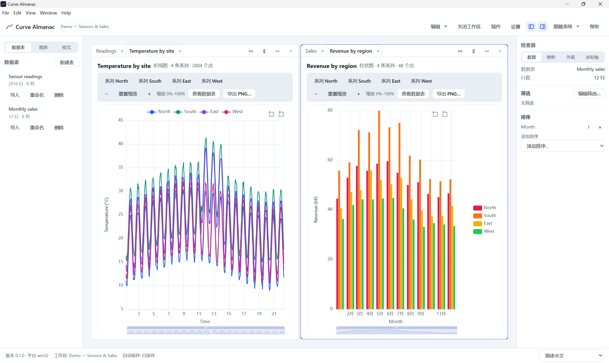
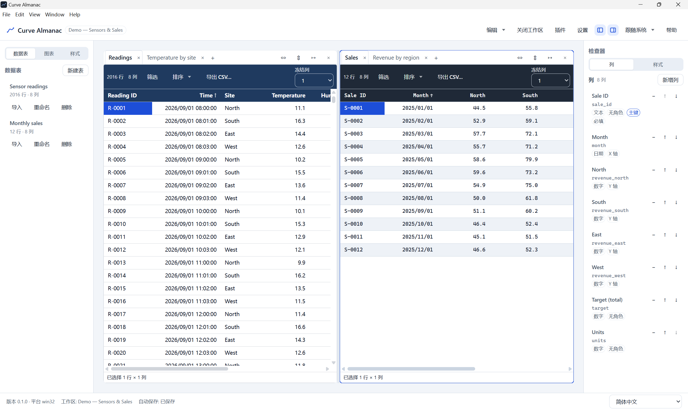

# Curve Almanac

**本地优先、离线的表格驱动曲线可视化桌面应用。**
**A local-first, offline desktop app for table-driven curve visualization.**

[下载 / Download](https://github.com/StarryEmber/Curve-Almanac/releases) ·
[用户手册 / User Manual](docs/MANUAL.md) ·
[开发者指南 / Developer Guide](docs/DEVELOPER.md) ·
[MIT License](LICENSE)



## 功能 / Features

**中文**

- **灵活的表结构**：数值 / 文本 / 日期 / 布尔 / 枚举五种类型；X / Y / 系列 / 标签角色；主键、
  必填、单位、精度，以及插件提供的语义字段类型。
- **表格外观**：4 套内置模板、可视化样式编辑器、列级覆盖、条件格式、可复用/导入导出的样式模板。
- **表格转图表**：宽表/长表映射、折线/散点/柱状图、缩放与图例交互、大表 LTTB 采样、2× PNG 导出。
- **面向真实数据**：键盘编辑与校验、区域粘贴、CSV/JSON 导入（编码/分隔符/坏行）、筛选、多级排序，
  支持 10 万行工作区。
- **数据安全**：1.5 秒自动保存、崩溃恢复、撤销/重做、原子写与 manifest 备份。
- **离线设计**：无网络请求、无遥测、无自动更新；插件为编译期静态模块，不下载运行时代码。
- **Windows 安装包与便携版**：每用户安装，不需要管理员权限。

**English**

- **Flexible schemas** — number, text, date, boolean, and enum columns; roles for X / Y / series /
  label; primary keys, required fields, units, precision, and plugin-provided semantic types.
- **Table styling** — four built-in templates, a visual style editor, column overrides, conditional
  rules, and reusable/importable style templates.
- **Charts from tables** — wide and long mappings, line/scatter/bar charts, zoom and legend
  interaction, LTTB sampling for large data, and 2× PNG export.
- **Designed for real data** — keyboard editing and validation, range paste, CSV/JSON import with
  encoding/delimiter/bad-row handling, filtering, multi-column sorting, and 100k-row workspaces.
- **Data safety** — 1.5 s autosave, crash recovery, undo/redo, atomic writes, and manifest backups.
- **Offline by design** — no network requests, no telemetry, no automatic updates; plugins are
  statically compiled, never downloaded at runtime.
- **Windows installer and portable build** — per-user install, no administrator required.

## 界面 / Screenshots



**中文**：在同一工作区打开多张表与图表，用可拖拽的分栏并排查看，列检查器紧贴数据。布局、筛选、
排序与图表映射会在下次启动时还原。

**English**: Open multiple tables and charts in the same workspace, arrange them in resizable panes,
and keep the column inspector next to the data. Layouts, filters, sorts, and chart mappings are
restored on the next launch.

## 安装 / Install

**中文**

系统要求：**Windows 10/11 x64**。

1. 打开 [Releases](https://github.com/StarryEmber/Curve-Almanac/releases)。
2. 下载任一文件：
   - `Curve Almanac Setup 0.1.0.exe`：每用户安装包，默认安装到
     `%LOCALAPPDATA%\Programs\Curve Almanac`。
   - `Curve Almanac 0.1.0.exe`：便携版单文件，运行时自解压到临时目录。
3. 运行。安装包**未签名**，SmartScreen 可能提示“未知发布者”；选择 **更多信息 → 仍要运行**。

卸载**不会**删除数据：`%APPDATA%\Curve Almanac`（设置/最近工作区/窗口状态/日志）与
`Documents\Curve Almanac`（工作区默认父目录）都会保留。

**English**

Requires **Windows 10/11 x64**.

1. Open [Releases](https://github.com/StarryEmber/Curve-Almanac/releases).
2. Download one of:
   - `Curve Almanac Setup 0.1.0.exe` — per-user installer (defaults to
     `%LOCALAPPDATA%\Programs\Curve Almanac`).
   - `Curve Almanac 0.1.0.exe` — portable single file; extracts to a temporary directory at launch.
3. Run it. The installer is **unsigned**, so SmartScreen may show “Unknown publisher”; choose
   **More info → Run anyway**.

Uninstalling does **not** delete your data: `%APPDATA%\Curve Almanac` (settings, recent workspaces,
window state, logs) and `Documents\Curve Almanac` (default workspace parent folder) are kept.

## 快速上手 / Quick start

**中文**

1. **新建工作区**：输入名称与位置；工作区是一个 `Demo.cstudio` 目录。
2. **新建表**：创建主键列，再添加带类型与角色的列。
3. **录入数据**：直接编辑单元格、从 Excel 粘贴区域，或导入 CSV/JSON。
4. **调整外观**：应用模板、改密度/颜色、添加条件格式。
5. **创建图表**：选择图型和 X/Y 列，在检查器中切换宽表/长表映射。

编辑后 1.5 秒自动保存；应用被强杀后，下次启动会提示恢复。完整说明见
[用户手册](docs/MANUAL.md)。

**English**

1. **Create a workspace** — choose a name and location; a workspace is a `Demo.cstudio` folder.
2. **Create a table** — add a primary key column, then add columns with types and roles.
3. **Add data** — edit cells directly, paste a block from Excel, or import CSV/JSON.
4. **Style it** — apply a template, adjust density/colors, add a conditional rule.
5. **Chart it** — create a line/scatter/bar chart, pick X and one or more Y columns, switch between
   wide and long mappings in the inspector.

Edits are saved automatically after 1.5 s. If the app is killed, the next launch offers recovery.
See the [User Manual](docs/MANUAL.md) for the full walkthrough.

## 文档 / Documentation

**中文**

- [用户手册](docs/MANUAL.md)：安装、15 分钟上手、功能详解、快捷键、FAQ、限制。
- [开发者指南](docs/DEVELOPER.md)：目录、命令、依赖边界、测试、打包。
- [已知限制](docs/ROADMAP.md)：v1 限制与维护范围（不规划 v2）。
- [DSH/自动化指南](docs/DSH.md)：环境、命令、测试、打包与发布流程。

**English**

- [User Manual](docs/MANUAL.md): install, 15-minute tutorial, every feature, shortcuts, FAQ, limitations.
- [Developer Guide](docs/DEVELOPER.md): repository layout, commands, boundaries, tests, packaging.
- [Known Limitations](docs/ROADMAP.md): v1 limitations and maintenance scope (no v2 roadmap).
- [Agent/Automation Guide](docs/DSH.md): environment, commands, testing, packaging, release workflow.

## 开发 / Development

**中文**：要求 Node.js ≥ 20.11、pnpm 11。完整测试、基准、打包与发布流程见
[开发者指南](docs/DEVELOPER.md)。

**English**: Requires Node.js ≥ 20.11 and pnpm 11. Full test, benchmark, packaging, and release
instructions are in the [Developer Guide](docs/DEVELOPER.md).

```bash
pnpm install
pnpm dev          # Electron development mode / 开发模式
pnpm verify       # lint + typecheck + unit tests / 单元测试
pnpm build        # renderer + main + preload
pnpm package      # NSIS installer + portable build / 安装包与便携版
```

## AI 辅助开发与免责声明 / AI Assistance & Disclaimer

**中文**

Curve Almanac 的核心代码在 **DeepSeek Harness** 代理环境中、由 **DeepSeek v4.1 Flash**
辅助实现。AI 参与了代码生成、重构、调试、测试编写与文档草拟；项目的**功能定义、方案取舍、
测试验收与发布决定**由人类维护者 **StarryEmber** 负责。所有 AI 产出均经人类维护者审阅后才进入
代码库；最终代码、发布内容与对外承诺由人类维护者确认。AI 工具不拥有本项目版权，版权归属与
许可条款见根目录 [LICENSE](LICENSE)（MIT）。

本项目包含 AI 辅助生成的代码，并依赖 Electron、Chromium、Node.js、ECharts 等第三方组件，以及
Windows 平台、驱动程序、杀毒软件/安全策略等外部环境。上述因素具有不确定性，可能导致缺陷、
安全漏洞、兼容性问题、性能波动或数据异常；维护者无法保证软件在所有环境、所有数据集上完全
正确、稳定、安全或满足特定用途。

软件按 **“现状”（AS IS）** 提供，不提供任何明示或默示担保，包括但不限于适销性、特定用途
适用性、不侵权、无病毒、无中断或无错误。使用者应在使用前自行评估并测试；重要数据必须自行
备份。因使用或无法使用本软件导致的直接或间接损失、数据丢失或损坏、业务中断、利润损失或
第三方索赔，在适用法律允许的最大范围内，维护者不承担责任。本声明不替代根目录
[LICENSE](LICENSE)（MIT）中的免责条款；如两者不一致，以 `LICENSE` 为准。使用本软件即表示你
理解并接受上述风险。

**English**

The core code of Curve Almanac was implemented with assistance from **DeepSeek Harness** and
**DeepSeek v4.1 Flash**. AI assisted with code generation, refactoring, debugging, test authoring,
and documentation drafts. Feature definition, design trade-offs, testing/acceptance, and release
decisions were made by the human maintainer, **StarryEmber**. All AI-assisted output was reviewed
before inclusion; the maintainer is responsible for the final code and releases. AI tools are not
copyright holders.

This project contains AI-assisted code and depends on third-party components such as Electron,
Chromium, Node.js, and ECharts, as well as external environments including Windows, drivers,
antivirus software, and security policies. These factors are inherently uncertain and may cause
defects, security vulnerabilities, compatibility issues, performance fluctuations, or data
anomalies. The maintainer cannot guarantee that the software will be completely correct, stable,
secure, or fit for any particular purpose in every environment or dataset.

THE SOFTWARE IS PROVIDED "AS IS", WITHOUT WARRANTY OF ANY KIND, EXPRESS OR IMPLIED, INCLUDING BUT
NOT LIMITED TO THE WARRANTIES OF MERCHANTABILITY, FITNESS FOR A PARTICULAR PURPOSE,
NON-INFRINGEMENT, FREEDOM FROM VIRUSES, UNINTERRUPTED OPERATION, OR ERROR-FREE OPERATION. Evaluate
and test the software before use, and back up important data. To the maximum extent permitted by
applicable law, the maintainer is not liable for any direct or indirect loss, data loss or
corruption, business interruption, loss of profits, or third-party claims arising from the use of
or inability to use this software. The warranty disclaimer in [LICENSE](LICENSE) prevails.

## 许可证 / License

**中文**：[MIT](LICENSE) © 2026 StarryEmber。第三方组件仍受各自许可证约束。“Curve Almanac” 为
产品名，不随代码授予商标使用权。

**English**: [MIT](LICENSE) © 2026 StarryEmber. Third-party components remain under their own
licenses. “Curve Almanac” is a product name and is not licensed as a trademark.
