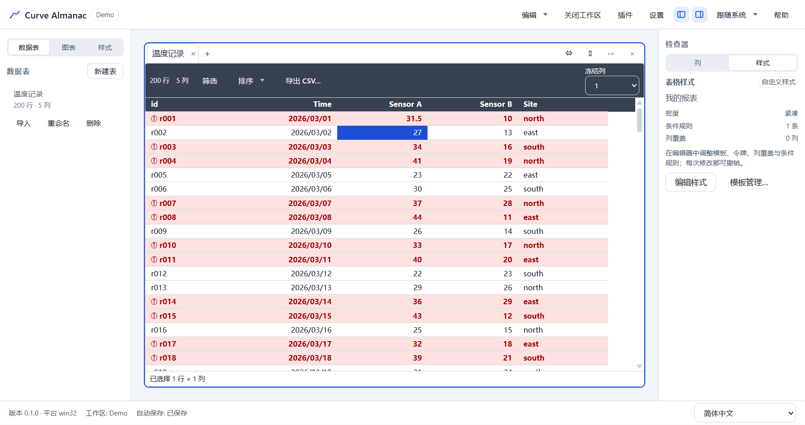

# Curve Almanac

**本地优先、离线的表格驱动曲线可视化桌面应用。**

自定义表结构，录入或导入数据，调整表格外观，把数据变成实时曲线。所有数据保存在本机目录中，
无账号、无云端、无遥测。

[**下载**](https://github.com/StarryEmber/Curve-Almanac/releases) ·
[用户手册](docs/MANUAL.md) ·
[开发者指南](docs/DEVELOPER.md) ·
[MIT 许可证](LICENSE) ·
[English](README.md)



## 特性

- **灵活的表结构**：数值 / 文本 / 日期 / 布尔 / 枚举五种类型；X / Y / 系列 / 标签角色；主键、
  必填、单位、精度，以及插件提供的语义字段类型。
- **表格外观**：4 套内置模板、可视化样式编辑器、列级覆盖、条件格式、可复用/导入导出的样式模板。
- **表格转图表**：宽表/长表映射、折线/散点/柱状图、缩放与图例交互、大表 LTTB 采样、2× PNG 导出。
- **面向真实数据**：键盘编辑与校验、区域粘贴、CSV/JSON 导入（编码/分隔符/坏行）、筛选、多级排序，
  支持 10 万行工作区。
- **数据安全**：1.5 秒自动保存、崩溃恢复、撤销/重做、原子写与 manifest 备份。
- **离线设计**：无网络请求、无遥测、无自动更新；插件为编译期静态模块，不下载运行时代码。
- **Windows 安装包与便携版**：每用户安装，不需要管理员权限。

## 安装

系统要求：**Windows 10/11 x64**。

1. 打开 [Releases](https://github.com/StarryEmber/Curve-Almanac/releases)。
2. 下载任一文件：
   - `Curve Almanac Setup 0.1.0.exe`：每用户安装包，默认安装到
     `%LOCALAPPDATA%\Programs\Curve Almanac`。
   - `Curve Almanac 0.1.0.exe`：便携版单文件，运行时自解压到临时目录。
3. 运行。安装包**未签名**，SmartScreen 可能提示“未知发布者”；选择 **更多信息 → 仍要运行**。

卸载**不会**删除数据：

- `%APPDATA%\Curve Almanac`：设置、最近工作区、窗口状态、日志。
- `Documents\Curve Almanac`：工作区默认父目录。

## 快速上手

1. **新建工作区**：输入名称与位置；工作区是一个 `Demo.cstudio` 目录。
2. **新建表**：创建主键列，再添加带类型与角色的列。
3. **录入数据**：直接编辑单元格、从 Excel 粘贴区域，或导入 CSV/JSON。
4. **调整外观**：应用模板、改密度/颜色、添加条件格式。
5. **创建图表**：选择图型和 X/Y 列，在检查器中切换宽表/长表映射。

编辑后 1.5 秒自动保存；应用被强杀后，下次启动会提示恢复。完整说明见
[用户手册](docs/MANUAL.md)。

## 文档

| 文档 | 内容 |
|---|---|
| [用户手册](docs/MANUAL.md) | 安装、15 分钟上手、功能详解、快捷键、FAQ、限制 |
| [开发者指南](docs/DEVELOPER.md) | 目录、命令、边界、测试、打包 |
| [已知限制](docs/ROADMAP.md) | v1 限制与维护范围（不规划 v2） |
| [DSH/自动化指南](docs/DSH.md) | 环境、命令、测试、打包与发布流程 |

## 开发

要求 Node.js ≥ 20.11、pnpm 11。

```bash
pnpm install
pnpm dev          # Electron 开发模式
pnpm verify       # lint + typecheck + 单元测试
pnpm build        # renderer + main + preload
pnpm package      # NSIS 安装包 + 便携版，输出到 release/
```

完整测试、基准、打包与发布流程见 [开发者指南](docs/DEVELOPER.md)。

## AI 辅助开发与技术风险声明

### AI 辅助开发

Curve Almanac 的核心代码在 **DeepSeek Harness** 代理环境中、由 **DeepSeek v4.1 Flash**
辅助实现。AI 参与了代码生成、重构、调试、测试编写与文档草拟；项目的**功能定义、方案取舍、
测试验收与发布决定**由人类维护者 **StarryEmber** 负责。所有 AI 产出均经人类维护者审阅后才进入
代码库；最终代码、发布内容与对外承诺由人类维护者确认。AI 工具不拥有本项目版权，版权归属与
许可条款见根目录 [LICENSE](LICENSE)（MIT）。

### 技术不可控与免责声明

本项目包含 AI 辅助生成的代码，并依赖 Electron、Chromium、Node.js、ECharts 等第三方组件，以及
Windows 平台、驱动程序、杀毒软件/安全策略等外部环境。上述因素具有不确定性，可能导致缺陷、
安全漏洞、兼容性问题、性能波动或数据异常；维护者无法保证软件在所有环境、所有数据集上完全
正确、稳定、安全或满足特定用途。

软件按 **“现状”（AS IS）** 提供，不提供任何明示或默示担保，包括但不限于适销性、特定用途
适用性、不侵权、无病毒、无中断或无错误。使用者应在使用前自行评估并测试；重要数据必须自行
备份。因使用或无法使用本软件导致的直接或间接损失、数据丢失或损坏、业务中断、利润损失或
第三方索赔，在适用法律允许的最大范围内，维护者不承担责任。

本声明不替代根目录 [LICENSE](LICENSE)（MIT）中的免责条款；如两者不一致，以 `LICENSE` 为准。
使用本软件即表示你理解并接受上述风险。

## 许可证

[MIT](LICENSE) © 2026 StarryEmber。第三方组件仍受各自许可证约束。“Curve Almanac” 为产品名，
不随代码授予商标使用权。
