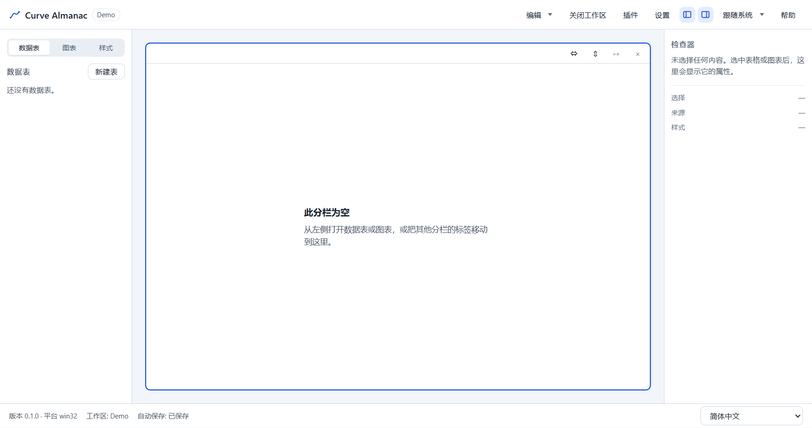
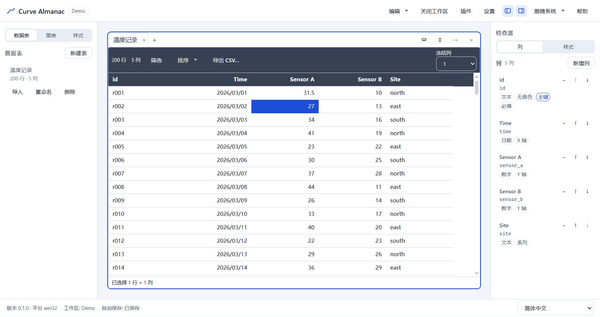
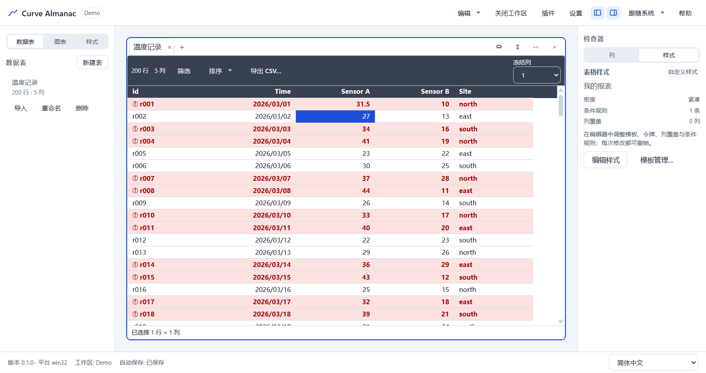
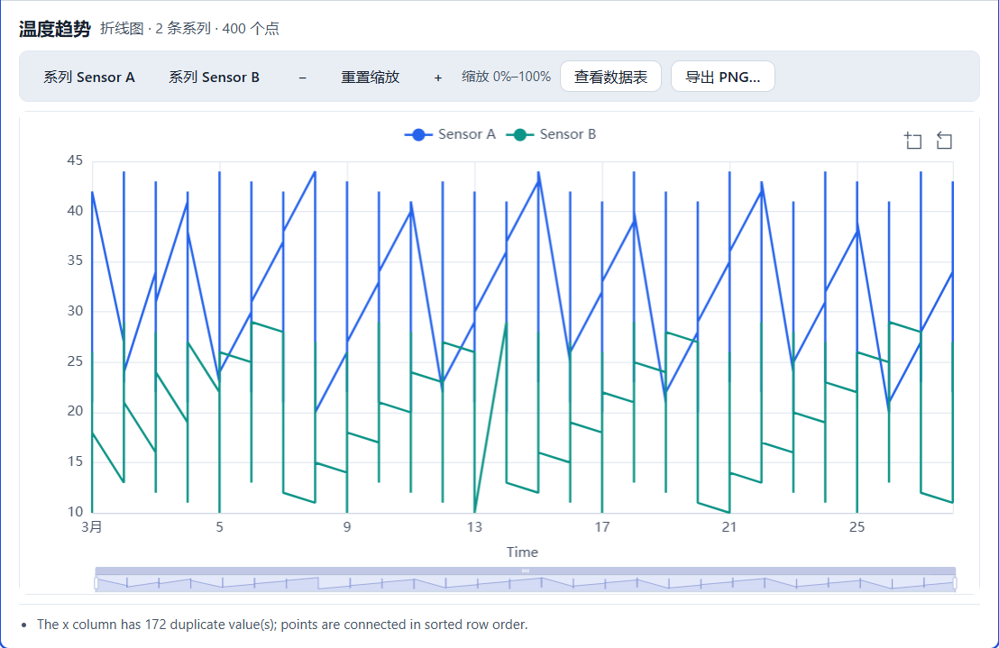
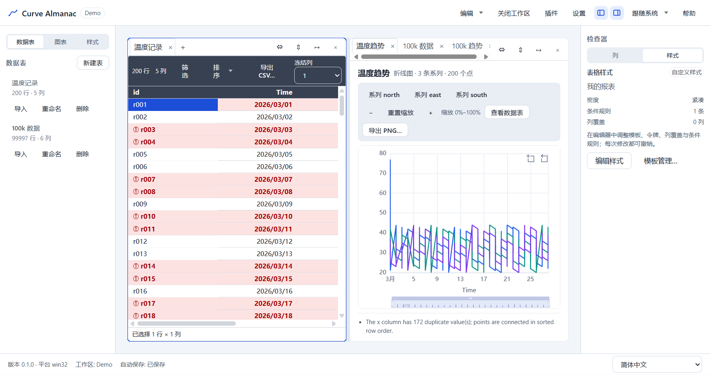
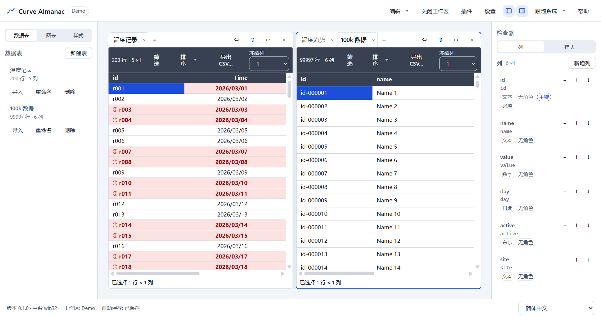
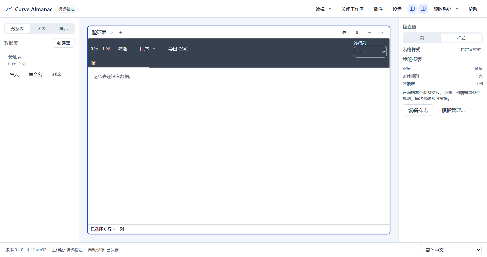
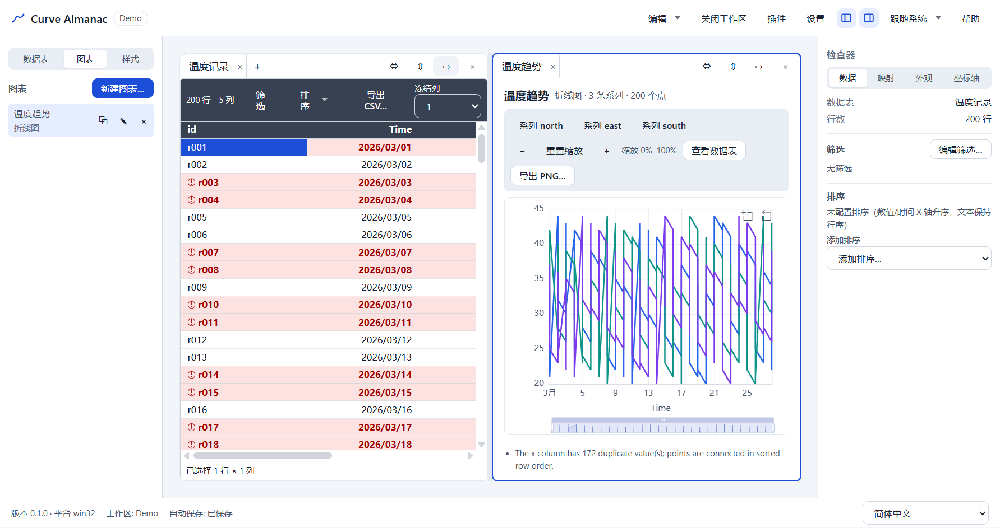
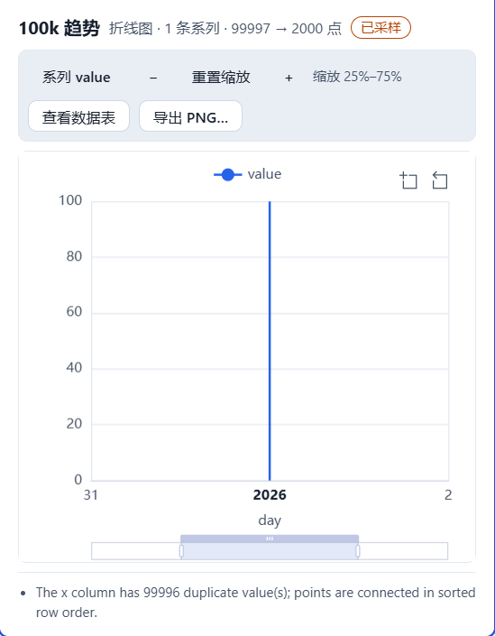
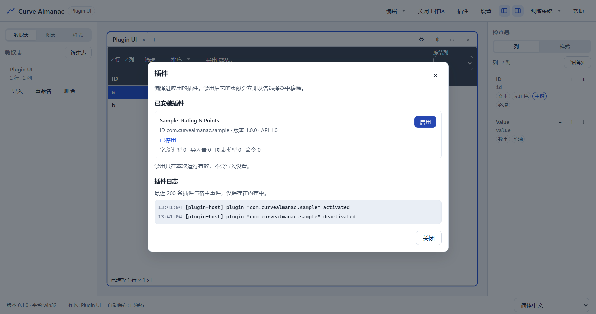

# Curve Almanac 用户手册

> **适用版本**：Curve Almanac 0.1.0（Windows 10/11 x64）
> **手册版本**：2026-10-30 · 与 v1 / M0–M6 实现一致
> **面向读者**：首次使用 Curve Almanac 的分析、实验、运营与数据录入人员
> **配套文档**：[快速说明 README](../README.md) · [SPEC](SPEC.md) · [开发者指南](DEVELOPER.md) ·
> [已知限制](ROADMAP.md)

## 目录

1. [关于本手册](#1-关于本手册)
2. [安装与启动](#2-安装与启动)
3. [15 分钟快速上手](#3-15-分钟快速上手)
4. [界面概览](#4-界面概览)
5. [工作区](#5-工作区)
6. [表与列](#6-表与列)
7. [录入、编辑与校验](#7-录入编辑与校验)
8. [导入 CSV/JSON](#8-导入-csvjson)
9. [筛选与排序](#9-筛选与排序)
10. [样式与模板](#10-样式与模板)
11. [图表](#11-图表)
12. [分栏布局](#12-分栏布局)
13. [撤销、自动保存与恢复](#13-撤销自动保存与恢复)
14. [快捷键与命令面板](#14-快捷键与命令面板)
15. [设置与语言](#15-设置与语言)
16. [插件](#16-插件)
17. [导出](#17-导出)
18. [数据位置、备份与卸载](#18-数据位置备份与卸载)
19. [故障排查与 FAQ](#19-故障排查与-faq)
20. [已知限制](#20-已知限制)
21. [附录](#21-附录)

---

## 1. 关于本手册

### 1.1 用 Curve Almanac 做什么

Curve Almanac 是一个**本地、离线、表格驱动**的曲线可视化工具：

- 自己定义表结构（列类型、角色、主键、必填、枚举、单位/精度），录入或导入数据；
- 自己定义表格外观（主题令牌、列覆盖、条件格式、可保存/导入导出的样式模板）；
- 在同一工作区里把表格变成折线/散点/柱状图，支持宽表与长表映射、采样、交互与 PNG 导出；
- 数据以本地目录（`.cstudio`）保存，自动保存、崩溃恢复、撤销/重做，不上传任何数据。

### 1.2 本手册的约定

- **粗体**表示界面按钮/菜单/字段名；`等宽字体`表示文件名、路径、格式或键盘键。
- “视图”= 一个表视图或图表视图；“工作区”= 一个 `.cstudio` 目录；“面板”= 左侧栏/检查器/分栏。
- `Ctrl/Cmd` 表示 Windows 用 `Ctrl`、macOS 用 `Cmd`（v1 仅发布 Windows 包）。
- 截图来自 v1 验收演示（保存在 `docs/images/manual/`），显示的是示例数据，不代表默认工作区。
- 未实现的功能会在文中明确标注“v1 不支持”，不要按其他工具的习惯假设它存在。

### 1.3 获取帮助

- 应用内按 **F1** 打开快捷键表；按 `Ctrl/Cmd+K` 打开命令面板。
- 标题栏 **插件** → 插件管理器 → 插件日志。
- 日志文件：`%APPDATA%\Curve Almanac\logs\main.log`（按天归档，保留 7 天）。

---

## 2. 安装与启动

### 2.1 系统要求

| 项 | 要求 |
|---|---|
| 系统 | Windows 10/11 x64 |
| 内存 | 建议 8 GB 以上（10 万行场景建议 16 GB） |
| 磁盘 | 安装约 400 MB；工作区按数据量增长 |
| 显示 | 建议 1280×720 以上；支持 200% 缩放 |
| 网络 | **不需要**；应用不发起网络请求、无遥测、无自动更新 |

### 2.2 安装版（推荐）

1. 双击 `Curve Almanac Setup 0.1.0.exe`。
2. 安装包是**每用户安装**，默认目录 `%LOCALAPPDATA%\Programs\Curve Almanac`，不要求管理员权限。
3. 按向导完成安装；会创建开始菜单与桌面快捷方式。
4. 首次运行若出现 SmartScreen“未知发布者”，选择 **更多信息 → 仍要运行**（v1 安装包未签名）。

### 2.3 便携版

双击 `Curve Almanac 0.1.0.exe`。它会自解压到临时目录运行，不写安装目录；适合临时机器或 U 盘。
便携版与安装版使用**同一个** `%APPDATA%\Curve Almanac` 用户数据目录。

### 2.4 首次启动

启动后进入欢迎页：

- **新建工作区**：输入名称与保存位置，创建 `.cstudio` 目录；
- **打开工作区**：选择一个已有的 `.cstudio` 目录；
- **最近工作区**：已成功打开过的目录，可单条移除或清空。

默认保存位置是 `Documents\Curve Almanac`（可在对话框中修改）。

### 2.5 卸载与数据保留

通过“设置 → 应用 → 已安装的应用”卸载。卸载**不会**删除：

- `%APPDATA%\Curve Almanac`（设置、最近列表、窗口状态、日志）
- `Documents\Curve Almanac`（默认工作区目录）

需要彻底清理时，手动删除上述目录；删除工作区前请先复制备份。

---

## 3. 15 分钟快速上手

下面用一个小例子走完“建工作区 → 建表 → 录数据 → 调样式 → 出图 → 保存/恢复”。

### 3.1 新建工作区

欢迎页 → **新建工作区** → 名称 `Demo` → 保存位置保持默认 → **创建工作区**。



### 3.2 建表与列

1. 左侧 **数据表** → **新建表**，表名 `温度记录`，主键列保持 `id`；
2. 右侧 **列** → **新增列**，依次创建：

| 显示名称 | 存储类型 | 角色 |
|---|---|---|
| Time | 日期 | X 轴 |
| Sensor A | 数字 | Y 轴 |
| Sensor B | 数字 | Y 轴 |
| Site | 文本 | 系列 |

3. 列对话框里的 **语义类型** 只在插件提供字段类型时出现（例如 `Rating`），普通表可留空。

### 3.3 录入 200 行

可以直接在网格中编辑，也可以从 Excel 复制一块区域后 `Ctrl+V` 粘贴。粘贴遵循“锚点单元格”：

- 矩阵比表宽 → 弹出“粘贴需要新增列”，确认后自动建列；
- 任一单元格类型错误 → **整批不提交**，列出问题单元格，可“定位第一个错误”；
- 筛选激活时只能粘贴到可见行，超出可见行数会整批拒绝。



### 3.4 应用样式与条件格式

1. 右侧 **样式** → **模板管理…** → 对 `报告（浅）` 点 **应用**；
2. **编辑样式** → **令牌** 把密度改为 `紧凑`；
3. **条件规则** → **添加规则**：`Sensor A > 30`，背景 `#fde2e2`、文字 `#a40000`、图标 `warning`、加粗；
4. 在 **模板** 页 **另存为** `我的报表`。



### 3.5 新建图表

1. 左侧 **图表** → **新建图表**，名称 `温度趋势`；
2. 选表 `温度记录`，类型 `折线图`，X = `Time`，Y 勾选 `Sensor A` 与 `Sensor B`；
3. **创建图表**，在检查器 **映射** 中把布局切到 **长表**，系列列选 `Site`、Y 选 `Sensor A`；
4. 工具栏可缩放/重置；**外观** 可关图例、换调色板；**导出 PNG…** 导出 2× 图片。



### 3.6 保存与恢复

- 编辑后 **1.5 秒**自动写盘，状态栏显示“已保存”；`Ctrl/Cmd+S` 立即写。
- 关闭工作区会 flush 保存并释放 `.lock`。
- 若应用被强杀，下次打开会提示“上次未正常退出”，可选 **尝试恢复** 或 **直接打开**。


---

## 4. 界面概览

| 区域 | 作用 |
|---|---|
| **标题栏** | 产品名、当前工作区、编辑（撤销/重做）、关闭工作区、插件、设置、侧栏/检查器开关、主题、帮助 |
| **左侧栏** | 数据表 / 图表 / 样式三个页签；数据表页含新建、导入、重命名、删除 |
| **主区** | 可递归分栏（pane）+ 标签页；每个标签是一个表视图或图表视图 |
| **右侧检查器** | 表视图：列 / 样式；图表视图：数据 / 映射 / 外观 / 坐标轴 |
| **状态栏** | 版本/平台、工作区状态、编辑状态、自动保存状态、语言切换 |



界面约定：

- 左侧栏与检查器可用标题栏按钮折叠（`Ctrl/Cmd+B` / `Ctrl/Cmd+Alt+I`），把空间让给数据。
- 所有对话框支持 `Esc` 关闭、焦点陷阱与焦点恢复；纯键盘可完成主流程。
- 200% 缩放下不出现横向裁切；表格本身允许横向滚动。

---

## 5. 工作区

### 5.1 新建

欢迎页 **新建工作区** → 名称 → 保存位置 → **创建工作区**。实际目录为
`<保存位置>/<名称>.cstudio`。名称不能为空；同目录同名会失败并提示。

### 5.2 打开与最近列表

- **打开工作区**：选择 `.cstudio` 目录；
- **最近工作区**：只记录成功打开过的目录；可单条移除或全部清空；
- 关闭工作区：标题栏 **关闭工作区**，会先 flush 保存、删除 `.lock`，再回到欢迎页。

### 5.3 自动保存

| 场景 | 行为 |
|---|---|
| 普通编辑 | 最后一次变更后 **1.5 s** 写盘 |
| 连续编辑 | 最迟 **10 s** 强制写一次 |
| `Ctrl/Cmd+S` | 立即写 |
| 关闭工作区/退出 | 走退出握手 flush（默认 3 s 超时） |
| 设置里关闭自动保存 | 不安排后台定时器；显式提交/`Ctrl/Cmd+S`/关闭时仍需保存或确认 |

状态栏会显示“已保存 / 保存中 / 保存失败（重试）”。保存失败时数据仍在内存，修复磁盘/只读问题后
点“重试”或 `Ctrl/Cmd+S`。

### 5.4 崩溃恢复

强杀/崩溃后，`.lock` 会残留。下次打开该工作区：

1. **尝试恢复**：复核 manifest；必要时用 `backups/` 最新一份 manifest 备份重建；
2. **直接打开**：不重建；manifest 不可读则失败；
3. manifest 损坏：列出备份供选择，取消不会改动任何文件。

**最后 1.5 s 内未落盘的修改可能丢失**，对话框会明确提示。恢复不建议跳过——跳过可能留下不一致状态。

### 5.5 工作区目录结构

```text
Demo.cstudio/
├─ manifest.json          # 表、视图、图表、样式、布局（最后写）
├─ tables/
│  ├─ tbl_xxx.jsonl        # 行数据，一行 {"id":"row_...","v":[...]}
│  └─ ...
├─ backups/                # 表与 manifest 的上一版备份
├─ imports/                # 导入时归档的原始文件
└─ .lock                   # 打开锁；正常退出删除
```

工作区可整体复制/移动；打开时校验 `formatVersion`，高版本会拒绝（`E_WS_VERSION_UNSUPPORTED`）。
不要手工编辑 `manifest.json`/JSONL；需要批量修复时先备份并联系维护者。

### 5.6 规模上限

| 项 | 上限/目标 |
|---|---|
| 单表行数 | 目标 100,000；硬上限 200,000（超过拒绝导入/新增） |
| 工作区总行数 | 软上限 300,000（提示，不硬阻止） |
| 列/表 | 100 |
| 表/工作区 | 20 |
| 图表/工作区 | 50 |
| 系列/图 | 20（超出不渲染并警告） |
| 单元格文本 | 100,000 字符 |
| 表文件 | 256 MB |

---

## 6. 表与列

### 6.1 新建表

左侧 **数据表** → **新建表**，输入表名与主键列名（默认 `id`）。新表自动包含主键列；主键必须
为文本、必填且唯一。工作区最多 20 张表。

### 6.2 存储类型

| 类型 | 存储/显示 | 输入与校验 |
|---|---|---|
| `number` | number | 接受千分位、负数、小数；可设精度与单位；非数字拒绝 |
| `text` | string | 任意文本（≤100,000 字符）；可设必填 |
| `date` | number（epoch ms） | 接受 `YYYY-MM-DD`、ISO 等；显示用 `Intl`，随语言变化 |
| `boolean` | boolean | 显示“是/否”或本地化文本；编辑器为下拉 |
| `enum` | string | 必须定义选项（值 + 显示名）；只能选已定义值 |

### 6.3 角色

`X 轴`、`Y 轴`、`系列`、`标签`、`无角色`。角色只影响图表向导的默认映射，不限制之后在检查器里改。

### 6.4 主键

- 主键列不可删除，类型固定为文本且必填；
- 可把另一文本列设为 **主键**（要求唯一、非空）；
- 导入/粘贴时主键重复会拒绝或按导入模式处理。

### 6.5 编辑列

右侧 **列** → 点击列行打开“编辑列”：

- 显示名称、Key、存储类型、角色、单位、精度、必填、枚举选项、语义类型；
- 改存储类型触发结构迁移：先统计可转换/失败行；失败则整次取消且文件字节不变；成功则整表重写；
- 删除列会列出受影响的图表；确认后清理视图状态与图表映射（图表进入可重映射的错误态）。

### 6.6 语义字段类型（插件）

列对话框的 **语义类型** 只列出与当前存储类型匹配的插件字段类型（例如 `Rating`）。它只改变解析、
校验与显示（`3` → `★★★`），不改变 JSONL 物理类型；换存储类型会清空语义类型，也可显式选
“（按存储类型）”。

---

## 7. 录入、编辑与校验

### 7.1 键盘编辑

| 操作 | 键 |
|---|---|
| 进入编辑 | 双击或 `F2` |
| 提交并下移 | `Enter` |
| 提交并右移 | `Tab` |
| 取消编辑 | `Esc` |
| 移动活动单元格 | 方向键 |
| 扩展选择 | `Shift` + 方向键 |
| 行/列首尾 | `Home` / `End` |
| 翻页 | `PageUp` / `PageDown` |

### 7.2 校验

- 非法值**不写盘**：编辑器保持打开并标记 `aria-invalid`，单元格带错误样式；
- 必填列不能清空；枚举只能选已定义值；日期/数字按列规则归一；
- 校验在命令层与编辑器层使用同一套规则（避免“编辑器能存、命令拒绝”）。

### 7.3 区域粘贴

从 Excel/CSV 复制后 `Ctrl+V`：

- 以当前活动单元格为锚点写入矩形区域；
- 超宽：弹“粘贴需要新增列”，可逐个改新列显示名与类型；
- 类型错误/必填缺失：**整批不提交**，列出问题单元格（可“定位第一个错误”）；
- 筛选激活：只写可见行；矩阵超出可见行数整批拒绝；
- 超大矩阵（约 10k 单元格以上）可能提示/取消；粘贴过程有进度与取消。

---

## 8. 导入 CSV/JSON

### 8.1 打开向导

左侧 **数据表** → 对应表的 **导入** 按钮 → “导入数据”对话框。向导分 5 步：

1. **文件**：自动嗅探编码（UTF-8/GB18030 等）与分隔符；可手动改编码、分隔符、首行为表头；
2. **预览**：显示前 20 行与推断类型/置信度；
3. **映射**：每个源列映射到“已有列”“新建列”或“忽略”；新建列可改名称与类型；
4. **校验**：统计总数/可导入/跳过，列出坏行；可勾选“跳过错误行”或导出错误 CSV；
5. **提交**：追加或替换；替换会先备份并归档原文件；≥100,000 行需额外确认，>200,000 行拒绝。

### 8.2 示例

```csv
id;name;value;day;active;site
r1;North;12.5;2026-01-01;true;站点-A
r2;East;18.0;2026-01-02;false;站点-B
```

若表已有 `id` 列，把 `id` 映射到已有列，其余映射为“新建列”（文本/数字/日期/布尔/文本）。
编码为 GBK 时，编码下拉选 `GB18030`；分号分隔时把分隔符改为 `;`。



### 8.3 错误处理

- 坏行会列出行号与原因；“跳过错误行”后仍可在 **导出错误 CSV** 得到明细；
- 全部失败时整次导入不落盘，原表字节不变；
- 导入会归档原始文件到工作区 `imports/`；替换模式可用 `Ctrl+Z` 撤销。

### 8.4 插件导入器

插件可提供额外导入器（例如 `Points JSON`）。选中后在渲染进程解析，编码下拉禁用；
解析失败会内联报错并保留文件，可切回内置解析器。插件导入大文件可能阻塞界面。

---

## 9. 筛选与排序

### 9.1 筛选

工具栏 **筛选** 打开条件编辑器：

- 支持多条件（AND）与常用比较/文本操作符；
- 应用后工具栏显示“N 个条件”，可一键清除；
- 筛选属于**视图**，随 manifest 保存，重启还原；不影响其他视图。

### 9.2 排序

点列头按钮排序，`Shift` + 点击追加多级；再次点击切换升/降/无；空值排在最后。

### 9.3 列宽、隐藏与冻结

- 拖动列头分隔线改宽度；双击分隔线 **自动列宽**；
- 列可隐藏（列表/列面板），隐藏状态随视图保存；
- 可冻结 0–3 列（工具栏 **冻结列**）；横向滚动时冻结列保持可见。

### 9.4 视图状态

每个表视图独立保存：筛选、排序、隐藏列、列宽、冻结列数。关闭/重启后按视图恢复；同一张表的
两个视图互不影响。

---

## 10. 样式与模板

### 10.1 内置模板

| id | 名称 | 特点 |
|---|---|---|
| `builtin.report-light` | 报告（浅） | 白底、清晰边框，适合报表/截图 |
| `builtin.compact-light` | 紧凑（浅） | 行高更小、信息密度高 |
| `builtin.dark` | 深色 | 深色表头/表体，适合暗色环境 |
| `builtin.finance` | 财务 | 等宽数字、右对齐、千分位 |

右侧 **样式** → **模板管理…** → 对某模板点 **应用**（当前视图）或 **设为默认**（工作区）。
应用内置模板会直接使用；开始编辑内置模板时会自动 fork 为自定义样式。

### 10.2 样式编辑器

**编辑样式** 打开对话框，分为：

- **令牌**：密度、字体、字号、表头/表体/选中背景与文字、边框、网格线、圆角、内边距、斑马纹；
- **列覆盖**：显示名、列宽、对齐、数字/日期格式、单元格渲染（文本 / badge / bar）；
- **条件规则**：条件（列 + 操作符 + 值，可组合 AND/OR）、目标（行 / 单元格 / 列）、样式与图标
  （warning/up/down）；**首条命中优先**；
- **模板**：另存为、设为默认、导出/导入。

修改实时预览（毫秒级），每次控件提交是一条可撤销命令。

### 10.3 模板管理

“模板管理…”支持应用、设为工作区默认、另存为、重命名、复制、删除、导出、导入。

- 删除仍被视图引用的模板时，视图回退到工作区默认样式并提示；删除可用 `Ctrl+Z` 撤销；
- 导出为 `.curvestyle.json`（含 `kind: curve-table-style`、`version: 1`、`style`）；
- 导入会重新分配样式/规则 id，不影响已有样式；非法文件被拒绝且不改 manifest。



---

## 11. 图表

### 11.1 新建

左侧 **图表** → **新建图表**：

1. 选表（默认当前表）；
2. 选图表类型：折线 / 散点 / 柱状（插件可提供“预设”，建图时展开为 series type + options）；
3. 选 X 列与一个/多个 Y 列；
4. 命名 → **创建图表**（向导内有预览）。

### 11.2 宽表与长表

- **宽表**：每个 Y 列 = 一个系列（适合 `sensor_a`、`sensor_b` 并列）；
- **长表**：一个 Y 列 + 一个系列列，按系列列的不同值拆分（适合 `site`、`device` 等）；
  空值归“(空)”；系列超过 20 个时截断并警告。



### 11.3 检查器

| 页签 | 内容 |
|---|---|
| 数据 | 表、行数、筛选/排序摘要 |
| 映射 | 宽/长表、X、Y、系列列；缺失列时内嵌重映射 |
| 外观 | 图表类型、调色板、背景、图例、网格、平滑、数据点、线宽 |
| 坐标轴 | X/Y 轴标题 |

### 11.4 交互

- 工具栏：放大/缩小/重置缩放；显示当前缩放范围；
- 图例项可点击隐藏/显示系列；悬停显示 tooltip；窗口 resize 自适应；
- 大表（>2,000 点/系列）自动 LTTB 采样，工具栏显示 **已采样**；首尾点保留；
- 空态/错误态提供 **重新映射**、**查看数据表** 等行动按钮，不崩溃。

### 11.5 PNG 导出

**导出 PNG…**：固定 2× 像素，背景可选透明/白色/深色；文件名含图表名与时间。空图不可导出。



---

## 12. 分栏布局

- 每个 pane 右上角：**水平分栏**、**垂直分栏**、**移动到下一分栏**、**关闭分栏**（需为空）；
- 拖动分隔条调整比例；标签可点击切换，`Ctrl/Cmd+W` 关闭；
- 最多 4 个 pane；每个 pane 至少一个标签；
- 布局变化 500 ms 去抖后保存，重启完整还原；
- 非法布局（引用缺失/比例越界）会回退为单 pane 并保留全部标签。

常用做法：左侧表格 + 右侧图表做“边看数据边看图”；或上下两图对比不同映射。

---

## 13. 撤销、自动保存与恢复

### 13.1 撤销/重做

- 所有带 patches 的命令（编辑、粘贴、导入、列操作、样式、图表、布局）都可撤销/重做；
- 最多 100 条或 256 MB 估算；`table.cell.set` 在 800 ms 内合并为一条；
- 标签切换、选择、滚动、缩放不入历史；切换焦点保留 redo；关闭/重开工作区清空历史；
- 标题栏 **编辑** 菜单显示“撤销/重做 + 命令名”与快捷键，空栈时禁用。

### 13.2 自动保存与退出

| 场景 | 行为 |
|---|---|
| 普通编辑 | 1.5 s 后写盘 |
| 连续编辑 | 最迟 10 s |
| `Ctrl/Cmd+S` | 立即写 |
| 关闭工作区/退出 | flush；失败时提示 |
| 自动保存关闭 | 关闭/退出时询问“保存并继续 / 放弃修改 / 取消” |

### 13.3 强杀恢复

强杀后 `.lock` 残留，下次打开提示“上次未正常退出”。**已提交且已落盘**的数据保留；最后 1.5 s
内未落盘的修改可能丢失。恢复流程见 §5.4。

---

## 14. 快捷键与命令面板

### 14.1 快捷键

| 操作 | 快捷键 |
|---|---|
| 命令面板 | `Ctrl/Cmd+K` |
| 帮助/快捷键表 | `F1` |
| 保存 | `Ctrl/Cmd+S` |
| 撤销 / 重做 | `Ctrl/Cmd+Z` / `Ctrl/Cmd+Shift+Z`（或 `Ctrl+Y`） |
| 关闭当前视图 | `Ctrl/Cmd+W` |
| 复制当前表视图 / 图表 | `Ctrl/Cmd+Shift+D` |
| 显示/隐藏侧栏 | `Ctrl/Cmd+B` |
| 显示/隐藏检查器 | `Ctrl/Cmd+Alt+I` |
| 水平 / 垂直分栏 | `Ctrl/Cmd+Alt+H` / `Ctrl/Cmd+Alt+V` |
| 移动标签到下一 pane | `Ctrl/Cmd+Alt+M` |
| 关闭空 pane | `Ctrl/Cmd+Alt+W` |

### 14.2 命令面板

- `Ctrl/Cmd+K` 打开；按标签/命令 id 做子序列匹配；
- `↑/↓/Home/End` 选择，`Enter` 执行，`Esc` 关闭；
- 显示最近使用的 8 条命令；不可用命令保留并给出原因（如“当前视图不是图表”）；
- 输入框内 `Ctrl/Cmd+K` 不抢占，`Ctrl/Cmd+V` 保持原生粘贴；
- 插件命令合并进面板，带来源徽标（`插件：<name>`）。

### 14.3 F1 帮助

F1 打开快捷键表，数据来自应用的同一个命令注册表（与面板一致），不是手写副本。

---

## 15. 设置与语言

标题栏 **设置** 或命令面板 `app.settings`：

| 设置 | 说明 |
|---|---|
| 主题 | 浅色 / 深色 / 跟随系统；即时生效 |
| 语言 | 简体中文 / English；即时切换，无需重启 |
| 自动保存 | 开启/关闭 |
| 默认表格样式 | 只列内置模板；有工作区时应用到工作区默认样式，无工作区时作为新工作区种子 |

设置写入 `%APPDATA%\Curve Almanac\settings.json`，重启恢复。已有工作区保留自己的 manifest
默认样式；应用设置不会在切换工作区时覆盖它。

---

## 16. 插件

### 16.1 插件管理器

标题栏 **插件** 或命令面板 `app.plugins`：

- 列表显示状态（active/disabled/inactive）、版本、API 版本、贡献数量、错误；
- **禁用/启用**：仅本次会话有效，不写 `settings.json`/manifest；重启后重新尝试激活；
- **插件日志**：内存环形日志（最多 200 条），可查看最近错误。



### 16.2 可用贡献

| 类型 | 示例 | 在 UI 的位置 |
|---|---|---|
| 语义字段类型 | `Rating`（1–5，`★`） | 列对话框“语义类型” |
| 导入器 | `Points JSON` | 导入向导“导入器” |
| 图表类型 | 预设（line/scatter/bar + options） | 新建图表“类型” |
| 命令 | 插件命令 | 命令面板（带来源徽标） |

### 16.3 错误隔离

插件抛错只会影响自身：网格格式化回退存储格式、导入失败保留文件并可切回内置解析器、命令失败不改
文档；同时弹带插件名的 toast，可“查看插件日志”。其他插件与内置功能继续可用。

---

## 17. 导出

### 17.1 CSV

表格工具栏 **导出 CSV…**：

- 默认“显示格式”、当前筛选/排序、不导出隐藏列；
- 可切“原始值”（无千分位、日期为 epoch ms、布尔/枚举为存储值）；
- UTF-8 BOM + CRLF；100k 行可取消；导出前显示行×列摘要。

### 17.2 PNG

图表工具栏 **导出 PNG…**：2× 像素，背景透明/白色/深色，文件名含图表名与时间。

### 17.3 样式模板

**样式 → 模板管理… → 导出/导入**，`.curvestyle.json` 可在其他工作区复用；导入会重分配 id，
不会覆盖已有样式。

---

## 18. 数据位置、备份与卸载

### 18.1 路径

| 路径 | 内容 |
|---|---|
| `%APPDATA%\Curve Almanac\settings.json` | 主题/语言/自动保存/默认样式 |
| `%APPDATA%\Curve Almanac\recent.json` | 最近工作区 |
| `%APPDATA%\Curve Almanac\window-state.json` | 窗口尺寸/位置 |
| `%APPDATA%\Curve Almanac\logs\main.log` | 主进程 + renderer 错误日志（当天） |
| `%APPDATA%\Curve Almanac\logs\main-YYYY-MM-DD.log` | 历史日志（含今天保留 7 天） |
| `%LOCALAPPDATA%\Programs\Curve Almanac` | 安装目录（卸载删除） |
| `Documents\Curve Almanac` | 新建工作区默认父目录 |

### 18.2 备份

- 直接复制整个 `.cstudio` 目录即可备份/迁移（建议先关闭工作区）；
- 工作区内的 `backups/` 是应用自动生成的上一版备份，不要当唯一备份；
- `imports/` 保留导入原始文件，便于追溯；
- 恢复时把备份目录复制回原位置，再从欢迎页打开。

### 18.3 卸载

卸载不删除 `%APPDATA%\Curve Almanac` 与工作区；需要彻底清理时手动删除。卸载前建议导出重要表为
CSV、复制工作区目录。

---

## 19. 故障排查与 FAQ

### 19.1 排查表

| 现象 | 处理 |
|---|---|
| SmartScreen 拦截 | 未签名安装包；“更多信息 → 仍要运行” |
| 提示“上次未正常退出” | 选“尝试恢复”；manifest 损坏时从备份重建 |
| “保存失败” | 检查磁盘空间/只读属性；状态栏“重试”；修复后 `Ctrl/Cmd+S` |
| `E_WS_VERSION_UNSUPPORTED` | 工作区由更高版本创建；用对应版本打开，不要手改 manifest |
| 图表显示“列已删除” | 在错误态重新映射 X/Y，或撤销删除 |
| 插件报错 | 插件管理器禁用；查看插件日志；重启重试 |
| 导入乱码 | 手动选 `GB18030`/`UTF-8`；确认分隔符 |
| 粘贴被拒 | 看“问题单元格”列表；类型/必填/列宽/筛选可见行 |
| 数据“丢了” | 查 `backups/`、`imports/`；强杀可能丢最后 1.5 s |
| 日志在哪 | `%APPDATA%\Curve Almanac\logs\` |

### 19.2 FAQ

**Q：会自动上传数据吗？**
不会。应用无网络请求、无遥测、无自动更新（ADR-016）。

**Q：能装到别的盘吗？**
安装向导支持修改安装目录（每用户安装）；工作区可放在任意可写目录。

**Q：两个窗口打开同一工作区？**
v1 单实例 + 每工作区 `.lock`；第二个实例会聚焦已有窗口，不会并发写。

**Q：支持 10 万行以上吗？**
单表目标 10 万、硬上限 20 万；超过 20 万拒绝新增/导入；工作区软上限 30 万。

**Q：日期显示格式能改吗？**
随语言/`Intl` 与列覆盖的日期格式；存储始终是 epoch ms。

**Q：公式列 / SQL / 多表关联？**
v1 不支持，见 [ROADMAP](ROADMAP.md)。

**Q：插件能在线安装吗？**
v1 插件编译期静态导入，不能运行时下载；禁用仅本次会话。

**Q：卸载会删我的数据吗？**
不会；见 §18.3。

---

## 20. 已知限制

- 仅 Windows x64；无 macOS/Linux 包；安装包未签名；无自动更新/发布通道。
- 无公式列、多表关联、SQL、云同步、协作。
- 强杀最多丢最后 1.5 s；恢复只自动尝试最新一份 manifest 备份。
- 插件静态编译、不可运行时安装；禁用不跨启动；插件文案不本地化；插件导入大文件可能阻塞。
- 插件图表预设不会在检查器回显；CSV 导出不套用语义字段格式。
- 主进程原生对话框（关于/退出确认/恢复提示）为英文。
- 日志按天归档，跨天后首次写入才归档；单日无硬大小上限；renderer 错误转发限 10 条/分钟。
- 100k 图表切换的整应用内存门禁为 **1GB**（ADR-057；600MB 为历史门禁）。

**v1 范围外的功能（公式列、SQL、多表关联、云同步、插件市场、自动更新、macOS/Linux 等）不做
规划与承诺**（ADR-060）；仅在用户明确要求时另行评估。完整限制见 [ROADMAP](ROADMAP.md)。

---

## 21. 附录

### 21.1 示例：温度记录

| 列 | 类型 | 角色 | 说明 |
|---|---|---|---|
| `id` | 文本 | 无 | 主键，`r001`… |
| `time` | 日期 | X 轴 | `2026-03-01`… |
| `sensor_a` | 数字 | Y 轴 | 20–44，部分 >30 触发条件格式 |
| `sensor_b` | 数字 | Y 轴 | 10–29 |
| `site` | 文本 | 系列 | north / east / south |

条件规则 `sensor_a > 30` → 行背景红 + warning 图标；图表用长表映射按 `site` 拆系列。

### 21.2 快捷键速查（同 §14）

`Ctrl/Cmd+K` 面板 · `F1` 帮助 · `Ctrl/Cmd+S` 保存 · `Ctrl/Cmd+Z` 撤销 ·
`Ctrl/Cmd+Shift+Z` 重做 · `Ctrl/Cmd+W` 关闭视图 · `Ctrl/Cmd+Shift+D` 复制视图 ·
`Ctrl/Cmd+B` 侧栏 · `Ctrl/Cmd+Alt+I` 检查器 · `Ctrl/Cmd+Alt+H/V` 分栏 ·
`Ctrl/Cmd+Alt+M` 移动标签 · `Ctrl/Cmd+Alt+W` 关闭空 pane。

### 21.3 术语表

| 术语 | 含义 |
|---|---|
| 工作区 | 一个 `.cstudio` 目录，含 manifest、表数据、备份 |
| 视图 | 表视图或图表视图；一个标签对应一个视图 |
| pane | 主区的分栏容器；可递归分栏，最多 4 个 |
| 角色 | 列的 X/Y/系列/标签提示，只影响图表默认映射 |
| 存储类型 | JSONL 物理类型：number/text/date/boolean/enum |
| 语义类型 | 插件字段类型，只改变解析/校验/显示，不改变存储 |
| 模板 | 可复用/导入导出的表格样式（`.curvestyle.json`） |

### 21.4 更多文档

| 文档 | 内容 |
|---|---|
| [README](../README.md) | 产品简介、安装、快速上手、文档索引（同一页含英文/中文） |
| [SPEC](SPEC.md) | 模型、文件格式、IPC、验收标准（契约） |
| [DEVELOPER](DEVELOPER.md) | 开发/测试/打包 |
| [ROADMAP](ROADMAP.md) | v1 已知限制与维护范围（不规划 v2） |
| [TESTPLAN](TESTPLAN.md) | 测试矩阵与发布检查清单 |
