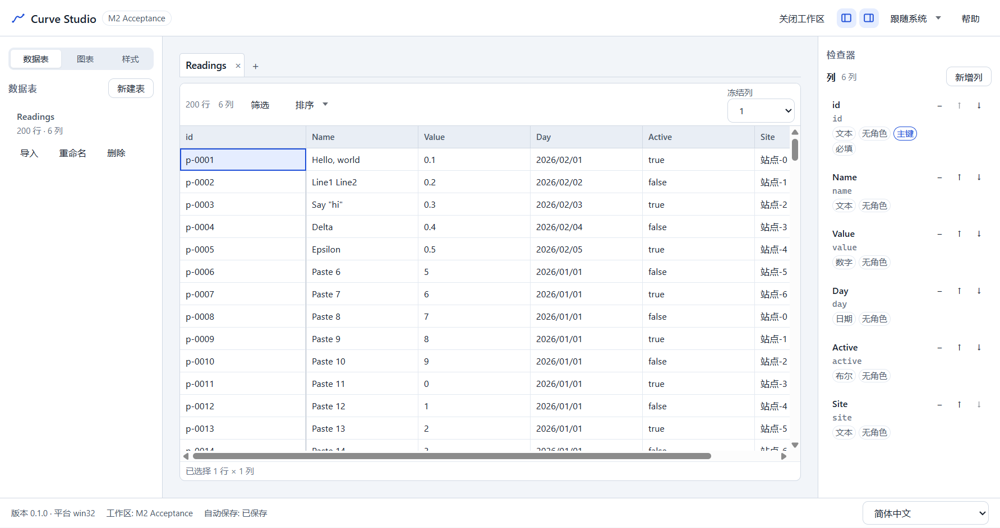
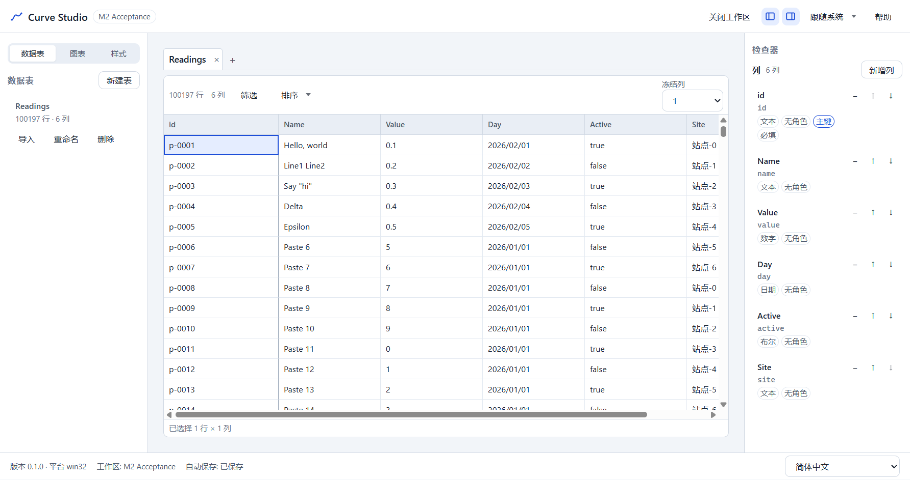
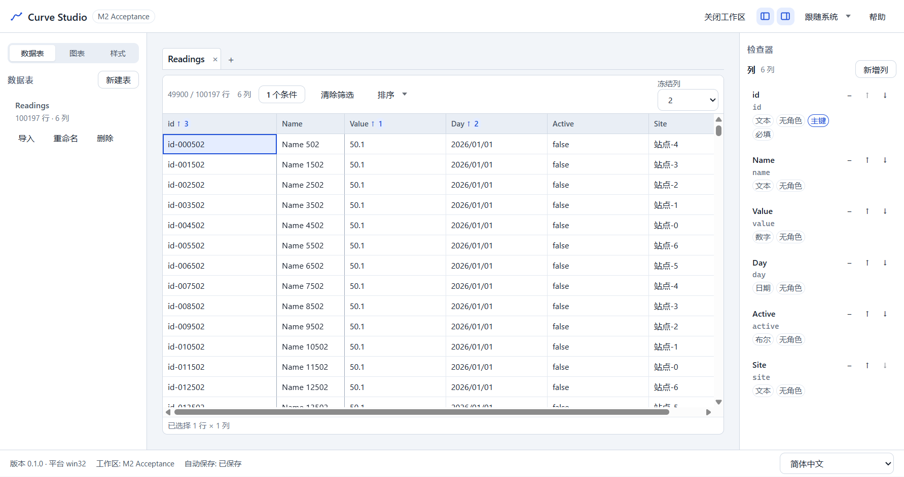

# M2 验收报告 — 表格数据

> 日期：2026-10-23 · 分支：`main` · 基线提交：`d7baded`（T2.7 代码提交 `1915f76` 之后的交接文档）
> 环境：Windows 10 x64 · Node 24.21.0 · pnpm 11.28.5 · Electron 44.9.0 · 16GB / SSD
> 验收口径：`docs/TASKS.md` M2、ADR-033 §7、HANDOFF §6、SPEC §16.1/§9.3/§9.5/§13.3
> 结论：**单条 `apps/desktop/e2e/m2-acceptance.spec.ts` 通过，全量 E2E 64 passed；
> 2026-10-23 获用户接受，M2 关闭；验收时未进入 T3.x。**

## 1. 结论

M2 的验收演示已固化为一条真实 Electron 端到端用例：新建工作区与表 → 粘贴 200 行 →
导入 100k GBK CSV（跳过 3 条坏行）→ 筛选 → 3 级排序 → 列宽/冻结 → 退出并重启 Electron →
断言界面与磁盘还原 + 性能预算。

| # | 验收步骤 | 结果 |
|---|---|---|
| 1 | 新建工作区 `M2 Acceptance`、表 `Readings`（默认 `id` text 主键） | ✅ |
| 2 | 粘贴 200 行 × 6 列（含 5×4 引号/内嵌换行片段），新增 5 列并设类型 | ✅ |
| 3 | 导入 100k GBK 分号 CSV（3 条坏行，跳过），最终 **100,197** 行 | ✅ 824ms（预算 8s） |
| 4 | 单层 all `value > 50` → **49,900** 行；3 级排序 `value↑ / day↑ / id↑` | ✅ 筛选 19ms、排序 63ms（预算 400ms） |
| 5 | 调整 `Name` 列宽、冻结 2 列并写入 manifest | ✅ |
| 6 | 工作区保持打开退出 → 重启 → 最近列表打开 → 筛选/排序/列宽/冻结/行数还原 | ✅ |
| 7 | 磁盘 JSONL/manifest 与界面一致，JSONL 重启前后 SHA-256 不变 | ✅ |
| 8 | 性能预算：100k 打开 ≤3s、内存 ≤600MB、导入 ≤8s（另加查询 ≤400ms） | ✅ |

关键实测（全量 E2E 套件内，整机空闲）：

| 指标 | 实测 | 预算 |
|---|---:|---:|
| 导入 100k（点击提交 → 网格可交互） | **824ms** | 8,000ms |
| 筛选 100k（Worker） | **19ms** | 400ms |
| 3 级排序 100k（Worker） | **63ms** | 400ms |
| 重启后打开 100k（`performance.measure('curve:open')`） | **624ms** | 3,000ms |
| 重启冷启动（launch → `curve:app-ready`） | **951ms** | 2,500ms（趋势；硬门禁在 `perf.spec.ts`） |
| 重启后查询（筛选 + 3 级排序） | **95ms** | 400ms |
| 整应用 private 内存峰值（main+renderer+worker，不含 GPU） | **497MB** | 600MB |
| 整应用 working set 峰值（仅诊断） | 635MB | — |
| 物理行数 / 可见行数 / `aria-rowcount` | 100,197 / 49,900 / 49,901 | — |

## 2. 演示方式

- 验收测试：`apps/desktop/e2e/m2-acceptance.spec.ts`，一个 `test`，`test.setTimeout(180_000)`。
- 启动方式：`e2e/fixtures.ts` 新增 `launchCurveApp()`，用同一 `userData` 启动两次 Electron；
  第一次在“工作区仍打开”时退出，第二次从最近列表打开。仅测试代码，不改生产启动路径。
- 数据与 UI：工作区/表通过欢迎页与“新建表”对话框创建；粘贴通过真实 `ClipboardEvent`
  （`text/plain`）派发；导入走真实导入向导；筛选/排序/列宽/冻结均操作真实控件。
- 夹具：`e2e/import-fixtures.ts` 的 `prepareImportFile('gbk-100k.csv')`（GB18030、`;`、
  3 条坏行），不提交大文件。
- 生产代码未改动；`formatVersion`、JSONL、manifest 字段、IPC、preload、CSP 均未变化。

## 3. 验收步骤逐项

### 3.1 新建与 200 行粘贴

1. 欢迎页新建工作区 `M2 Acceptance`，再新建表 `Readings`（默认 `id` text 主键、必填）。
2. 粘贴矩阵为 200 行 × 6 列：`id/name/value/day/active/site`。前 5 行嵌入 T2.4 的
   5×4 片段（`Hello, world`、`Line1\nLine2`、`Say "hi"`、`Delta`、`Epsilon`）；
   其余 195 行的 `value` 为 0–9，确保不改变后续筛选计数。
3. “粘贴需要新增 5 列”对话框里设置 `Name` text、`Value` number、`Day` date、
   `Active` boolean、`Site` text；label slug 生成的 key 正好与 CSV 表头一致。
4. 断言 `aria-colcount=6`、`aria-rowcount=201`、`data-visible-rows=200`，前三行引号/
   内嵌换行单元格内容正确；`autosave-status` 为“已保存”。



### 3.2 导入 100k GBK CSV（含坏行）

1. 同一张表打开导入向导；自动检测 **GB18030**、分号分隔、首行表头，预览 20 行。
2. 6 个源列全部自动映射到已有列（`existing:*`），无需新建列。
3. 校验结果：`total=100000`、`accepted=99997`、`skipped=3`；勾选“跳过错误行”，
   提交前确认“导入后超过 100,000 行”。
4. 从点击“开始导入”到网格 `aria-rowcount=100198` 用时 **824ms**（单跑 1.8–2.0s），
   远低于 8s 预算；随后 `autosave-status=已保存`。
5. 磁盘：manifest `rowCount=100197`，JSONL **100,197** 个内容行。



### 3.3 筛选与 3 级排序

1. `FilterDialog` 单层 `all`，条件 `value > 50`；应用后 `data-query-mode=worker`、
   `data-visible-rows=49900`，Worker 内耗时 **19ms**（预算 400ms）。
   - 计数依据：生成 CSV 的 `value = (index % 1000) / 10`，每 1,000 行中 501–999
     共 499 行 >50，100 轮即 49,900；3 条坏行均被跳过且不改变该计数。
2. 表头点击 `value`（asc），Shift+点击 `day`（asc）、`id`（asc）；表头显示
   `1/2/3` 级别与 `aria-sort=ascending`，`data-query-ms=63`（预算 400ms）。
3. 排序键选择数字/日期/ASCII 文本，避免把全中文 `site` 作为 100k 排序键；
   全中文 100k 单列排序仍由 ADR-033 的 800ms 预算与 `pnpm bench` 覆盖。

### 3.4 列宽与冻结

1. 拖动 `Name` 列分隔条 +90px，manifest 出现 `name` 宽度且 >160（拖动可持久化）。
2. 通过分隔条的 `dblclick` 触发 autofit，提交一个确定宽度 **107px**；界面计算宽度与
   manifest 一致。随后冻结列设为 **2**（`id`、`name`），manifest
   `frozenColumnCount=2`，网格前两个表头带 `cs-grid__header-cell--frozen`。
3. 说明：Playwright 合成的“快速拖动 + 立即释放”会让最后一次 `columnSizing` 与
   `pointerup` 提交产生一步差；因此验收用双击自适应提交确定值，拖动本身另行断言 >160。
   未为此修改生产代码。


### 3.5 退出并重启 Electron

1. 工作区保持打开，`electronApp.close()` 退出；同一 `userData` 重新启动 Electron。
2. 重启后出现一次 **stale lock** 警告（T5.3 已后置完整恢复交互），断言后点击“隐藏提示”；
   这符合 T2.1/ADR-026 的现状，不作为失败条件。
3. 从最近列表打开 `M2 Acceptance`：冷启动 **951ms**，`curve:open` **624ms**。
4. 还原结果：
   - 物理行 100,197、筛选后可见 49,900（`aria-rowcount=49901`、`data-total-rows=100197`）。
   - 工具栏“1 个条件”，`value`/`day`/`id` 三级排序仍为 asc，级别 1/2/3。
   - `Name` 列宽 **107px**，冻结 2 列。
   - 重启后查询 **95ms**（预算 400ms），整应用 private 峰值 **497MB**（预算 600MB）。
5. 磁盘一致性：
   - manifest `rowCount=100197`，`filter={kind:'all', children:[{columnId:value, op:'gt', value:50}]}`，
     `sort=[value↑, day↑, id↑]`，`widths.name=107`，`frozenColumnCount=2`。
   - JSONL 100,197 行；重启前后 SHA-256 相同：
     `e1dc160265c6f518f17e5c8079676a489029951d22ec344d8f236748650fba35`。
   - 打开/重启未重写 JSONL，manifest 的视图状态与界面逐项相等。



## 4. 门禁结果（2026-10-23）

| 命令 | 结果 |
|---|---|
| `pnpm verify` | **123 files / 978 tests passed**；ESLint 0；depcruise **345 modules / 1,326 deps / 0 violations** |
| `pnpm test:coverage` | statements **74.88%** / branches **67.02%** / functions **75.91%** / lines **74.99%**（阈值 70/60 未下调） |
| `pnpm format:check` | 通过 |
| `pnpm build` | exit 0；renderer **1,415.85 kB** + `ImportSession` 42.82 kB；table/query/import worker 216.61/229.63/266.09 kB |
| `pnpm e2e` | **64 passed**（60 + `perf.spec` 3 + M2 验收 1），2.6min；M2 spec 10.6s |
| `pnpm bench` | exit 0；全部受门禁用例通过（见下表），`baseline=missing` 仍为既有状态 |

`pnpm bench` 实测（P95，预算）：

| 用例 | P95 | 预算 | 结果 |
|---|---:|---:|---|
| `table.open.100k` | 553ms | 3,000ms | ok |
| `table.save.100k` | 409ms | 500ms | ok |
| `edit.commit.100k` | 0ms | 50ms | ok |
| `query.100k` | 191ms | 400ms | ok |
| `query.text-sort.100k` | 249ms | 400ms | ok |
| `query.cjk-sort.100k` | 661ms | 800ms | ok |
| `import.100k` | 685ms | 8,000ms | ok |
| `query.sync-clone.100k` | 340ms | — | 诊断 |

> 环境说明：第一次 `pnpm verify` 在外部游戏 `helldivers2` 占用约 8 核（CPU 75–87%）时出现
> 3 个 5s 超时；3 个文件单独复跑 26 tests 全部通过。暂停游戏后重跑 `pnpm verify`
> 全绿。未放宽任何超时或预算。

## 5. 证据与复现

- 验收测试：`apps/desktop/e2e/m2-acceptance.spec.ts`
- 重启 helper：`apps/desktop/e2e/fixtures.ts`（`launchCurveApp`）
- 截图证据：
  - `docs/reports/m2/m2-01-paste.png`
  - `docs/reports/m2/m2-02-import.png`
  - `docs/reports/m2/m2-03-view-state.png`
  - `docs/reports/m2/m2-04-restored.png`
- Playwright 运行产物（gitignore）：`apps/desktop/test-results/m2-acceptance-*`，含
  `m2-01…04.png`、timings/manifest attachment、失败时 trace。
- 复现单条验收：

```powershell
$env:PATH = "D:\DSH_Work_Space\tools\bin;C:\Users\MECHREVO\.dsh\dsh-runtimes\dsh-primary-runtime\dependencies\node\bin;$env:PATH"
$env:CURVE_E2E_NO_SANDBOX = '1'
Remove-Item Env:ELECTRON_RUN_AS_NODE -ErrorAction SilentlyContinue
pnpm build
pnpm exec playwright test --config apps/desktop/playwright.config.ts apps/desktop/e2e/m2-acceptance.spec.ts
```

全量：`pnpm verify` → `pnpm test:coverage` → `pnpm format:check` → `pnpm build` → `pnpm e2e` → `pnpm bench`。

## 6. 口径说明与残留

- **重启方式**：按用户确认，工作区保持打开时退出；因此重启会出现 stale lock 提示。
  T5.3 的完整恢复交互仍后置，不作为 M2 失败条件。
- **列宽**：最终宽度由双击自适应提交，未用拖动最后一步做像素级断言（见 §3.4）。
- **排序键**：验收用 `value/day/id` 保持 400ms 预算；中文 `site` 保留在表中但不作为
  100k 排序键。全中文单列 800ms 由 `pnpm bench` 的 `query.cjk-sort.100k`（661ms）覆盖。
- **冷启动**：全量套件内 951ms；单条 spec 连续两次分别 2,401ms/2,649ms（首尾两次启动
  紧邻、机器状态不同），故 M2 spec 只记录趋势，2.5s 硬门禁仍由 `perf.spec.ts` 判定。
- **内存**：497MB/600MB，余量约 17%；CI runner 更慢时仍需关注。
- **bench 基线**：`bench/baseline.json` 尚未提交，回归比较为 `missing`（T2.7 既有残留，
  M2 未改变）。
- **未进入 T3.x**：本报告输出后停下等用户验收；不开始 M3/图表/样式任务。

## 7. 验收结论

M2 的 8 项演示全部通过，且固化为可重复运行的单条 E2E；未发现需要修改生产代码的缺陷。

**用户已于 2026-10-23 接受 M2；M2 关闭，下一步 T3.1（已按授权完成，见
`docs/reports/t3.1/REPORT.md`）。**
