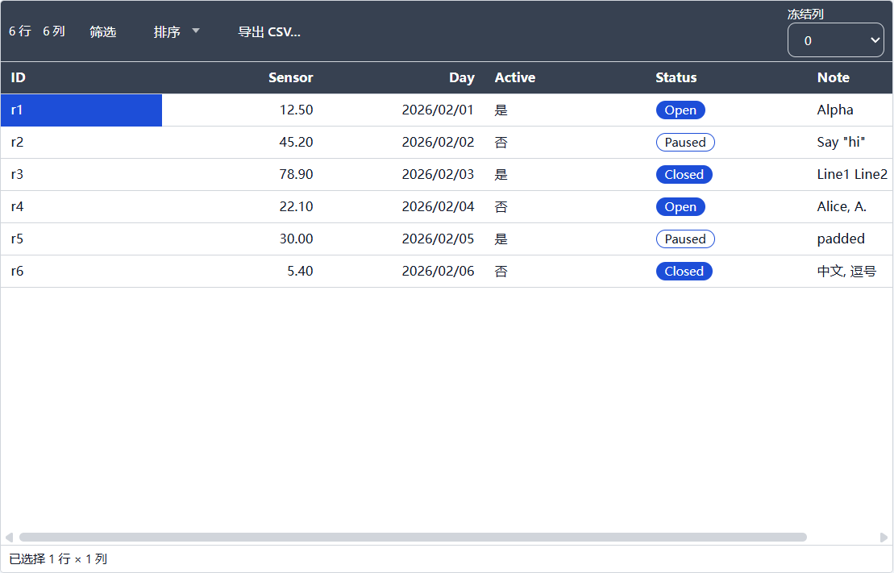
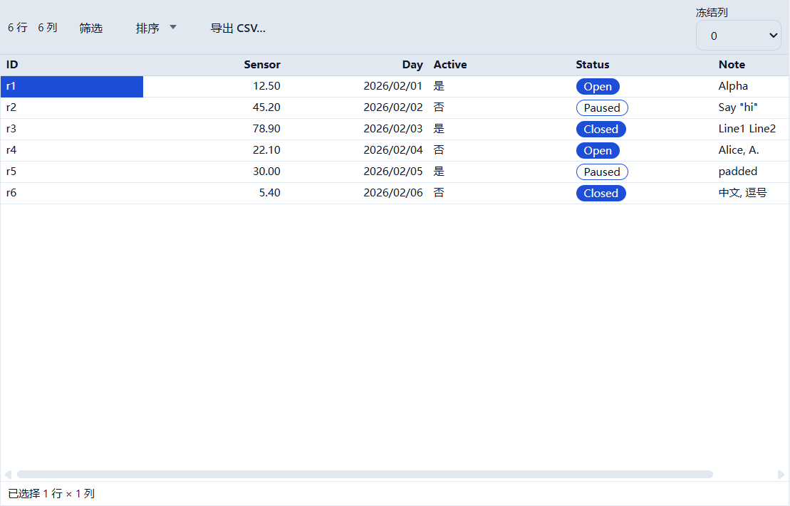
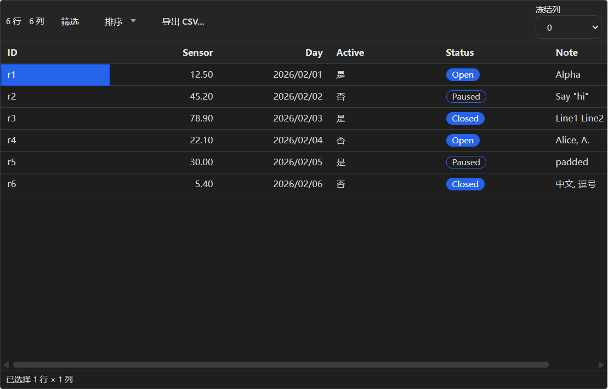
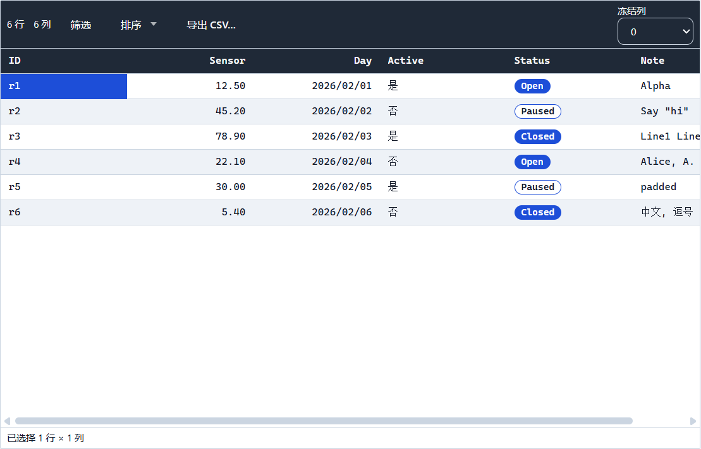
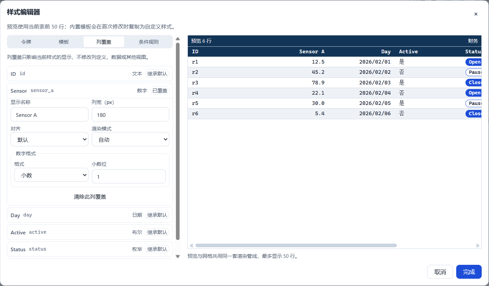
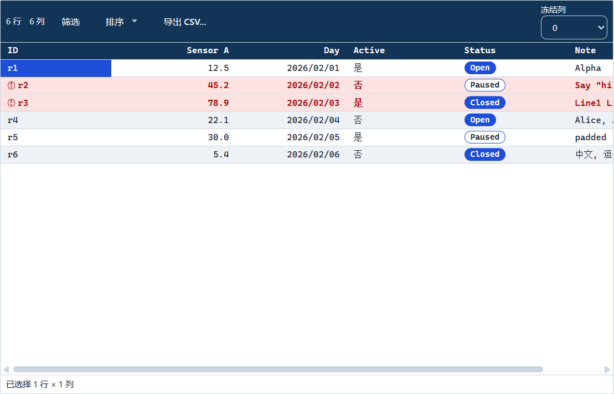
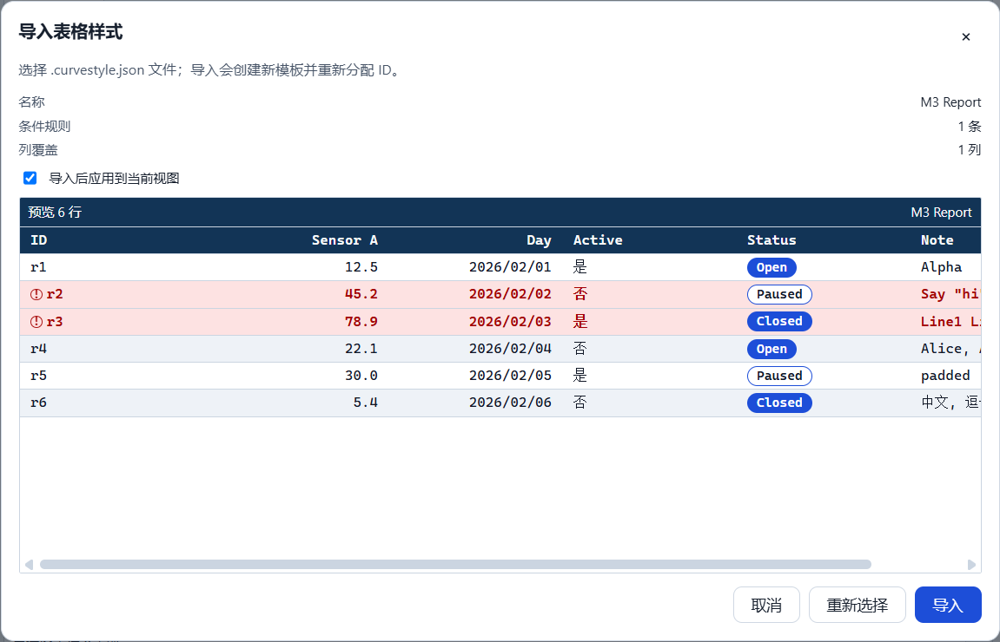
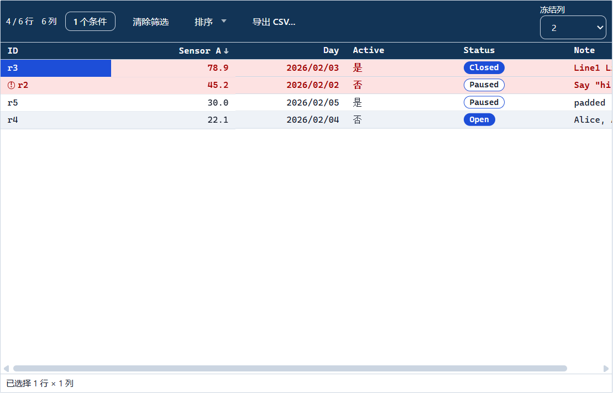

# M3 报告 — 表格外观验收演示

- 里程碑：**M3 表格外观**（T3.1–T3.6 已完成）
- 日期：2026-10-24
- 状态：**演示已执行；等待用户验收**（未进入 T4.x）
- 演示：`apps/desktop/e2e/m3-acceptance.spec.ts`（1 条，全量 E2E 内 **11.2s**，三次启动）
- 决策：ADR-034/035/036/037/038/039；本次**无新增 ADR**（未改 `formatVersion`、manifest 字段、
  JSONL、IPC、preload、CSP 或运行时依赖）
- 演示中发现并修复 1 个缺陷：虚拟化行高不随样式令牌重测（见 §5）

## 1. 目标与范围

按 `docs/TASKS.md` 的 M3 验收脚本（`TASKS.md:1070`）与 HANDOFF §6A，用一条可复现的 E2E 走完：

1. 同一视图依次应用 4 个内置模板，断言颜色/行高/字族/对齐/斑马纹差异；
2. 在真实样式编辑器中改密度、表头色与 `sensor_a` 列格式（显示名/宽度/1 位小数），
   断言前 50 行预览 ≤100ms 更新、一次控件一条撤销；
3. 加条件规则“高温”（`sensor_a > 30` → 红底 + 警告图标），断言命中/未命中行；
4. 另存模板、筛选/排序、冻结 2 列、列宽自适应、设为工作区默认，并导出当前结果 CSV；
5. 重启后把 `.curvestyle.json` 导入**新工作区**并应用，断言 12 项计算样式一致、CSV 转义正确；
6. 再次退出并重启，断言模板、视图引用、筛选/排序、列宽、冻结与工作区默认样式均还原。

工作区通过 `window.api` 预置（与 T3.2/T3.5 相同的 seed 模式，两张表 schema/行完全一致）；模板应用、
样式编辑、规则、另存、导出、导入、重启全部走真实 UI。生产代码只改了一处缺陷修复（§5）。

## 2. 演示步骤与断言

| # | 操作（真实 UI） | 关键断言 |
|---|---|---|
| 1 | 模板管理 → 应用 `builtin.report-light` / `compact-light` / `dark` / `finance` | 行高 **32 → 24**；compact 表头字号 **12px**；dark 单元格 `rgb(30,30,30)`、表头 `rgb(37,37,38)`；finance 字族含 **Cascadia Mono**、表头 `rgb(31,41,55)`、斑马纹交替色不同；数字右对齐；截图 4 张 |
| 2 | 检查器“编辑样式” → 密度 `compact` | manifest 先懒 fork 出 `sty_*`（`builtin:false`）；`data-preview-ms` 实测 **2–3ms**（预算 100ms） |
| 3 | 表头背景 `#123456`、`sensor_a` 显示名 `Sensor A`、列宽 `180`、小数位 `1` | 每次控件提交各写一次 `style.create/update`；预览 `12.50 → 12.5` |
| 4 | 关闭编辑器后 `Ctrl+Z` / `Ctrl+Shift+Z` | 仅最后一次提交（小数位）回滚为 `12.50`，再重做为 `12.5`；密度/表头色/列覆盖保持 → **一次控件一条撤销** |
| 5 | 条件规则：`sensor_a` `gt` `30`，背景 `#fde2e2`、文字 `#a40000`、图标 warning、加粗 | 规则落盘为 `{kind:'all', children:[compare]}`；r2/r3 行 `data-conditional-rule` + 图标 `warning`，r1/r4/r5/r6 无；预览同规则生效 |
| 6 | 模板页“另存为模板…” → `M3 Report` | 生成新 `sty_*`、原名保留、视图指向新副本；导出文档 `kind=curve-table-style`、`version=1`、id 为快照（导入时才重分配） |
| 7 | 筛选 `sensor_a >= 20` + 表头两击降序；冻结列 `2`；Note 列双击自适应 | `data-visible-rows=4`（r3/r2/r5/r4）；`aria-sort=descending`；冻结 2 列；manifest `widths[col_note]` 落盘，实测 **116px** |
| 8 | 模板管理 → 设为默认；导出模板（`m3-work`，复制为 `.curvestyle.json`）；导出 CSV | 默认样式写入 manifest；CSV 摘要 `4 行 × 6 列`；BOM `EF BB BF`、5 条 CRLF 记录、表头 `ID,Sensor A,Day,Active,Status,Note`；`r3,78.9,2026/02/03,是,Closed,"Line1\nLine2"`、`"Say ""hi"""`、`" padded "`、`"Alice, A."`；顺序 r3→r2→r5→r4；r1/r6 不在文件 |
| 9 | 退出 → 同一 `userData` 重启 → 打开目标工作区 → 导入 `.curvestyle.json` → 应用 | 导入强制新 `sty_*`/`rule_*` id、名称 `M3 Report`、1 条规则、1 个列覆盖；**12 项计算样式与源工作区逐项相等**；目标 CSV 6 行 + 表头、`r1,12.5,...`、`"中文, 逗号"` |
| 10 | 再退出并重启 → 打开源工作区 → 关闭工作区 → 打开目标工作区 | 源：`data-table-style` 为用户样式、`1 个条件`、降序、冻结 2、Note 列宽 116、规则命中、面板名称 `M3 Report`、模板行 `data-default/data-current`；目标：导入样式仍应用且持久化 |

## 3. 实测数据

| 项 | 实测 |
|---|---|
| 演示用例耗时（全量套件内） | **11.2s**（单跑 11.6s / 12.7s） |
| 预览更新 `data-preview-ms` | **2ms**（单跑 3ms）/ 预算 100ms |
| 条件规则求值 | 规则即时命中，预览与网格一致；`condition.rules.50x100` P95 **0ms**/16ms |
| 列宽自适应 | Note 列 **116px**，重启后计算宽度一致 |
| 源 CSV | **211 字节**，5 条 CRLF 记录，UTF-8 BOM |
| 目标 CSV | **293 字节**，7 条 CRLF 记录 |
| 模板 id | 源 `sty_bb19f292-…`（另存副本 `M3 Report`）→ 目标导入 `sty_0d753447-…` |
| JSONL | 6 行；SHA-256 `2face74e41a662ced9b2e4314545195667807105403cbd253405d6e6473843c5`（重启前后不变） |
| 12 项样式契约 | 源/目标完全相等：`headerBg/bodyBg/alternateBg/rowHeight/fontFamily/radius/headerLabel/headerWidth/numberText/dateText/boolText/ruleBackground`（`m3-contract.json` attachment） |

## 4. 截图证据

四套内置模板（同一视图、同一数据）：

| Report（浅） | Compact（浅） | Dark | Finance |
|---|---|---|---|
|  |  |  |  |

样式编辑器（密度 compact、表头 `#123456`、Sensor A/180px/1 位小数、前 6 行预览）：



条件规则“高温”（r2/r3 红底 + 警告图标，r4/r5 未命中）：



导出 CSV（当前筛选/排序，4 行 × 6 列，仅可见列）：


导入到全新工作区（1 条规则、1 个列覆盖、预览已应用规则）：



重启还原（4/6 行、1 个条件、降序、冻结 2 列、规则仍生效）：



完整清单：`m3-01`…`m3-10`（10 张，截图为设备像素，断言不依赖像素；`m3-08-source-final.png`
为源工作区最终状态）。

## 5. 演示中发现的缺陷与修复

**现象**：通过“模板管理 → 应用”切换到 `builtin.compact-light` 后，表格行的背景/字号/内边距立即变化，
但 **行高仍停留在上一个模板的 32px**（`--cs-table-row-height` 已是 24px），直到滚动或改变窗口尺寸才
恢复。样式编辑器的密度修改同样受影响。

**根因**：`DataGrid` 的 `useVirtualizer({ estimateSize: () => rowHeight })` 在 `rowHeight` 变化时不会
自动重新测量；TanStack Virtual 会保留已测量的行尺寸。T3.2 的 `style.spec.ts` 通过切换**视图**规避了
该路径（视图切换会重建行集合），所以此前没有暴露。

**修复**（`apps/desktop/src/renderer/features/grid/DataGrid.tsx`）：行高变化时显式重测。

```ts
useEffect(() => {
  virtualizer.measure();
}, [virtualizer, rowHeight]);
```

**验证**：M3 用例在应用 `compact-light` 后**立即**断言行高 24px；修复前该断言在 32px 上等待 10s 失败
（可复现），修复后 2–3 帧内稳定通过。只多一次重测，不改变行数/滚动位置；不涉及格式、IPC 或公共 API。
`pnpm verify` / `pnpm e2e` 全绿。

## 6. 验收逐项（对照 TASKS M3 与 HANDOFF §6A）

| 验收项 | 结果 |
|---|---|
| 应用 4 个内置模板对比 | ✅ 同一视图逐一应用；行高/颜色/字族/对齐/斑马纹断言 + 4 张截图 |
| 改令牌/列格式，预览 ≤100ms | ✅ 密度/表头色/显示名/宽度/小数位；预览 2–3ms；一次控件一条撤销（undo/redo 实测） |
| 条件规则“高温标红” | ✅ `sensor_a > 30` → 行背景/前景/加粗/警告图标；命中与未命中行均断言 |
| 另存模板 | ✅ 新 `sty_*`、名称 `M3 Report`、规则随副本、视图切换；导出快照校验 |
| 导出 CSV（当前筛选排序） | ✅ BOM/CRLF/RFC 4180/顺序/隐藏行排除/显示格式与列覆盖表头；4 行 × 6 列 |
| 新工作区导入并应用 | ✅ 导入重分配 id、1 条规则/1 个列覆盖、12 项计算样式逐项一致；目标 CSV 正确 |
| 重启还原 | ✅ 模板、视图引用、筛选/排序、列宽、冻结 2 列、工作区默认样式；目标工作区同样还原 |
| 键盘与 200% 缩放 | ✅ 沿用 T3.4/T3.5/T3.6 的既有 E2E（样式编辑器、模板管理、导出对话框）；本次演示以鼠标路径为主 |
| 性能预算 | ✅ 100k 导出 1,646ms/5s；内存 572MB/600MB；冷启动 1,017ms/2.5s；bench 全绿 |

## 7. 验证命令与结果（2026-10-24 本机）

```text
pnpm verify
  143 files / 1232 tests passed；ESLint 0；
  depcruise 395 modules / 1592 deps / 0 violations

pnpm test:coverage
  lines 74.89% / statements 74.76% / branches 67.66% / functions 73.17%
  阈值 70/60 未下调

pnpm format:check
  通过

pnpm build
  exit 0；renderer 1,618.04 kB + ImportSession 42.82 kB；CSS 64.03 kB；
  table/query/import worker 220.68/236.16/270.16 kB

pnpm e2e
  72 passed（3.5m）；m3-acceptance 1 条 11.2s；export-csv 100k 1,646ms/5,000ms；
  perf 冷启动 1,017ms/2.5s、100k 打开 637ms/3s、内存 572MB/600MB

pnpm bench
  exit 0；open 436ms/3s、save 258ms/500ms、edit 0ms/50ms、query 239ms/400ms、
  text-sort 276ms/400ms、cjk-sort 502ms/800ms、import 918ms/8s、
  condition.rules.50x100 P95 0ms/16ms；clone 256ms（诊断）
```

E2E 用例为 `apps/desktop/e2e/m3-acceptance.spec.ts`；Playwright 产物（trace/attachment）在
`apps/desktop/test-results/`（gitignore），截图已复制到 `docs/reports/m3/`。

## 8. 残留风险与未覆盖

- 演示用 6 行小表；100k 行下的样式/条件规则性能仍由 T2.7/T3.3 的 bench 与 E2E 覆盖，而不是本演示。
- 4 个模板是在同一视图上**依次应用**比较，不是并排对比；像素级基线仍不提交（HANDOFF §3.6）。
- “另存为模板”会保留懒 fork 产生的中间副本（`财务 (2)`）与最终模板两条记录，视图指向后者；
  这是 ADR-037/038 的既有语义，演示未删除中间副本。
- 条件规则按首条命中、不叠加；条件背景覆盖 bar；日期显示为本地化文本（`2026/02/03`），
  原始值导出仍是 epoch ms。
- 演示依赖 E2E 保存/导入对话框替身（`CURVE_E2E_SAVE`/`CURVE_E2E_IMPORT`）与同一 `userData`
  重启；替身只读测试环境变量，不进入生产路径。
- 行高重测修复只在密度/字号/内边距变化时触发一次 `virtualizer.measure()`；极端自定义样式导致
  连续行高变化时会有一次重测开销（未纳入 bench 门禁）。

## 9. 结论与停点

M3 的 6 个任务与本次验收脚本全部通过；演示覆盖模板、样式编辑、条件格式、模板管理、CSV 导出、
跨工作区导入与重启还原，证据可一键复跑：

```powershell
$env:CURVE_E2E_NO_SANDBOX = '1'
pnpm exec playwright test --config apps/desktop/playwright.config.ts apps/desktop/e2e/m3-acceptance.spec.ts
```

**停点**：报告与证据已输出，等待用户验收 M3；未获接受前不进入 T4.x。
