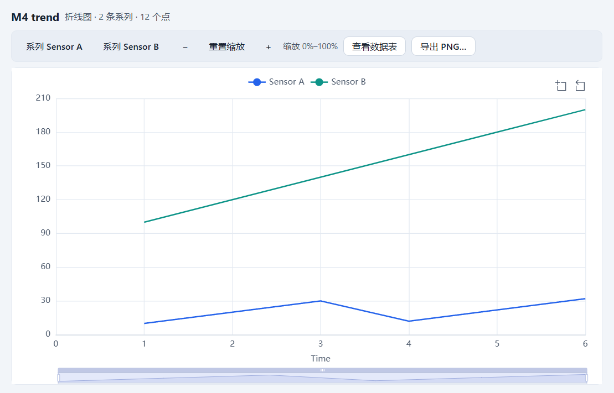
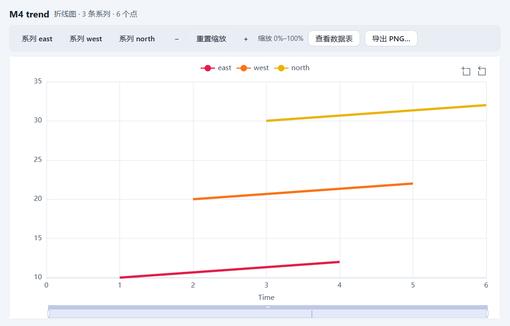
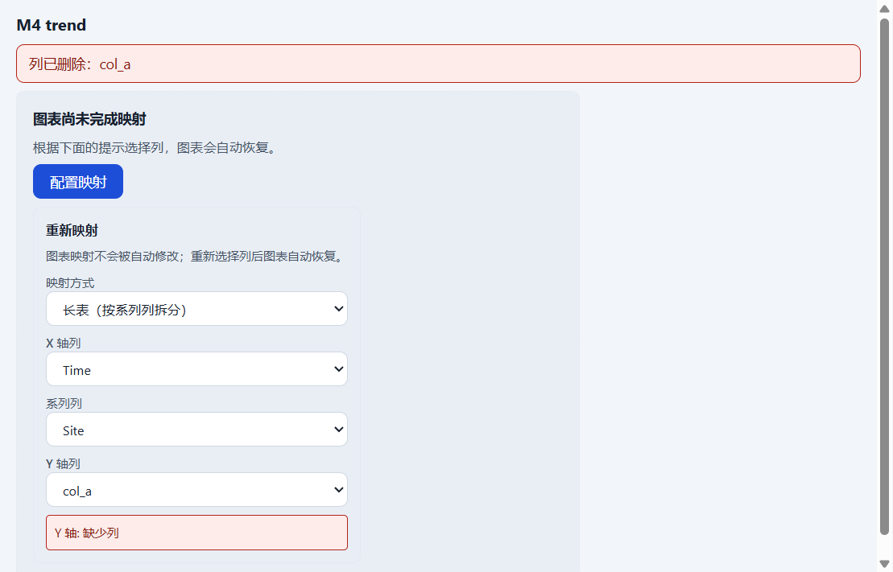
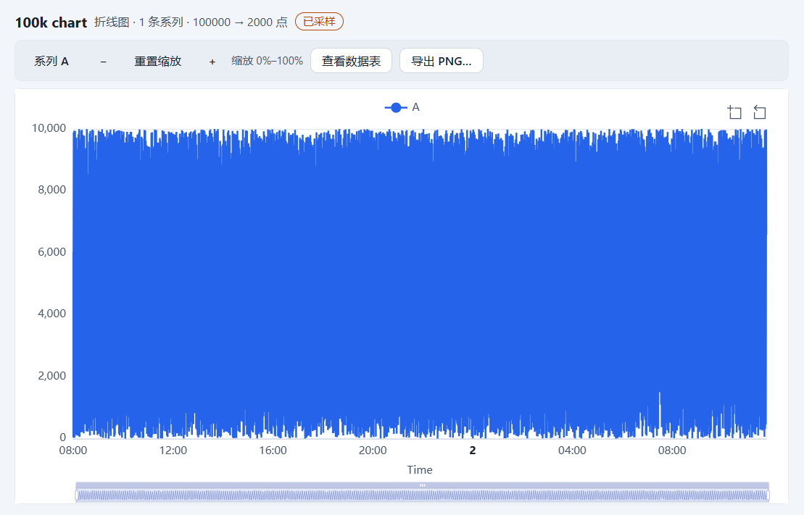
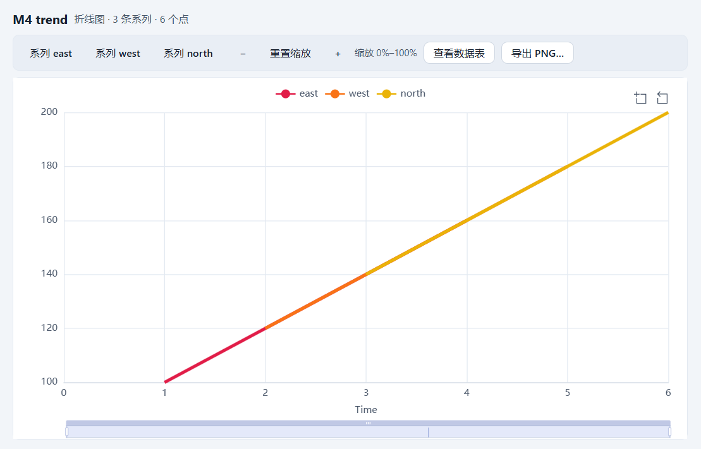
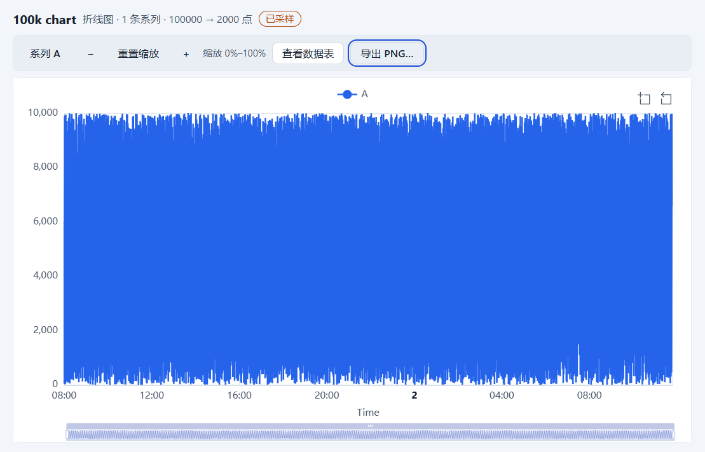

# M4 报告 — 图表验收演示

- 里程碑：**M4 图表**（T4.1–T4.6 已完成）
- 日期：2026-10-26（演示）/ 2026-10-27（验收入）
- 状态：**已于 2026-10-27 获用户接受；M4 关闭**（下一步 M5 从 T5.1 开始）
- 演示：`apps/desktop/e2e/m4-acceptance.spec.ts`（1 条，2 次 `launchCurveApp`）
- 决策：ADR-040–045；本次**无新增 ADR**，生产代码**零改动**（不改 `formatVersion`、
  manifest 字段、JSONL、IPC、preload、CSP、公共 API 或运行时依赖）
- 证据：7 张截图（本目录）＋ `m4-metrics.txt` attachment；全量 E2E **82 passed**

## 1. 目标与范围

按 TESTPLAN E6 与 HANDOFF §0.1，用一条可复现的 E2E 走完 M4 验收脚本：

1. 同一张表建**宽表折线**（2 个 Y 列），断言 2 个系列与图例名称；
2. 同一图表切**长表映射**（系列列 `site`），断言系列数 = distinct 值数；
3. 用真实工具栏**缩放、关图例、改调色板、改线宽**；重开应用后断言持久化项保留，
   并确认临时交互状态按 ADR-044 复位；
4. 100k 点表出图：先出现 loading，再断言“已采样”徽标与每系列 ≤ 2k 点；
5. 导出 PNG：断言文件、容器 2x 尺寸、白色背景与文件名；
6. **删除映射列**：断言图表进入可操作错误态、可重新映射且不崩溃，然后重启还原。

小型源工作区（6 行、`site` 三个 distinct 值）与 100k 夹具通过 `window.api` 预置（与
M2/M3/T4.x 相同的 seed 模式）；图表创建、检查器、工具栏、删列、导出、重启全部走真实 UI。
断言使用 `data-chart-*` 渲染契约、manifest 落盘与 PNG 字节，**不做整图像素比对**
（HANDOFF §3.6）。

E6 第 3 步原文要求“缩放/关图例…重开应用后保留”。ADR-044 已裁决交互状态是瞬态视图状态
（不写 `ChartSpec`/manifest、不进撤销），SPEC §11.5 同步了该边界；本演示因此断言：
**调色板/线宽/映射重启保留**，**缩放复位 0–100、图例恢复全选**。这是已接受的设计，不是回归。

## 2. 演示步骤与断言

| # | 操作（真实 UI） | 关键断言 |
|---|---|---|
| 1 | 图表列表 → 新建向导：表 `Readings`、名称 `M4 trend`、宽表 X `Time`、Y 勾选 `Sensor A`+`Sensor B` → 创建 | `data-chart-layout=wide`、`data-chart-series-count=2`、`data-chart-series="Sensor A|Sensor B"`、`source-points=12`、`sampled=false`；manifest 生成 1 个 `cht_*` + 1 个图表视图 |
| 2 | 检查器 → 映射 → 布局切 `long` | 系列数 **3**（east/west/north = distinct `site` 数）、`data-chart-series="east|west|north"`、`source-points=6`；manifest 为长表映射 |
| 3 | 工具栏：点 `系列 east` 开关 → 再点恢复；`+` 放大；悬停画布 | 隐藏时 `data-chart-hidden-series="east"` 且 `aria-pressed=false`；缩放窗口 **25%–75%**；tooltip 可见且非空（实测 `3north: 30.00`） |
| 4 | 检查器 → 外观：调色板 `vivid`、线宽 `4` | `data-chart-palette=#e11d48`、`data-chart-line-width=4`；manifest `options` 落盘 `paletteId:"vivid", lineWidth:4`；截图后重置缩放 |
| 5 | 表格标签 → 编辑列 `Sensor A` → 删除并确认；回到图表标签 | 图表态 `missing-columns` + `data-chart-empty=unmapped`，错误“列已删除：col_a”，内嵌重映射可见；选择 `Y 轴 = Sensor B` 后恢复 `ready`、3 系列、6 点，manifest 映射为 `yColumnId=col_b` |
| 6 | 100k 工作区：打开图表 → 工具栏“导出 PNG…” → 背景“白色” → 导出 | 先出现 `data-chart-state="loading"`/`data-chart-pending="true"`，再 `ready`；徽标“已采样”、`source=100000`、`rendered=2000`；文件名 `100k chart-yyyyMMdd-HHmm.png`；PNG **1706×916**（容器 854×459 的 2x）、151,363 B、角像素 `#ffffff` |
| 7 | 关闭应用 → 同一 `userData` 重启 → 打开源工作区 | 图表/视图仍在：`layout=long`、3 系列 east/west/north、`palette=#e11d48`、`lineWidth=4`、`mapping.y=col_b`；`zoom-start=0`/`zoom-end=100`、`hidden-series=""`（ADR-044） |
| 8 | 重启后打开 100k 工作区 | 再次先 loading 后 ready；“已采样”徽标、`100000 → 2000` 仍成立；导出对话框建议文件名与重启前同标题同格式 |

## 3. 实测数据

| 项 | 实测（全量 E2E 内） |
|---|---|
| M4 演示耗时 | **8.6s**（单跑 9.0s / 10.0s）；2 次启动 |
| 宽表 | 2 系列（`Sensor A|Sensor B`），12 个点，未采样 |
| 长表 | 3 系列（`east|west|north`），6 个点；与 distinct `site` 一致 |
| 图例/缩放/tooltip | 隐藏 `east` → 恢复；缩放 **25–75** → 重置 **0–100**；tooltip `3north: 30.00` |
| 外观持久化 | `palette=#e11d48`（vivid）、`lineWidth=4`；重启后一致 |
| 删除/重映射 | `col_a` 删除 → `missing-columns`；重映射到 `col_b` 后 3 系列、6 点；表列数 4 |
| 100k 采样 | loading=true；`source-points=100000`、`rendered-points=2000`、徽标“已采样” |
| 100k 性能诊断 | `resolve-ms=43`（≤300）、`update-ms=36`（≤200）、`instances=1`；单跑 40/34、51/41 |
| 100k 内存 | **488MB** / 600MB（单跑 493 / 495；`app.getAppMetrics()` privateBytes，不含 GPU） |
| PNG | `100k chart-20261026-2124.png`、151,363 B、**1706×916**；容器 854×459；2x 取整差 2px；角像素白 |
| 重启还原 | 源图表 3 系列/映射/调色板/线宽保留；100k `100000→2000` + 徽标保留；缩放/图例复位 |
| 结果 | **1 passed（10.0s 单跑）**；全量 **82 passed（4.2m）** |

## 4. 截图证据

宽表折线（2 个 Y、2 系列、12 点）：



长表多系列（3 系列 = 3 个 distinct site；调色板 vivid、线宽 4，缩放已重置为 0–100）：



删除映射列后的可操作错误态（`missing-columns` + 内嵌重映射）：



100k 点采样图（“已采样”徽标，100000 → 2000 点）：



PNG 导出对话框（白色背景、2x、建议文件名）：


重启后的源图表（映射到 `Sensor B`、vivid/4px 保留，缩放/图例已复位）：



重启后的 100k 图表（采样徽标与点数还原）：



## 5. 验收逐项（TESTPLAN E6 / TASKS M4）

| E6 # | 验收项 | 结果 |
|---|---|---|
| 1 | 同一张表建宽表折线（2 个 Y），2 个系列、图例名称正确 | ✅ 向导创建；`Sensor A|Sensor B`、12 点、未采样；manifest 落盘 |
| 2 | 切长表映射（`site`），系列数 = distinct 值数 | ✅ 同一图表切 long；3 个 distinct → 3 系列（east/west/north），6 点 |
| 3 | 缩放、关图例、改调色板、改线宽；重开应用后保留 | ✅ 缩放 25–75、图例隐藏/恢复、vivid、4px 全部生效；重启后调色板/线宽保留，缩放/图例按 ADR-044 复位（SPEC §11.5 已同步） |
| 4 | 100k 点出图：已采样徽标、点数 ≤ 2k/系列、首尾点存在 | ✅ loading → ready；徽标可见；100000 → 2000（≤2k）；首尾点保留由 `packages/chart-model/src/sampling.test.ts` 的 `lttbIndices` 用例锁定（`indices[0]=0`、末位=最后一点，`:57`/`:85`），E2E 不做像素取点 |
| 5 | PNG：文件存在、尺寸为容器 2x、背景符合选择 | ✅ 151,363 B、1706×916 vs 854×459（±2px 取整）、白色角像素、文件名 `<标题>-<yyyyMMdd-HHmm>.png` |
| 6 | 删除映射列：错误态且可重新映射，不崩溃 | ✅ `missing-columns` + `unmapped` + `列已删除：col_a`；重映射 `col_b` 后恢复 ready 并持久化；重启仍正常 |
| — | M4 演示脚本（TASKS M4 末行） | ✅ 宽表 + 长表 → 缩放/图例/tooltip → 100k 采样徽标 → PNG → 重启还原，一条用例覆盖 |
| — | 键盘 / 200% 缩放 | 沿用既有 E2E：`chart.spec.ts` 向导/检查器 200% 键盘、`chart-interaction.spec.ts` 导出对话框 200% + 键盘、本 demo 以鼠标与工具栏路径为主 |

## 6. 验证命令与结果（2026-10-26 本机，独占 CPU）

```text
pnpm verify
  163 files / 1505 tests passed；ESLint 0；
  depcruise 447 modules / 1874 deps / 0 violations

pnpm test:coverage
  statements 76.34% / branches 69.21% / functions 74.99% / lines 76.47%
  阈值 70/60 未下调（无生产代码改动，与 T4.6 基线一致）

pnpm format:check
  通过

pnpm build
  exit 0；renderer 3,251.27 kB + ImportSession 42.82 kB；CSS 72.31 kB；
  table/query/import worker 220.68/236.16/270.16 kB

pnpm e2e
  82 passed（4.2m）；m4-acceptance 1 条 8.6s；
  chart-perf resolve 47ms/update 98ms、切换后 private 593MB/600MB；
  100k CSV 1,635ms/5s；冷启动 1,111ms/2.5s、100k 打开 670ms/3s、
  整应用 private 577MB/600MB

pnpm exec playwright test --config apps/desktop/playwright.config.ts \
  apps/desktop/e2e/m4-acceptance.spec.ts
  1 passed（10.0s）
  [m4] wideSeries=Sensor A|Sensor B longSeries=east|west|north hiddenSeries=east
       tooltipText=3north: 30.00 zoomStart=25 zoomEnd=75 paletteColor=#e11d48
       lineWidth=4 remapY=col_b columnCountAfterDelete=4 hundredKLoading=true
       hundredKSourcePoints=100000 hundredKRenderedPoints=2000
       hundredKResolveMs=40 hundredKUpdateMs=34 hundredKInstances=1
       hundredKMemoryMB=493 pngFileName=100k chart-20261026-2120.png
       pngBytes=151363 pngWidth=1706 pngHeight=916 canvasWidth=854 canvasHeight=459

pnpm bench -- --chart
  exit 0；chart.resolve-sample.100k P50 64ms / P95 64ms（300ms）
  chart.sample.100k P95 3ms（50ms）；chart.option.2k P95 1ms（50ms）
  chart.restyle.100k P95 0ms（20ms）；chart.resolve-unsampled.100k P95 54ms（诊断）
  baseline: missing（沿用 ADR-033，CI runner 生成后提交）
```

E2E 产物在 `apps/desktop/test-results/`（gitignore）；截图已复制到本目录。`pnpm e2e` 会重写
`docs/reports/m0/*.png`，提交前已用 `git checkout --` 还原，未带入提交。

## 7. 残留风险与未覆盖

- **E6 第 3 步的“缩放/图例保留”与 ADR-044 冲突**：交互状态是瞬态、不写文档（ADR-044 §1、
  SPEC §11.5）。演示按现行契约断言“重启后复位 0–100/全选”，并把调色板/线宽/映射的持久化
  单独断言。若产品改为主张持久化，需要扩展 `ChartSpec`/manifest（迁移 + 新 ADR），不在 v1。
- **“首尾点存在”没有从画布反读数据**：DOM 契约没有逐点值；LTTB 的首尾保留由 T4.2 的单测
  （`sampling.test.ts`）锁定，E2E 断言 100000→2000 与徽标。若要在演示里逐点验证，需要新增
  只读数据反射/诊断属性（会扩 SPEC §11.5 契约）或提交不稳定的像素基线。
- **100k 只用宽表 1 个 Y**：HANDOFF §0.1 明确 100k 夹具的 `col_site` 有 1 万 distinct 值，
  长表映射会截断到 20 系列并产生大量 `null`。长表多系列因此在小表（3 个 distinct）上验收，
  100k 只验证采样/性能/导出；长表 × 100k 的成本仍是 T4.6 记录的限制。
- **演示数据由 `window.api` 预置**：与 M2/M3 相同；图表操作本身全部走真实 UI，但“导入/建表”
  不是本演示的验收点。
- **截图为设备像素（125% DPI）**：只作证据，不参与像素断言；仅 PNG 导出读取左上角像素。
- **单表 6 行的长表在缩放到 25–75 时会只剩孤立点**（每系列仅 2 点、`showSymbol=false`）；
  截图因此在重置缩放后拍摄，缩放窗口值仍由 `data-chart-zoom-start/end` 断言。
- **全量运行的性能数字有波动**：100k resolve 40–51ms、update 34–41ms、private 488–495MB；
  均远离预算。`chart-perf` 的 private 峰值本次 593/600MB，余量仍小（T4.6 残留风险不变）。
- **未做真实重启进程强杀/崩溃恢复**：本演示是正常关闭后重启；E8 的强杀恢复属于 T5.3。

## 8. 结论与停点

M4 的 T4.1–T4.6 与 TESTPLAN E6 的 6 个验收项全部通过：宽/长表映射、图例/缩放/tooltip、
调色板/线宽持久化、100k 采样徽标与 ≤2k 点、PNG 2x/背景/文件名、删列错误态与重映射、同一
`userData` 重启还原，均由一条可复现的 E2E 覆盖并留下 7 张截图。生产代码零改动，`pnpm verify`
163 files / 1505 tests、`pnpm e2e` **82 passed**、`pnpm bench -- --chart` exit 0。

**验收结论（2026-10-27）**：用户已确认 M4，M4 关闭。接受依据：本报告与 7 张截图；`pnpm verify`
163 files / 1505 tests、`pnpm e2e` **82 passed**（M4 演示 8.6s）、`pnpm build` exit 0、
`pnpm bench -- --chart` exit 0；演示六项全部通过。下一步进入 M5 的 T5.1（分栏布局与标签页），
M4 的渲染/采样/断点/缓存契约不再改动。

**停点**：M4 已验收关闭；下一动作 T5.1。复跑本演示（仅回归）：

```powershell
$env:CURVE_E2E_NO_SANDBOX = '1'
pnpm exec playwright test --config apps/desktop/playwright.config.ts apps/desktop/e2e/m4-acceptance.spec.ts
```

若 100k 夹具缺失，先执行 `pnpm e2e`（会运行 `scripts/gen-100k.ts`）或直接
`pnpm exec tsx scripts/gen-100k.ts --workspace bench/.fixtures/100k-workspace`。
