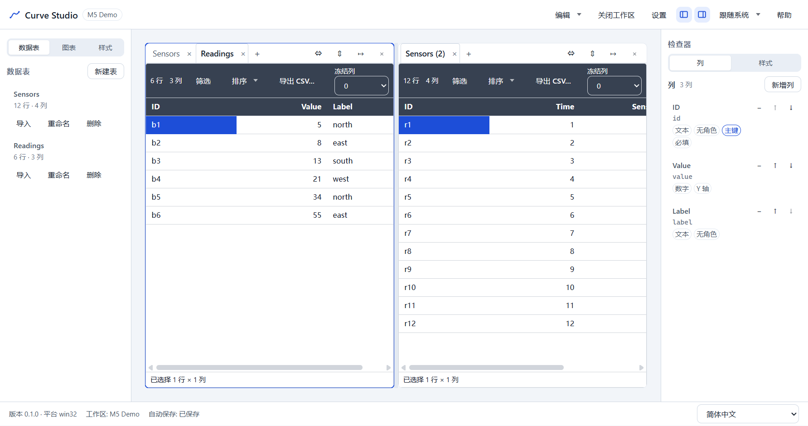
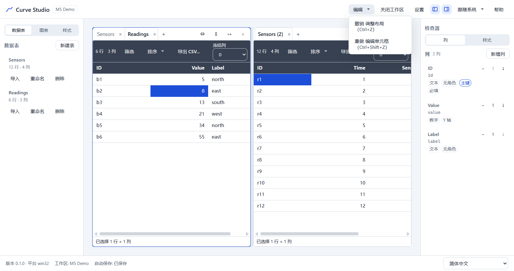
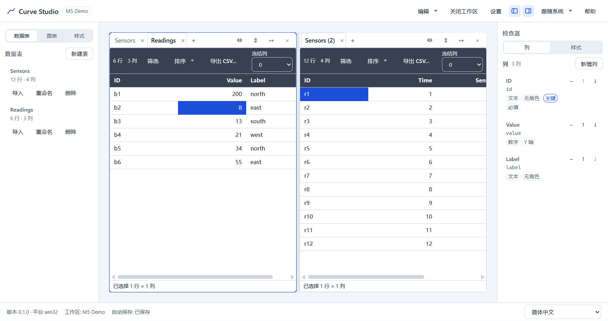
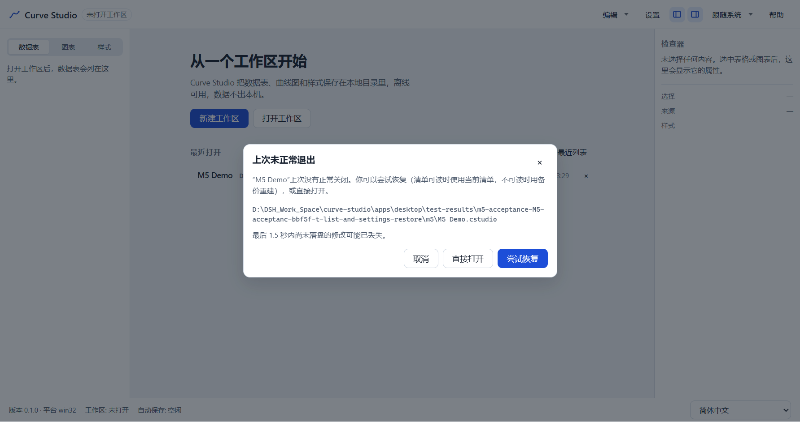
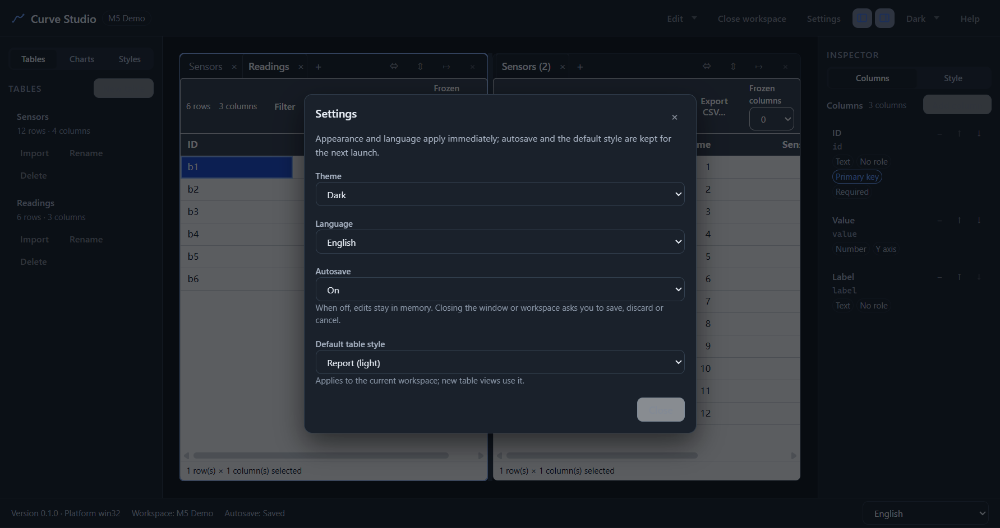
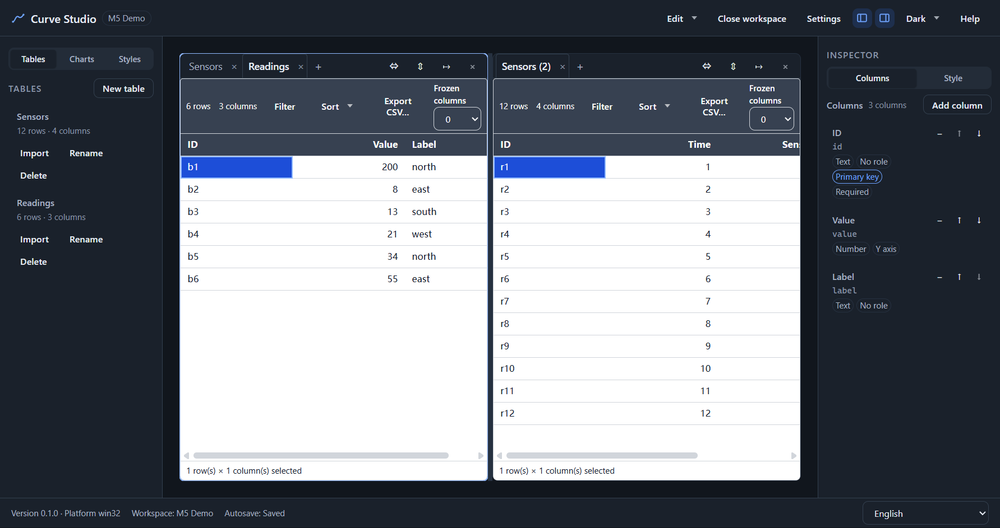

# M5 报告 — 体验验收演示

- 里程碑：M5（体验：分栏/标签、撤销/重做、自动保存/恢复、快捷键/命令面板、设置/i18n）
- 日期：2026-10-29
- 范围：T5.1–T5.5 的联合验收；单条真实 Electron 用例 `apps/desktop/e2e/m5-acceptance.spec.ts`
- 状态：**演示已执行并通过；等待用户确认接受 M5**
- 参考：TASKS M5 验收脚本、TESTPLAN E7/E8/E10、SPEC §12/§13/§16、ADR-046–050

## 1. 演示脚本与结果

一条用例、三次启动、一次强杀：

| # | 步骤 | 实测结果 |
|---|---|---|
| 1 | 通过 `window.api` seed 2 表（Sensors 12 行 × 4 列、Readings 6 行 × 3 列）与 2 个表视图；打开工作区 | 2 表、2 视图、单 pane；工作区名 `M5 Demo` |
| 2 | 真实 UI 复制当前视图 → 3 视图；水平分栏 → 2 pane；把复制视图移到下一 pane | 2 pane、3 标签；pane0 = Sensors + Readings，pane1 = Sensors (2)；Readings 为 pane0 活动标签 |
| 3 | 5 次单元格编辑（间隔 >800ms），撤销 5 次，重做 5 次 | 编辑后 `data-undo-depth` **8**（布局基线 3 + 5）；撤销 5 次回到 3，值回到 5；重做 5 次回到 8，值 105；JSONL 同步 |
| 4 | 提交值 200 并等待落盘；再编辑 999 后立即强杀主进程 | `.lock` 保留；恢复提示“最后 1.5 秒内尚未落盘的修改可能已丢失” |
| 5 | 重启 → 最近打开 → “尝试恢复” | 2 pane、3 标签与 Readings 活动标签恢复；单元格为已提交的 **200**，999 未落盘 |
| 6 | 关闭工作区 → 从最近列表重新打开（无恢复提示） | 最近列表 1 条；直接打开且布局/数据保持；无“上次未正常退出”对话框 |
| 7 | 设置 → 英文 + 深色；关闭后重启 | `html[lang=en-US]`、`data-theme=dark`、标题栏 Settings / 侧栏 Tables / 状态栏英文；重启后 2 pane、3 标签、Readings 活动、值 200 全部还原 |

## 2. 关键指标

```json
{
  "panes": 2,
  "tabs": 3,
  "baseDepth": 3,
  "editDepth": 8,
  "undoDepth": 8,
  "redoDepth": 0,
  "recoveredValue": "200",
  "discardedValueLost": true,
  "recentEntries": 1,
  "language": "en-US",
  "theme": "dark",
  "finalPanes": 2,
  "finalTabs": 3,
  "manifestTables": 2,
  "manifestViews": 3,
  "jsonlContainsCommitted": true
}
```

- 历史基线 3 = 复制视图（`view.create`）+ 分栏 + 移动标签各 1 条；5 次编辑各 1 条，未发生 800ms 合并。
- 强杀前 JSONL 含 `["b1",200,`；重启后仍含该值且不含 `999`。
- 最终 manifest：2 表、3 视图、`layout.type === "split"`；JSONL 与 manifest 均由重启后的真实读取链路验证。

## 3. 证据














## 4. 用例与运行

```text
apps/desktop/e2e/m5-acceptance.spec.ts
  1 条：layout, history, crash recovery, recent list and settings restore
  单跑：20.2s
```

- seed 只通过 `window.api` 写入 2 张表与 manifest（与 M2/M3/M4 一致）；布局、复制视图、撤销/重做、恢复、最近打开、设置全部由真实 UI 操作。
- 强杀使用 `electronApp.evaluate(() => process.pid)` 取得 main PID 后 `taskkill /F /T`，与 T5.3 的恢复用例一致。
- 断言使用真实网格文本、`data-undo-*`、`data-layout-panes`、`data-pane-active`、`data-theme`、`lang`、manifest/JSONL 与 `settings.json`；不做像素相等断言。

## 5. 验证

```text
pnpm exec playwright test --config apps/desktop/playwright.config.ts \
  apps/desktop/e2e/m5-acceptance.spec.ts
  1 passed（20.2s）

pnpm e2e
  104 passed（6.2m；含 M5 1 条 20.2s）

pnpm verify
  179 files / 1682 tests；ESLint 0；depcruise 493 modules / 2126 deps / 0 violations

coverage（T5.5）
  statements 76.86% / branches 69.64% / functions 75.55% / lines 77.01%

pnpm build
  exit 0；renderer 3,365.14 kB、CSS 77.89 kB

pnpm bench（T5.5）
  exit 0
```

## 6. 残留风险与说明

- 强杀仍可能丢最后 1.5s 的编辑；演示中 999 被丢弃且恢复对话框明确提示，符合 SPEC §13.3/§7.5。
- 恢复对话框正文包含工作区绝对路径（临时 E2E 路径）；这是既有恢复交互的行为，不是 M5 新增。
- 分栏比例未在演示中拖动；T5.1 的 `layout.spec.ts` 已覆盖 0.35 比例与键盘调整，M5 演示聚焦跨任务组合。
- 最近列表只验证 1 条（演示工作区）；移除/清空由 T5.3 的 `autosave.spec.ts` 覆盖。
- 英文/深色通过设置对话框切换；设置文件与重启读取由 T5.5 的 `settings.spec.ts` 与本次演示共同覆盖。
- 演示没有发现新的生产缺陷；仅调整了演示用例的单元格聚焦方式（多 pane 下先显式 focus 再 F2）。

## 7. 结论与停点

M5 验收脚本 7 个阶段全部通过：2 表 3 视图分 2 pane、5 步撤销/重做、强杀恢复、最近打开、英文/深色切换、重启全部还原。M5 的 T5.1–T5.5 功能在同一真实会话中组合工作。

**停点**：M5 演示已完成并输出报告；等待用户确认接受 M5。确认前不要开始 M6（插件 SDK/打包/发布）。
