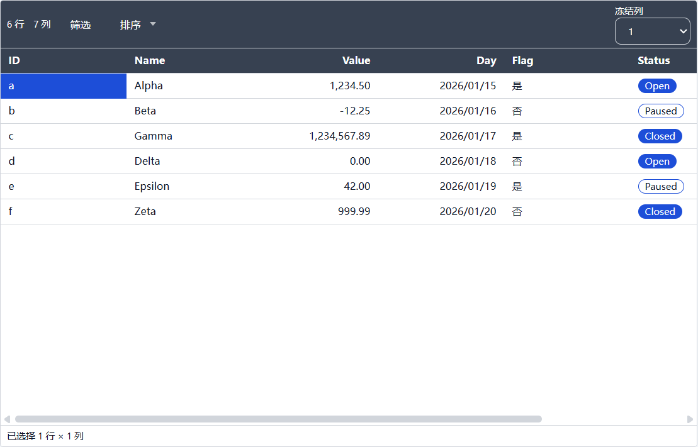
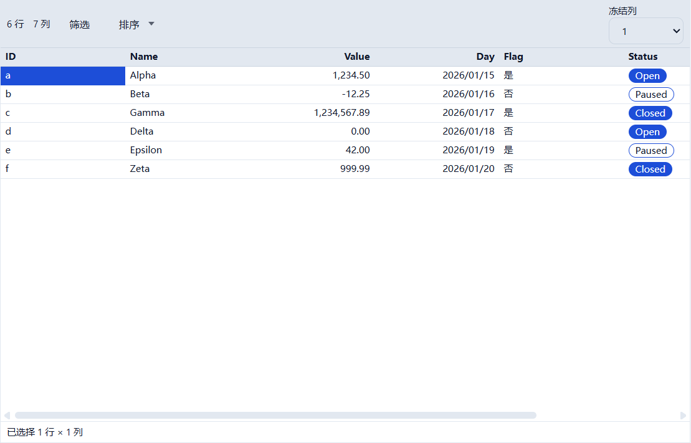
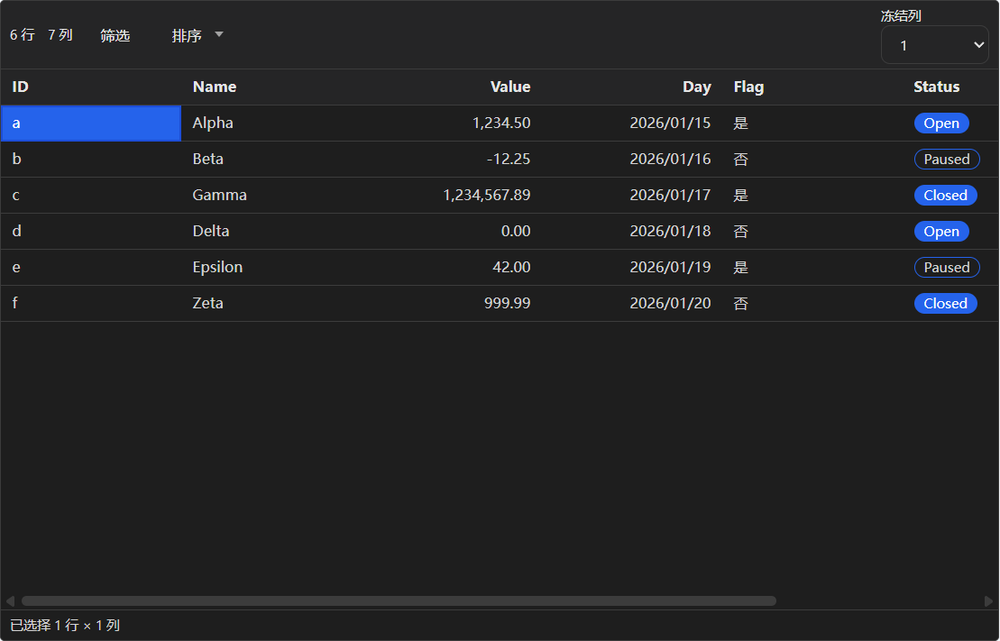
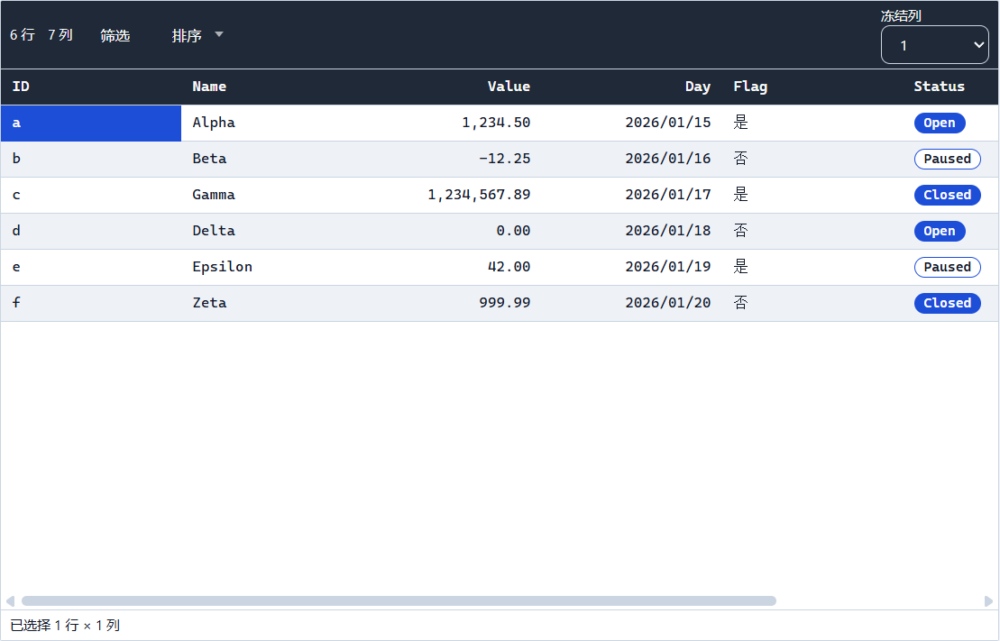
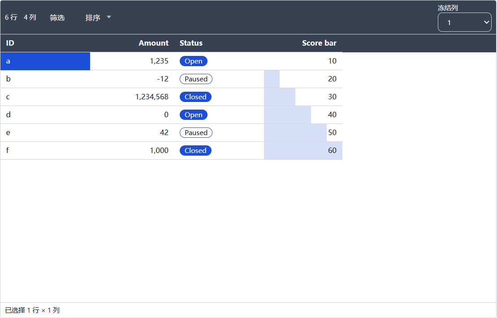

# T3.2 报告 — 样式渲染管线

- 任务：T3.2（FR-STY-02、FR-STY-03、FR-STY-07；SPEC §10.2）
- 日期：2026-10-23
- 决策：ADR-035（CSS 变量契约、行高、全局数字规则、列覆盖优先级、bar/badge、视觉验证）
- 状态：已完成；未进入 T3.3。

## 1. 目标与交付

1. `styleToCssVars(style)` + `TABLE_STYLE_CSS_VARIABLES`：TableStyle → 20 个
   `--cs-table-*`，`TableStyleProvider` 作为网格表面；
2. 密度行高、斑马纹、网格线、圆角、内边距全部由变量驱动；
3. 数字/日期/布尔/枚举格式化；数字统一 `Intl.NumberFormat` 千分位，数字/日期默认右对齐；
4. 列覆盖：对齐、宽度、标签、`cellRender`；
5. `bar`（当前可见行 min/max 归一）与 `badge`（枚举哈希到 4 个样式 tone）；
6. 四套内置模板 + 一个持久化用户样式的真实 Electron 视觉验证与截图。

## 2. 关键文件

```text
packages/ui/src/table-style.ts               # 20 个 CSS 变量、tableRowHeight、契约常量
packages/ui/src/table-style.test.ts          # 9 条变量/行高测试
packages/ui/src/TableStyleProvider.tsx       # grid <section> 表面
packages/ui/src/TableStyleProvider.test.tsx  # 3 条变量应用/重渲染测试
packages/ui/src/table-style-format.ts        # 格式化、对齐、覆盖、bar/badge、presentStyledCell
packages/ui/src/table-style-format.test.ts   # 20 条格式化/覆盖/bar/badge 测试
packages/ui/src/index.ts                     # 公开出口；新增 @curve/domain workspace 依赖
packages/ui/tsconfig.json                    # 增加 domain 项目引用
apps/desktop/src/renderer/features/workspace/WorkspaceView.tsx  # resolveStyle + 传入 grid
apps/desktop/src/renderer/features/grid/DataGrid.tsx            # 样式、行高、bar 缓存、格式化
apps/desktop/src/renderer/features/grid/GridCell.tsx            # align/render/bar/badge
apps/desktop/src/renderer/features/grid/GridHeader.tsx          # 表头对齐与样式
apps/desktop/src/renderer/features/grid/grid-sizing.ts          # 样式化 autofit
apps/desktop/src/renderer/styles.css                            # 网格/工具栏/选择栏消费变量
apps/desktop/test/ui-conventions.test.ts                        # --cs-table-* 变量契约校验
apps/desktop/src/renderer/features/grid/GridCell.test.tsx       # 7 条单元格渲染测试
apps/desktop/e2e/style.spec.ts                                  # 5 视图视觉契约 + 截图
apps/desktop/e2e/edit.spec.ts                                   # 布尔显示改为本地化“否”
docs/adr/035-t32-style-rendering.md
docs/reports/t3.2/REPORT.md
```

## 3. 公开 API

```ts
TABLE_STYLE_CSS_VARIABLES
TableStyleCssVariable
TableStyleCssVars
styleToCssVars(style: TableStyle): TableStyleCssVars
tableRowHeight(tokens: TableStyleTokens): number
TableStyleProvider({ tableStyle, ...sectionProps })
formatStyledCellValue(value, column, style, options?): string
resolveCellAlign(column, style): 'left' | 'center' | 'right'
resolveCellRender(column, style): 'text' | 'badge' | 'bar'
columnDisplayLabel(column, style): string
computeBarRanges(rows, columns, style): Record<string, BarRange>
barRatioForValue(value, range): number | null
enumBadgeTone(value): 0 | 1 | 2 | 3
presentStyledCell(value, column, style, barRanges, options?): StyledCellPresentation
```

`formatStyledCellValue` 只做显示，不写回模型；`ColumnStyleOverride` 的 label/width/align/
numberFormat/dateFormat/cellRender 全部在此层生效。`ColumnDef` 与 manifest 字节不变。

## 4. CSS 变量契约（20 个）

| 变量 | 来源 |
|---|---|
| `--cs-table-font-family` / `--cs-table-font-size` | `tokens.fontFamily` / `fontSize` |
| `--cs-table-row-height` | `tableRowHeight(tokens)` |
| `--cs-table-cell-padding-x` / `--cs-table-cell-padding-y` | `cellPaddingX` / `cellPaddingY` |
| `--cs-table-radius` | `radius` |
| `--cs-table-header-bg` / `-fg` / `-border` / `-weight` | `header.*` |
| `--cs-table-body-bg` / `-alt-bg` / `-fg` / `-border` | `body.*` |
| `--cs-table-selection-bg` / `-fg` | `selection.*` |
| `--cs-table-row-bg` / `--cs-table-row-alt-bg` | `body.background` / `zebra ? alternateBackground : background` |
| `--cs-table-grid-row-border` / `-column-border` | `grid` 模式 → 0/1px |

工具栏将应用控件的 `--cs-color-fg-*`/`--cs-color-bg-*`/`--cs-color-border-*` 局部映射到表头
令牌；单元格/表头/选择栏不使用任何内联颜色字面量。

## 5. 格式化与列覆盖

- **数字**：`Intl.NumberFormat` + 千分位；小数位 = 覆盖 `digits` → 列 `precision` → 原始精度
  （最多 20 位）；`decimal/percent/currency`；无效 currency 回退 decimal。
- **日期**：`date/date-time/time/iso`，locale 来自 i18n；默认 `date`。
- **布尔**：zh-CN 是/否，en-US Yes/No（消息表）。
- **枚举**：`enumOptions.label`；`auto` → badge。
- **对齐**：number/date 默认 right，其他 left；覆盖可改。
- **宽度**：`view.widths` > 覆盖 `width` > `ColumnDef.width` > 160。
- **标签**：只影响表头/排序菜单/无障碍文本，不写回 `ColumnDef`。
- **bar**：仅 number；当前可见行 min/max；全等值 0 宽；比例夹在 0..1。
- **badge**：仅 enum；FNV-1a 哈希到 4 个 tone，复用样式自身 header/selection/alternate/body 令牌。

## 6. 验证命令与结果（2026-10-23 本机）

```text
pnpm verify
  128 files / 1037 tests passed；ESLint 0；
  depcruise 355 modules / 1363 deps / 0 violations

pnpm test:coverage
  lines 75.39% / statements 75.29% / branches 67.97% / functions 76.37%
  table-style.ts lines 100% / branches 87.5%；TableStyleProvider.tsx 100%；
  table-style-format.ts lines 95.83% / branches 92.55%
  阈值 70/60 未下调

pnpm format:check
  通过

pnpm build
  exit 0；renderer 1,431.97 kB + ImportSession 42.82 kB；
  CSS 49.87 kB；table/query/import worker 220.13/233.15/269.61 kB

pnpm e2e
  65 passed；style.spec.ts 1 passed

pnpm bench
  exit 0；open 572ms/3s、save 358ms/500ms、edit 0ms/50ms、
  query 216ms/400ms、text-sort 287ms/400ms、cjk-sort 648ms/800ms、
  import 945ms/8s；clone 345ms（诊断）
```

## 7. 验收逐项

| # | 验收项 | 结果 |
|---|---|---|
| 1 | 令牌改动即时反映，无内联硬编码颜色 | ✅ `TableStyleProvider` 重渲染测试切换 dark→compact；`ui-conventions` 颜色字面量门禁通过；网格 CSS 只消费 `--cs-table-*` |
| 2 | 列覆盖不影响 schema 与其他视图 | ✅ 单测断言 column/style 不变；`style.spec.ts` 用户样式改 label/width/numberFormat/bar，切回内置视图恢复 `Score`/`10` |
| 3 | 数字/日期在 zh-CN/en-US 下格式正确 | ✅ `formatStyledCellValue` 单测覆盖 zh-CN/en-US 日期与数字、percent/currency；E2E 断言 zh-CN `1,234.50`/`2026/01/15`/`是` |
| 4 | 视觉快照通过（浅色/深色/紧凑/财务） | ✅ E2E 计算样式契约 + 5 张网格截图（report-light/compact-light/dark/finance/bars）；不提交易碎 PNG 像素基线（ADR-035） |

## 8. 视觉证据











## 9. 残留风险

- 所有模板的数字都带千分位、布尔显示“是/否”，与 T2.x 的纯 `String` 显示不同；这是用户确认的
  全局数字规则与本地化结果，不改变磁盘数据。
- 行高仍为统一值；极端字体/超大内边距会按公式增高，但不做逐行测量。
- badge 的 4 个 tone 复用样式令牌，样式颜色非常接近时 chip 区分度有限；不新增调色板模型。
- 未提交 PNG 像素基线；视觉验收依赖计算样式契约 + 截图证据，跨 DPI 不误报。
- `builtin.finance` 的右对齐/千分位由全局规则提供，不是模板专属字段；若未来要求按模板关闭，
  需扩展模型并写新 ADR。
- T3.3 条件格式必须复用 `presentStyledCell`/`GridCell` 渲染路径，不能另起样式逻辑。
