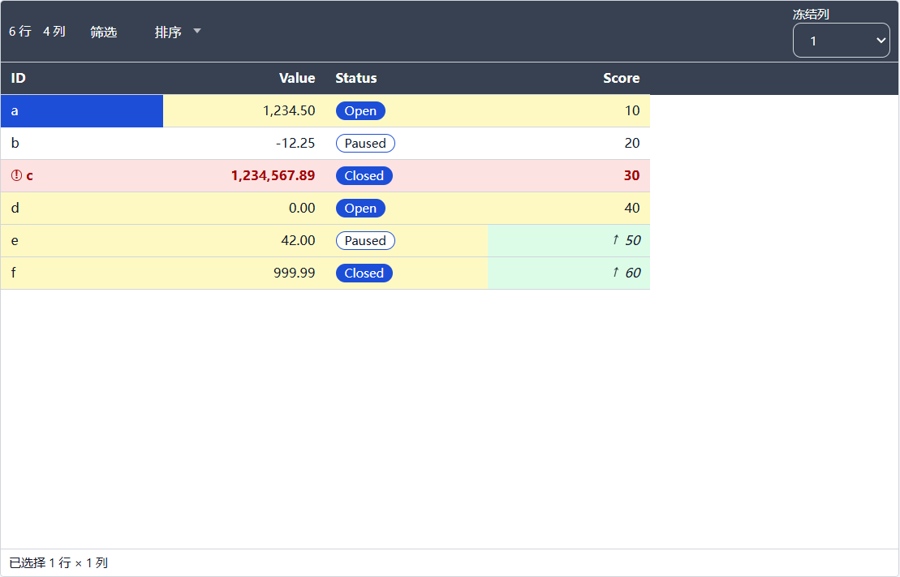

# T3.3 报告 — 条件格式引擎

- 任务：T3.3（FR-STY-04；SPEC §10.4）
- 日期：2026-10-24
- 决策：ADR-036（求值器归属、比较语义、样式优先级、撤销与性能口径）
- 状态：已完成；未进入 T3.4。

## 1. 目标与交付

1. `@curve/domain` 的纯函数条件引擎：`createConditionalFormat`/`evaluateRules`，行与单元格目标，
   数组顺序首条命中，禁用规则跳过，缺失列忽略。
2. 12 种比较语义：text 7 种、number/date 10 种（含条件模式的 `contains`）、boolean/enum 4 种；
   `between` 含边界且接受交换边界；空值与类型不匹配返回 `false`，不抛异常。
3. 比较原语下沉 domain，`@curve/table-engine` 的查询/排序复用同一实现，过滤器行为不变。
4. `style.update` 命令（manifest-only、`sty_` 用户样式、规则 id 唯一）与 workspace 作用域撤销；
   `SaveQueue.enqueueManifest` 串行保存，失败可重试。
5. `conditionalCellStyle` + `GridCell`/`DataGrid` 接线：背景/前景/粗体/斜体/icon、优先级、
   bar 抑制、行 icon 首列；只对虚拟化可见行求值。
6. 50 规则 × 100 行 ≤16ms 的 domain 单测与 bench 硬门禁；E2E 条件规则视图与 200% 缩放冒烟。

## 2. 关键文件

```text
packages/domain/src/predicate.ts               # 共享比较原语、conditionCompareOps、prepare/match
packages/domain/src/predicate.test.ts          # 6 条
packages/domain/src/condition.ts               # createConditionalFormat/evaluateRules
packages/domain/src/condition.test.ts          # 66 条（操作符/目标/缺失列/性能）
packages/domain/src/index.ts                   # 导出 condition/predicate
packages/table-engine/src/query.ts             # QueryContext/缓存保留，matchesCompare 复用 domain
packages/table-engine/src/query.test.ts        # 过滤白名单守卫（number contains 仍不匹配）
packages/app-core/src/commands/styles.ts       # style.update 命令
packages/app-core/src/commands/styles.test.ts  # 3 条
packages/app-core/src/history/edit-history.ts  # workspace 作用域条目 + onWorkspaceChanged
packages/app-core/src/history/edit-history.test.ts
packages/app-core/src/usecases/save-queue.ts   # enqueueManifest / manifest-only 串行写
packages/app-core/src/usecases/save-queue.test.ts
packages/app-core/src/usecases/workspace-actions.ts  # updateTableStyle + ActionOutcome.committed
packages/app-core/src/app-core.ts              # 命令注册、manifest 保存集合、历史钩子
packages/ui/src/table-style-format.ts          # conditionalCellStyle
packages/ui/src/table-style-format.test.ts     # +3 条
apps/desktop/src/renderer/features/grid/GridCell.tsx       # 条件样式/icon/优先级
apps/desktop/src/renderer/features/grid/GridCell.test.tsx  # +3 条
apps/desktop/src/renderer/features/grid/DataGrid.tsx       # 准备/逐可见行求值/行 icon
apps/desktop/src/renderer/styles.css                       # .cs-grid__rule-icon
apps/desktop/src/renderer/i18n/messages/{zh-CN,en-US}.ts   # grid.ruleIcon.*
apps/desktop/e2e/style.spec.ts                 # 条件规则视图 + 200% 缩放
scripts/bench.ts                               # condition.rules.50x100（16ms）
docs/adr/036-t33-conditional-format.md
docs/reports/t3.3/REPORT.md
```

## 3. 公开 API

```ts
// @curve/domain
type CompareMode = 'filter' | 'condition'
DEFAULT_COMPARE_LOCALE
allowedCompareOps(column)
conditionCompareOps(column)
compareOpNeedsValue(op) / compareOpNeedsSecondValue(op)
interface PreparedComparison
prepareComparison(column, predicate, { locale?, mode? })
matchesPreparedComparison(cell, prepared)

interface ConditionalRuleMatch { rule; target: 'row' | 'cell'; columnId: string | null }
interface RowConditionalFormat { rowRule; cellRule(columnId) }
interface ConditionalFormat { evaluateRules(row); evaluateRow(row) }
createConditionalFormat(rules, columns, { locale? })
evaluateRules(rules, row, columns, { locale? })
```

```ts
// @curve/ui
type ConditionalIcon = 'up' | 'down' | 'warning'
interface ConditionalCellStyle { ruleId; label?; background?; foreground?; bold?; italic?; icon? }
conditionalCellStyle(match, { includeIcon? })
```

```ts
// @curve/app-core
createStyleUpdateCommand(options?)
StyleUpdatePayload { style }
WorkspaceActions.updateTableStyle(style): Promise<ActionOutcome>
SaveQueue.enqueueManifest(): void
ActionOutcome 增加可选 committed
```

## 4. 语义与优先级

| 类型 | 条件规则可用操作符 |
|---|---|
| text | `eq/neq/contains/startsWith/endsWith/isNull/notNull`，大小写不敏感 |
| number/date | `eq/neq/gt/gte/lt/lte/between/contains/isNull/notNull`；`contains` 仅条件模式 |
| boolean/enum | `eq/neq/isNull/notNull` |

- 首条命中，不叠加；行目标覆盖整行，单元格目标只覆盖目标列；混合目标取数组下标较小者。
- 缺失列：谓词分支忽略，全部分支缺失则规则永不命中；单元格目标列缺失则规则不适用。
- `between` 含边界、可交换；`isNull` 匹配 `null` 与 text `""`；空值/类型错误不抛。
- 渲染优先级：错误/冲突/粘贴错误 > 选中 > 条件规则 > bar > 斑马纹/基础；条件背景覆盖 bar；
  行目标 icon 只画在首个可见列。
- 条件样式只影响显示，不改变 manifest/JSONL 字节。

## 5. 验证命令与结果（2026-10-24 本机）

```text
pnpm verify
  131 files / 1123 tests passed；ESLint 0；
  depcruise 361 modules / 1390 deps / 0 violations

pnpm test:coverage
  lines 75.82% / statements 75.70% / branches 68.74% / functions 76.68%
  threshold 70/60 未下调

pnpm format:check
  通过

pnpm build
  exit 0；renderer 1,446.60 kB + ImportSession 42.82 kB；
  CSS 50.21 kB；table/query/import worker 220.53/236.02/270.01 kB

pnpm e2e
  65 passed；style.spec.ts 1 passed（含条件规则 + 200% 缩放）

pnpm bench
  exit 0；open 548ms/3s、save 327ms/500ms、edit 0ms/50ms、
  query 224ms/400ms、text-sort 302ms/400ms、cjk-sort 581ms/800ms、
  import 913ms/8s、condition.rules.50x100 P50 1ms / P95 1ms/16ms；
  clone 309ms（诊断）
```

E2E 预算：冷启动 1,123ms/2.5s、100k 打开 764ms/3s、整应用 private 565MB/600MB。

## 6. 验收逐项

| # | 验收项 | 结果 |
|---|---|---|
| 1 | 所有操作符正反例；`between` 含边界 | ✅ `condition.test.ts` 覆盖 text/number/date/boolean/enum 的全部适用操作符、边界与交换边界、`isNull`/`notNull` |
| 2 | 首条命中；50 规则 × 100 行 ≤16ms | ✅ 首条/混合目标/禁用测试；domain best-of-3 与 bench `condition.rules.50x100` P95 **1ms**/16ms |
| 3 | 空值/类型不匹配不抛异常 | ✅ null、空 text、错误 value/value2 类型、不支持操作符均返回 false；单测覆盖 |
| 4 | 规则编辑可撤销 | ✅ `style.update` → 历史 → undo 恢复规则；`workspace-actions` 集成测试断言 manifest 落盘，`edit-history` 断言 workspace 钩子 |

## 7. 视觉证据

条件规则视图（`sty_rules`）：行 3 命中“高温”红色 + 警告 icon；其余非负行为黄色 fallback；
Score 50/60 命中单元格绿色 + 上升 icon；首行首列是选中态（选中优先于条件背景）。



## 8. 残留风险

- number/date 的 `contains` 比较 `String(value)`（日期是 epoch 字符串），不是用户看到的显示文本；
  如需按显示格式匹配需新 ADR。
- 条件样式只应用首条命中，不支持多规则叠加；渲染层不做对比度自动校正。
- 条件背景覆盖 bar；若产品希望“背景 + 条”并存，需要新的视觉规则。
- `style.update` 的 manifest 写入是异步的；撤销/重做后由保存队列落盘，与 T2.2 的最小历史语义一致。
- T3.4 必须使用 `conditionCompareOps` 构建条件规则操作符列表，并复用 `style.update`，
  不得在组件里另写求值或写盘逻辑。
- 16ms 是纯求值预算；DOM 应用不计入，样式预览的 100ms 仍由 T3.4 的组件/E2E 覆盖。
