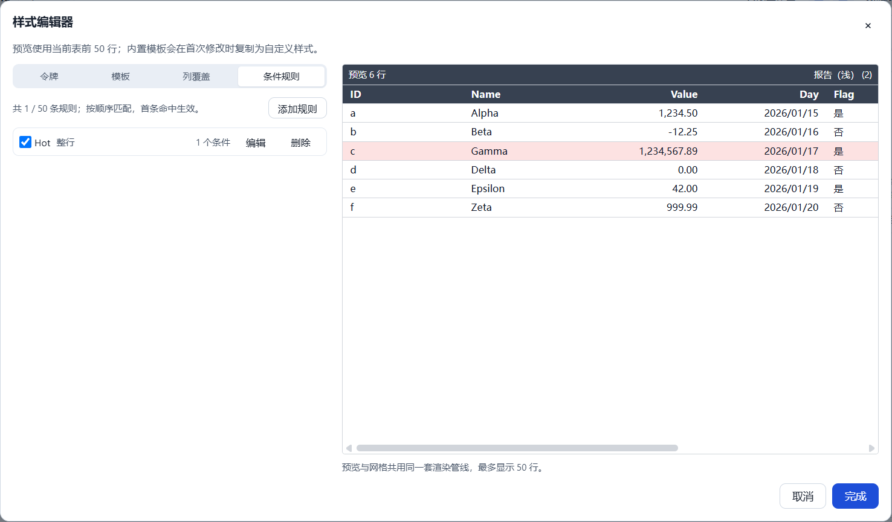
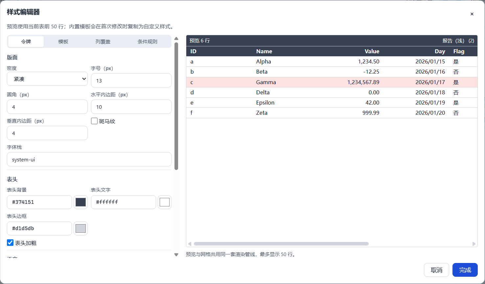

# T3.4 报告 — 样式编辑器与实时预览

- 任务：T3.4（FR-STY-02、FR-STY-04；SPEC §10.6）
- 日期：2026-10-24
- 决策：ADR-037（检查器入口 + 宽对话框、懒 fork 与 `style.create`、本地草稿/提交粒度、
  50 行预览、两层规则构建器）
- 状态：已完成（代码提交 `57f1bb2`）；未进入 T3.5。

## 1. 目标与交付

1. 检查器新增“列 / 样式”标签；样式标签显示模板、密度、规则/覆盖数量、回退警告并打开编辑器。
2. 样式编辑器四组：令牌、模板、列覆盖、条件规则；支持颜色文本/取色器、数值、下拉、
   复选框与内联错误。
3. 编辑内置模板时本地 fork；第一次提交用 `style.create` 原子创建 `sty_` 副本并指向当前视图；
   后续提交走 `style.update`。取消不产生副本。
4. 文本/数字/颜色合法输入即时预览、失焦/Enter 提交；下拉/复选框/规则保存各一条撤销。
5. 条件规则构建器支持 all/any 最多两层，操作符用 `conditionCompareOps`，非法/缺失列/超深
   谓词不静默改写。
6. 前 50 行预览复用真实渲染管线；纯键盘可完成“改密度 + 加一条规则”；200% 缩放可用。

## 2. 关键文件

```text
packages/app-core/src/commands/styles.ts                  # style.create + style.update
packages/app-core/src/commands/styles.test.ts             # 6 条（含 create）
packages/app-core/src/validation/condition-builder.ts     # 规则草稿 ↔ 谓词、两层 all/any
packages/app-core/src/validation/condition-builder.test.ts# 7 条
packages/app-core/src/app-core.ts                         # 注册 style.create + manifest 保存集合
packages/app-core/src/history/edit-history.ts             # style.create 进入 workspace 历史
packages/app-core/src/history/edit-history.test.ts        # 10 条（新增 create 撤销）
packages/app-core/src/usecases/workspace-actions.ts       # createTableStyle action
packages/app-core/src/usecases/workspace-actions.test.ts  # 14 条（新增 create/apply）
packages/app-core/src/index.ts                            # 导出 condition-builder
apps/desktop/src/renderer/features/style/
├─ StylePanel.tsx             # 检查器样式摘要/入口
├─ StyleEditorDialog.tsx      # 草稿、提交队列、模板/预览、四组标签
├─ StylePreview.tsx           # 物理前 50 行 + 真实 GridCell 渲染
├─ StyleTokensTab.tsx         # 字体/颜色/密度/网格/圆角/内边距
├─ StyleColumnsTab.tsx        # 列 label/width/align/render/number/date 覆盖
├─ StyleRulesTab.tsx          # 规则列表 + 两层条件构建器 + 样式
├─ StyleFieldControls.tsx     # 文本/数字/颜色/复选框字段
├─ style-text.ts              # 内置名称/密度/网格本地化
└─ StyleEditorDialog.test.tsx # 5 条组件测试
apps/desktop/src/renderer/features/grid/GridCell.tsx      # 预览 test-id 前缀
apps/desktop/src/renderer/shell/Inspector.tsx             # 列/样式标签
apps/desktop/src/renderer/styles.css                      # 编辑器/预览/列覆盖/规则样式
apps/desktop/src/renderer/i18n/messages/{zh-CN,en-US}.ts  # 样式编辑器文案
apps/desktop/e2e/style.spec.ts                            # T3.4 键盘/撤销/预览/200% 流程
docs/adr/037-t34-style-editor.md
docs/reports/t3.4/REPORT.md
```

## 3. 公开 API 与命令

```ts
// @curve/app-core
createStyleCreateCommand(options?): CommandDefinition<StyleCreatePayload>
StyleCreatePayload { style: TableStyle; viewId?: string }

WorkspaceActions.createTableStyle(
  style: TableStyle,
  viewId?: string,
): Promise<ActionOutcome<{ styleId: string }>>

// 规则构建器（表单层）
MAX_CONDITIONAL_GROUPS = 2
ConditionGroupMode / ConditionalConditionDraft / ConditionalGroupDraft
ConditionalPredicateDraft / ConditionalPredicateIssue
BuildConditionalPredicateResult
defaultConditionalOperator(column)
defaultConditionalValue(column)
createConditionDraft(table, columnId?)
createConditionalPredicateDraft(table)
conditionPredicateFromRule(when, table)
buildConditionalPredicate(table, draft)
```

- `style.create` 只接受新的 `sty_`、非内置样式；`viewId` 可选，且必须是现有表视图。
- 两个样式命令都只写 `state.tableStyles`/`state.views[].tableView.styleId` 与 workspace
  `updatedAt`，不写表 JSONL；保存走 `SaveQueue.enqueueManifest`。
- `EditHistory` 将 `style.create`/`style.update` 记为 workspace 作用域；undo/redo 只入队
  manifest，不标记脏表。
- `conditionPredicateFromRule` 对超过两层、缺失列或不支持操作符返回 `null`，UI 置为只读。

## 4. 交互与撤销语义

| 控件 | 草稿更新 | 命令提交 | 撤销粒度 |
|---|---|---|---|
| 文本/数字/颜色 | 每次合法输入 | 失焦或 Enter | 一次控件提交 |
| 下拉/复选框 | 选择时 | 立即 | 一次交互 |
| 规则保存 | 表单本地 | 点击“保存规则” | 一条规则 |
| 规则启用/删除 | 列表 | 立即 | 一次交互 |
| 模板选择（仅内置） | 仅替换草稿 | 不单独提交 | 首次后续控件提交时随 `style.create` |

- 首次编辑内置模板：`style.create` 一条历史；后续控件：`style.update` 各一条。
- 提交前 `tableStyleSchema.safeParse`；字段错误（含非法 hex、越界数值、必填货币代码）显示
  `role="alert"` 并禁用“完成”。文本非法时保留最后一个合法草稿，不提交。
- 相同草稿的重复提交由序列化签名去重；提交队列串行，避免 create/update 竞态。
- 规则表单值用 `coerceCell` 归一；`between` 第二值、enum/boolean 选择、number/date
  `contains` 都由 `conditionCompareOps` 决定可用操作符。
- 改密度会同步 SPEC §10.2 的标准垂直内边距（4/7/10），保证“紧凑”行高符合预期。

## 5. 预览

- 数据：当前表**物理前 50 行**；列顺序、隐藏列与宽度取当前视图。
- 管线：`TableStyleProvider` + `GridCell` + `presentStyledCell` + `createConditionalFormat`
  + `computeBarRanges`，与主网格共享格式化/条件/bar/badge/CSS 变量。
- 不挂载 DataGrid 的编辑器、筛选/排序工具条、选择层、查询 Worker 或虚拟滚动。
- 预览单元 test id 为 `preview-cell-<row>-<col>`，不与主网格 `grid-cell-*` 冲突。
- `data-preview-ms` 记录本地草稿变更到布局阶段完成的时间；T3.4 E2E 实测 **3ms**（预算
  100ms）。该指标仅用于测试/报告，不是新增 bench 门禁。

## 6. 验证命令与结果（2026-10-24 本机）

```text
pnpm verify
  133 files / 1140 tests passed；ESLint 0；
  depcruise 372 modules / 1461 deps / 0 violations

pnpm test:coverage
  lines 74.70% / statements 74.59% / branches 67.35% / functions 72.97%
  threshold 70/60 未下调

pnpm format:check
  通过（最终检查）

pnpm build
  exit 0；renderer 1,545.42 kB + ImportSession 42.82 kB；
  CSS 59.59 kB；table/query/import worker 220.53/236.02/270.01 kB

pnpm e2e
  66 passed；style.spec.ts 2 passed（含 T3.4 键盘/撤销/200% 流程）

pnpm bench
  exit 0；table.open 504ms/3s、save 340ms/500ms、edit 0ms/50ms、
  query 192ms/400ms、text-sort 234ms/400ms、cjk-sort 598ms/800ms、
  import 873ms/8s、condition.rules.50x100 P95 1ms/16ms；
  clone 304ms（诊断）
```

E2E 预算：冷启动 1,083ms/2.5s、100k 打开 654ms/3s、整应用 private 内存峰值 566MB/600MB。
T3.4 预览自测：**3ms/100ms**；200% 缩放与纯键盘流程在同一 spec 通过。

## 7. 验收逐项

| # | 验收项 | 结果 |
|---|---|---|
| 1 | 改任意令牌 100ms 内预览更新 | ✅ 编辑器本地草稿即时更新；E2E `data-preview-ms` **3ms**；组件测试覆盖密度/字号与行高变化 |
| 2 | 非法输入不提交且提示明确 | ✅ 非法 hex/数值/货币代码内联 `role="alert"` + 禁用完成；组件测试断言非法颜色不调用 `style.update`；规则值非法不保存并显示 issue |
| 3 | 一次控件提交 = 一条撤销记录 | ✅ 文本失焦、下拉/复选框、规则保存各一条；E2E 首次 `style.create` 后改字号，关闭编辑器 Ctrl+Z 只回滚字号（密度保持 compact），manifest 同步断言 |
| 4 | 纯键盘可完成“改密度 + 加一条规则” | ✅ E2E 用 Tab/Enter/Home/方向键/键入完成改密度、加规则、设置条件与背景并保存；200% 缩放仍可操作 |

## 8. 视觉证据

T3.4 样式编辑器（条件规则 + 预览；Gamma 行命中“Hot”）：



令牌组（紧凑密度、行高调整后的实时预览）：



截图由 `e2e/style.spec.ts` 在真实 Electron 中生成并 attach；像素不稳定，断言不依赖截图。

## 9. 残留风险

- T3.4 不做模板另存/重命名/复制/删除/设为默认/导入导出；这些是 T3.5，不可在本任务顺手实现。
- 预览只取物理前 50 行，不反映筛选后的行集；如需筛选预览，需更新 SPEC/ADR 与 E2E。
- 规则构建器最多 2 个条件组；超过两层、缺失列或含不支持操作符的已有规则只读。T3.5 导入
  复杂模板时不能在本任务中改写。
- 规则列表不能拖拽排序，新规则追加末尾；首条命中顺序仍由数组顺序保证。
- 改密度会覆盖 `cellPaddingY` 为 SPEC 预设；用户自定义的垂直内边距不会被保留为“密度预设”。
- 颜色仍只接受 hex，不支持 `transparent`/CSS 变量/颜色关键字（ADR-034）。
- 文本输入后直接 Esc 会丢弃尚未提交的本地值；这是“取消即丢弃”的一致语义。
- `pnpm bench` 的 `memoryPeakMB`（约 855MB）是 Node 管线趋势，不是应用内存门禁；600MB 只由
  `perf.spec.ts` 的整应用 `privateBytes` 判定（本次 566MB）。
- 覆盖率降至 lines 74.70%（新增 UI 主要由 E2E 覆盖），仍高于 70/60 阈值；T3.5 不额外增加
  编辑器 UI 时应继续复用本任务的组件测试。
