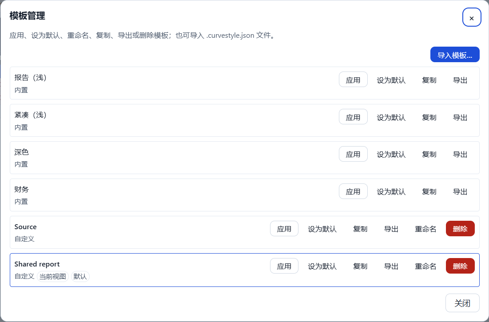
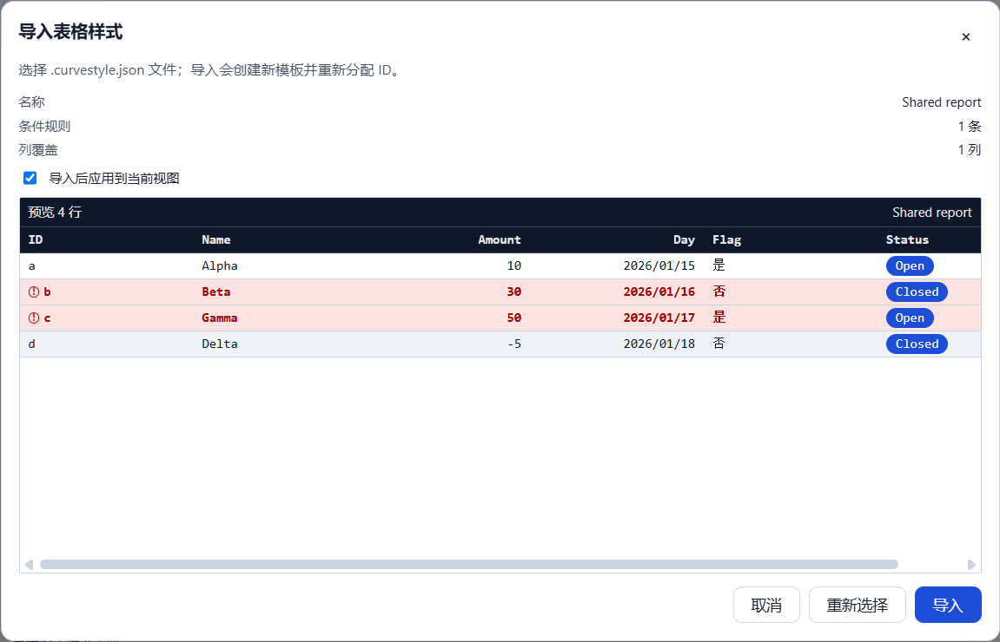

# T3.5 报告 — 模板管理与导入导出

- 任务：T3.5（FR-STY-05、FR-STY-06；SPEC §10.5）
- 日期：2026-10-24
- 决策：ADR-038（命令面、删除可撤销、导入导出通道、身份重分配、模板管理 UI）
- 状态：已完成（代码提交 `95f37f5`）；未进入 T3.6 / M3 验收。

## 1. 目标与交付

1. 模板管理：另存为、重命名、复制、删除、设为默认、应用当前视图。
2. `.curvestyle.json` 导出（`kind/version/exportedAt/style`）与导入（Zod 校验、身份重分配、
   名称冲突 ` (2)`、前 50 行预览、可选应用）。
3. 删除被引用模板：同一命令内所有视图回退工作区默认（默认被删则 `builtin.report-light`），
   UI 确认框列出受影响视图，成功后显示回退结果。
4. 模板操作全部走命令总线：`style.create`/`style.update` 复用，新增 `style.delete`/`style.apply`
   与 `duplicateTableStyle` action；manifest-only、workspace 作用域历史、一次操作一条撤销。
5. 不新增 IPC/preload 通道、运行时依赖，不改变 `formatVersion`/manifest 字段/JSONL。

## 2. 关键文件

```text
packages/domain/src/style-export.ts (+style-export.test.ts)   # 导出文档 schema/解析/序列化
packages/domain/src/table-style.ts                            # clone/reassign/名称辅助
packages/domain/src/index.ts
packages/app-core/src/commands/styles.ts (+styles.test.ts)    # style.delete/style.apply
packages/app-core/src/validation/style-import.ts (+test)      # 导入校验、列引用、缺失列
packages/app-core/src/{app-core.ts,history/edit-history.ts}   # 注册、manifest 保存、workspace 历史
packages/app-core/src/usecases/workspace-actions.ts (+test)   # delete/apply/duplicate actions
packages/app-core/src/index.ts
apps/desktop/src/renderer/features/style/
├─ TemplateManagerDialog.tsx (+test)   # 列表、应用/默认/重命名/复制/导出/删除/导入入口
├─ TemplateImportDialog.tsx (+test)    # 导入预览（真实前 50 行）、缺失列、应用选项
├─ style-transfer.ts (+test)           # 文件名/UTF-8 BOM 解码
├─ StylePanel.tsx                      # 入口、对话框状态、IPC 与 action 接线
├─ StyleEditorDialog.tsx (+test)       # “另存为模板”与继续编辑副本
└─ styles.css / i18n/messages/*        # 管理器与导入样式、中文/英文案
apps/desktop/e2e/template.spec.ts      # 2 条 T3.5 流程
apps/desktop/e2e/fixtures.ts           # launchCurveApp 可选 saveFile（仅测试）
docs/adr/038-t35-template-management.md
docs/reports/t3.5/REPORT.md + 2 张截图
```

## 3. 公开 API 与命令

```ts
// @curve/domain
STYLE_EXPORT_KIND = 'curve-table-style'; STYLE_EXPORT_VERSION = 1
MAX_STYLE_EXPORT_LENGTH = 2_000_000
StyleExportDocument { kind; version; exportedAt; style }
styleExportDocumentSchema
createStyleExportDocument(style, { now? }): StyleExportDocument
serializeStyleExportDocument(document): string
parseStyleExportDocument(text): { ok: true; document } | { ok: false; reason; detail? }
cloneTableStyle(style): TableStyle
reassignStyleIdentity(style, { name?, uuid? }): TableStyle
styleCopyName(base, existingNames): string
resolveStyleName(base, existingNames): string

// @curve/app-core
createStyleDeleteCommand(options?): CommandDefinition<{ styleId }>
createStyleApplyCommand(options?): CommandDefinition<{ styleId, target }>
StyleApplyTarget = { kind: 'view'; viewId } | { kind: 'default' }
styleFallbackId(state, deletedStyleId): string
prepareStyleImport(text, { existingNames, uuid? }): PrepareStyleImportResult
collectStyleColumnIds(style): string[]
missingStyleColumns(style, table): string[]

WorkspaceActions.deleteTableStyle(styleId):
  Promise<ActionOutcome<{ fallbackStyleId; affectedViewIds }>>
WorkspaceActions.applyTableStyle(styleId, target): Promise<ActionOutcome>
WorkspaceActions.duplicateTableStyle(styleId):
  Promise<ActionOutcome<{ styleId; name }>>
```

| 命令 | 载荷 | 语义 |
|---|---|---|
| `style.delete` | `{ styleId }` | 仅 `sty_`；移除样式、回退所有引用视图与工作区默认、更新 `updatedAt`；可撤销 |
| `style.apply` | `{ styleId, target }` | `view` 改一个表视图的 `styleId`；`default` 改 `settings.defaultTableStyleId`；只写 manifest |

`style.create`/`style.update` 保持不变：另存为/复制/导入落库用 `style.create`，重命名用
`style.update`。两个新命令与旧样式命令都加入 `MANIFEST_SAVING_COMMANDS` 与
`EditHistory` 的 workspace 作用域集合。

## 4. 语义与交互

- **导出**：领域层深拷贝快照 + ISO `exportedAt`；序列化为 2 空格缩进 + 结尾换行的 JSON；
  保存对话框由已有 `file:exportText` 提供，建议文件名 `<name>.curvestyle.json`。
- **导入**：`file:importText`（filters `json`）→ UTF-8/BOM 解码 → `parseStyleExportDocument`
  → `reassignStyleIdentity`（新 `sty_`、`builtin:false`、每条规则新 `rule_`）→ 前 50 行预览
  → 可选“应用到当前视图”→ 一条 `style.create`。失败按 `json/tooLarge/version/document`
  给具体文案，不 dispatch、不写 manifest、不归档到 `imports/`。
- **名称**：导入保留原名，冲突按 ` (2)`/` (3)` 递增；复制/另存为总是副本名；重命名遇到空名/
  >80 字符/重名（含内置模板规范名与本地化名）内联报错，不静默改名。
- **删除**：确认框列出受影响视图标题与回退模板；命令在同一 Immer 事务内回退视图、重置默认、
  删除样式。按 SPEC §13.1 可撤销（TASKS 原文“删除除外”与 SPEC 冲突，ADR-038 记录以 SPEC 为准）；
  成功后在管理对话框内显示“已删除…N 个视图回退到…”。
- **跨表列引用**：原样保留；导入预览列出当前表不存在的列并提示“将被忽略”，求值侧沿用
  ADR-036 的忽略语义。
- **UI**：检查器“样式”面板新增“模板管理…”；管理对话框内完成应用/默认/重命名/复制/导出/删除/
  导入入口；编辑器“模板”标签新增“另存为模板…”，把当前草稿克隆为新身份并 `style.create(viewId)`，
  编辑器切换到副本继续编辑。删除确认复用同一对话框（内容/footer 切换），不叠加模态框。

## 5. 验证命令与结果（2026-10-24 本机）

```text
pnpm verify
  138 files / 1181 tests passed；ESLint 0；
  depcruise 380 modules / 1503 deps / 0 violations

pnpm test:coverage
  lines 74.94% / statements 74.81% / branches 67.53% / functions 73.00%
  threshold 70/60 未下调

pnpm build
  exit 0；renderer 1,594.18 kB + ImportSession 42.82 kB；CSS 62.86 kB；
  table/query/import worker 220.68/236.16/270.16 kB

pnpm e2e
  68 passed（2.8m）；template.spec.ts 2 passed（5.4s / 1.9s）
  perf.spec 内存 568MB/600MB、冷启动 939ms/2.5s

pnpm bench
  exit 0；open 352ms/3s、save 254ms/500ms、edit 0ms/50ms、query 209ms/400ms、
  text-sort 248ms/400ms、cjk-sort 434ms/800ms、import 623ms/8s、
  condition.rules.50x100 P95 0ms/16ms；clone 236ms（诊断）
```

E2E 关键断言：

- 导出文件 `kind/version/exportedAt`、样式名、`builtin:false`、复制后的规则 id 与源规则不同。
- 新工作区导入后名称保留、样式 id 与规则 id 重新分配、视图指向新样式。
- 导出前后 12 项计算样式一致：`--cs-table-header-bg`/`body-bg`/`body-alt-bg`/`row-height`/
  `font-family`/`radius`、普通行/斑马行/规则命中行的背景、规则前景、列覆盖标签与宽度。
- 删除后 `tableStyles` 为空、视图回退 `builtin.report-light`、状态栏提示“回退”；`Ctrl+Z`
  恢复样式与视图引用。
- 版本 9 的 `.curvestyle.json` 被拒绝，`manifest.json` 字节不变；200% 缩放下两个对话框不越界，
  模板管理可纯键盘打开（Tab/Enter/Escape）。

## 6. 验收逐项

| # | 验收项 | 结果 |
|---|---|---|
| 1 | 导出→新工作区导入→应用，视觉一致 | ✅ 真实 Electron 往返；12 项计算样式逐项相等，列覆盖/条件规则/斑马纹/行高/字族一致 |
| 2 | 删除被引用模板，所有视图回退默认并提示 | ✅ 命令原子回退所有引用与默认；确认框列出视图，成功后显示回退数量与模板名 |
| 3 | 非法/损坏文件被拒绝，不污染 manifest | ✅ 领域层区分 json/tooLarge/version/document；E2E 断言版本错误后 manifest 字节不变，单测覆盖每类失败 |
| 4 | 模板操作可撤销（删除除外，需确认） | ✅ 删除按 SPEC §13.1 改为可撤销 + 二次确认；E2E 验证删除撤销恢复样式与引用；单测/action 测试覆盖 apply/delete/duplicate 撤销 |

补充验证：`duplicateTableStyle` 的 ` (2)`/` (3)` 命名；`prepareStyleImport` 对内置样式导入时
强制 `builtin:false`；BOM 解码；文件名清洗；缺失列收集（覆盖、行/单元格目标、嵌套谓词）。

## 7. 视觉证据

模板管理（5 个内置 + 2 个用户模板；当前视图/默认标记；键盘打开）：



导入预览（名称/规则/覆盖数量、应用到当前视图、真实前 50 行渲染、条件规则与列覆盖）：



截图由 `e2e/template.spec.ts` 在真实 Electron 中生成并 attach；像素不稳定，断言不依赖截图。

## 8. 残留风险

- 删除可撤销与 TASKS 原文“删除除外”不一致；已按 SPEC §13.1 选择可撤销并在 ADR-038 记录，
  确认框文案需始终说明可撤销，不能改成“不可撤销”。
- 导入总是创建新模板，不合并/覆盖同名样式；需要合并时另写 ADR 与冲突 UI。
- 导入预览只显示前 50 行；不能验证 100k 行下的 bar/badge 或筛选后的行集。
- 名称冲突按持久化 `style.name` 比较；英文界面下内置模板显示本地化名，极小概率出现
  “显示不同但名称相同”的观感差异。
- 2,000,000 字符上限对正常模板足够；超大 JSON 在解析前被拒绝。
- `.curvestyle.json` 复用 `file:importText`；主进程上限仍是 100MB，领域层先做 2M 字符短路。
- 模板管理是模态对话框，不能一边看主网格一边管理；应用/删除后需关闭对话框查看网格。
- renderer bundle 增至约 1.59MB（+48.8 kB），T6.4 打包阶段评估拆包。
- 合规性覆盖未单独统计；新增 UI 仍主要由 E2E 覆盖，全局 lines 74.94% 高于 70/60 阈值。
