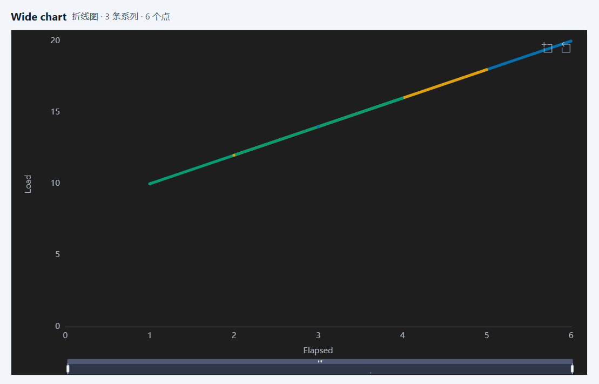

# T4.4 报告 — 图表创建与检查器

- 任务：T4.4（FR-CHT-01、FR-CHT-02、FR-CHT-03；SPEC §11.5）
- 日期：2026-10-25
- 决策：ADR-043（命令面、检查器、RenderModel 扩展、渲染更新策略）
- 状态：已完成；未进入 T4.5。

## 1. 目标与交付

1. 命令总线新增 `chart.create { chart, view }`、`chart.update { chart }`、`chart.delete { chartId }`：
   manifest-only、workspace 作用域撤销；创建时在同一事务内建图表 + 首个视图入 layout；删除级联
   图表视图与 layout 引用；更新允许悬空映射以便修复、覆盖 `createdAt`、刷新 `updatedAt`、
   标题变化同步图表视图标题。
2. `WorkspaceActions` 新增 `createChart/updateChart/deleteChart/duplicateChart/openChart`：
   新建向导只提交 `{ tableId, title, kind, mapping, options?, filter?, sort? }`，id/时间戳/
   `DEFAULT_CHART_OPTIONS`（sampling 5000/2000）在 app-core 生成；复制生成新 `cht_`/`viw_` 与
   ` (2)` 标题；`openChart` 激活或重建标签页。
3. 侧栏“图表”列表：新建、打开、复制、重命名、删除（二次确认、可 Ctrl+Z 撤销）；删除/复制后
   活动标签正确切换。
4. 新建向导（单模态框）：选表 → 类型/名称 → 映射与列（只列类型兼容列）→ 右侧实时预览 →
   创建；映射不完整/非法时创建禁用，`chart.create` 再次严格校验。
5. 检查器四组：数据（表/行数/筛选/≤3 级排序）、映射（宽/长布局、X、Y 多选或系列列 + Y）、
   外观（类型/调色板/背景/图例/网格/平滑/点/线宽）、坐标轴（X/Y 标签、小数位、Y 从 0）。
   下拉/复选框一次交互一条命令，文本/数字失焦/Enter 提交。
6. 图表视图：`ChartCanvas` 首次 `render()`、之后 120ms 防抖 `update()`（走 `setOption` merge，
   不重建实例）、`ResizeObserver → resize()`、卸载 `dispose()`；空态/错误态内联；把
   RenderModel 契约暴露为 `data-chart-*` 供 E2E 与后续 a11y 摘要。
7. 列删除后的可操作错误态：`missing-columns` + 缺失列 id + 内嵌重映射（与检查器共用
   `ChartMappingFields`），修复后重启仍为正常态；不自动改写映射。
8. `RenderModel` 扩展（ADR-043）：`y?: { label?: string }`（来自 `ChartOptions.yLabel`）与
   `RenderStyle.connectNulls`（采样图/长表 true，宽表未采样 false）；适配器映射 `yAxis.name`、
   X 轴名不再被 dataZoom 遮挡（`grid.bottom` 72）。
9. 不改变 `formatVersion`/manifest 字段/JSONL/IPC/preload/CSP/`ChartSpec` schema；不新增第三方
   运行时依赖（renderer 新增两个 workspace 依赖）。

## 2. 关键文件

```text
packages/app-core/src/commands/charts.ts (+charts.test.ts)      # 3 条命令、默认值、复制标题
packages/app-core/src/commands/charts.ts                         # cloneMapping/cloneFilter、DEFAULT_CHART_OPTIONS
packages/app-core/src/app-core.ts                                # 命令注册 + MANIFEST_SAVING_COMMANDS
packages/app-core/src/history/edit-history.ts (+test)            # chart.* workspace 作用域撤销
packages/app-core/src/usecases/workspace-actions.ts (+chart-actions.test.ts)  # create/update/delete/duplicate/open
packages/app-core/src/index.ts
packages/chart-model/src/render-model.ts (+test, +snapshot)      # y.label、style.connectNulls
packages/chart-echarts/src/option.ts (+option.test/ssr/snapshot) # yAxis.name、connectNulls 来源、grid.bottom
packages/ui/src/Select.tsx                                       # option disabled（布局不可表达）
apps/desktop/src/renderer/features/charts/
├─ ChartList.tsx            # 列表 + 新建/复制/重命名/删除
├─ ChartDialogs.tsx         # 重命名/删除模态框
├─ NewChartDialog.tsx       # 向导 + 实时预览
├─ ChartView.tsx            # 状态机、错误/空态、data-chart-* 契约、内嵌重映射
├─ ChartCanvas.tsx          # 首次 render / 120ms update / resize / dispose
├─ ChartInspector.tsx       # 数据/映射/外观/坐标轴四组
├─ ChartMappingFields.tsx   # 检查器与重映射共用的映射编辑器
├─ chart-fields.tsx         # 文本/数字/复选框控件
├─ chart-text.ts            # 枚举 → 消息键
├─ chart-view-model.ts      # 状态判定、布局映射构建、预览 spec
└─ use-chart-editor.ts      # 一条交互一条 chart.update
apps/desktop/src/renderer/shell/{Sidebar,Inspector}.tsx
apps/desktop/src/renderer/features/workspace/WorkspaceView.tsx   # ChartView 替换 ChartPlaceholder
apps/desktop/src/renderer/{i18n/messages/*,styles.css}
apps/desktop/src/renderer/features/charts/*.test.{ts,tsx}        # 39 条单元/组件测试
apps/desktop/e2e/chart.spec.ts                                   # 4 条 E2E
apps/desktop/e2e/schema.spec.ts                                  # 图表错误态断言更新
apps/desktop/{package.json,tsconfig.web.json}
pnpm-lock.yaml
docs/adr/043-t44-chart-creation-inspector.md
docs/reports/t4.4/REPORT.md
```

## 3. 公开 API

```ts
// @curve/app-core
DEFAULT_CHART_OPTIONS / defaultChartOptions()
ChartCreatePayload { chart; view } / ChartUpdatePayload { chart } / ChartDeletePayload { chartId }
ChartCreateRequest { tableId; title; kind; mapping; options?; filter?; sort? }
createNewChartPayload(options: NewChartOptions): ChartCreatePayload
duplicateChartTitle(base, existingTitles): string
createChartCreateCommand / createChartUpdateCommand / createChartDeleteCommand

WorkspaceActions
  createChart(request): Promise<ActionOutcome<{ chartId; viewId }>>
  updateChart(chart: ChartSpec): Promise<ActionOutcome>
  deleteChart(chartId: string): Promise<ActionOutcome>
  duplicateChart(chartId): Promise<ActionOutcome<{ chartId; viewId }>>
  openChart(chartId): Promise<ActionOutcome<{ viewId; created }>>

// @curve/chart-model（T4.4 扩展）
RenderYAxis { label?: string }
RenderModel.y?: RenderYAxis
RenderStyle.connectNulls: boolean

// @curve/ui
SelectOption.disabled?: boolean
```

## 4. 语义实现（对照 SPEC §11.5 / ADR-043）

| 项 | 语义 |
|---|---|
| 图表列表 | 按 manifest 插入顺序；行按钮打开，复制/重命名/删除行内操作；删除二次确认并说明可撤销 |
| 新建向导 | 单模态框；表/名称/类型 + 宽/长映射；只列类型兼容列；不可表达布局置灰；预览走同一 `resolveSeries`；非法映射禁用创建 |
| 数据组 | 表名、物理行数、图表筛选（复用 `FilterDialog`）、≤3 级排序（列唯一、方向切换、移除） |
| 映射组 | 宽：X + Y 多选（至少 1 个）；长：X + 系列列 + Y；悬空列可见并可替换/移除；问题按路径本地化 |
| 外观组 | 类型、4 调色板、auto/light/dark、图例四态、网格、平滑、点、线宽 1–6 |
| 坐标轴组 | X 标签（占位为列 label）、Y 标签、小数位 0–6、Y 从 0；标签清空删除字段 |
| 提交 | 下拉/复选框即时；文本/数字失焦/Enter；非法数字内联报错不提交；每条命令 flush manifest |
| 渲染更新 | 首次 `render`；120ms 防抖 `update`；容器 resize；卸载 dispose；错误内联 alert |
| 空/错误态 | 缺失图表/表、缺失列（可重映射）、无效映射（列类型/角色）、无点（空态提示） |
| 图表数据 | 全表行 + 图表自身 filter/sort；不跟随表格视图筛选 |
| 标签联动 | 图表标题变更同步视图标题；关闭标签不删除图表；复制新标签激活 |
| 撤销 | `chart.create/update/delete` 各一条 workspace 作用域历史；Ctrl+Z 恢复图表/视图/layout |

## 5. 验收逐项

| # | 验收项 | 结果 |
|---|---|---|
| 1 | 宽表多 Y、长表系列拆分均正确 | ✅ E2E：向导建 2 个 Y（`data-chart-series="Sensor A\|Sensor B"`、2 系列、12 点）；检查器切长表后 3 系列（east/west/north）、6 点、折线跨过结构性 null（`connectNulls=true`）；chart-model/option 单测与快照覆盖 |
| 2 | 检查器所有项生效并持久化，重启保留 | ✅ E2E 逐项断言 `data-chart-*`（palette `#0072b2`、背景 `#1e1e1e`、图例 none、网格 off、平滑/点 on、线宽 4、X/Y 标签、小数位 1、Y 从 0、排序 desc）并 poll manifest；同一 userData 重启后逐属性相等、canvas 仍渲染 |
| 3 | 列被删后图表进入可操作错误态 | ✅ E2E：UI 删除映射列 → `data-chart-state="missing-columns"` + “列已删除：col_note” + 内嵌重映射；重选 X 后恢复 ready，manifest 映射更新，重开仍正常；组件测试覆盖“移除悬空 Y 自动换成第一个兼容列” |
| 4 | 复制图表生成新 id，互不影响 | ✅ E2E：复制后 2 个图表、新 `cht_`/`viw_`、标题 `Readings chart (2)`；副本改调色板后源仍 `default`，切回源视图 `data-chart-palette="#2563eb"`；单测覆盖 command/action 级独立性与撤销 |

补充覆盖：非法映射不创建（命令与向导双层）、空/缺失表错误态、采样徽标、图表提示（warning）、
每交互一条撤销、复制/打开/删除失败的 `setError`、200% 缩放键盘（Enter 开向导、方向键/End 切
检查器标签）、重命名/删除对话框、`renderer` 首次/防抖/卸载生命周期（4 条组件测试）。

**截图证据**（E2E 生成后复制到本目录）：





## 6. 验证命令与结果

> 本节数字在本机（Windows、空闲 CPU）实测；`pnpm e2e` 独占 CPU 运行。

```text
pnpm verify
  159 files / 1434 tests passed；ESLint 0；
  depcruise 435 modules / 1791 deps / 0 violations

pnpm test:coverage
  All files：statements 75.75% / branches 68.76% / functions 74.28% / lines 75.89%
  chart-model/src：lines 95.93%（render-model.ts 97.0% 行）
  chart-echarts/src：lines 99.57%（option.ts 100%）
  app-core/src：lines 98.41%（commands/charts.ts 91.81%）
  renderer/features/charts：lines 62.47% / branches 52.58%
    （ChartList/ChartDialogs 容器只有 E2E；Canvas/View/inspector/fields 有组件测试）
  阈值 70/60 未下调

pnpm format:check
  通过

pnpm build
  exit 0；renderer 3,209.97 kB（+1,591.93 kB vs T4.3）
  + ImportSession 42.82 kB；CSS 70.66 kB（+6.63 kB）
  table/query/import worker 220.68/236.16/270.16 kB

pnpm e2e（chart 单独）
  4 passed（26.7s）：向导+四组检查器+重启 6.2s、删列重映射 3.9s、
  复制 2.8s、200% 键盘 2.8s

pnpm e2e（全量）
  76 passed（3.7m）；chart.spec 4 条全绿；T4.4 两次全量运行中 grid 200% 焦点 flake
  在第一次出现（单跑 2.3s 通过），第二次全绿

pnpm bench
  exit 0；open 361ms、save 306ms、edit 0ms、query 190ms、text-sort 238ms、
  cjk-sort 496ms、import 629ms、condition P95 1ms；
  chart.resolve-sample.100k P95 75ms/300ms、chart.sample.100k P95 5ms/50ms
  baseline=none
```

**黄金快照变更（有意，ADR-043）**：

- `packages/chart-model/src/__snapshots__/render-model.test.ts.snap`：两个快照新增
  `style.connectNulls`（宽表日期图 false、长表 enum 图 true）。
- `packages/chart-echarts/src/__snapshots__/option.test.ts.snap`：6 条 option 快照的
  `grid.bottom` 56→72；采样多系列快照的 `connectNulls` 由新的 `style.connectNulls` 提供。
  更新命令：`pnpm exec vitest run packages/chart-model packages/chart-echarts -u`。

## 7. 残留风险与未覆盖

- **长表跨过真实缺口**：长表的 null 被视为结构性（ADR-043）；该系列自身真实的缺失也会被连线。
  要区分需要结构化 gap 或 per-series x（ADR-041 复核条件）。
- **坏图表不可复制**：`chart.create` 严格校验映射，复制悬空映射的图表会返回 `E_VALIDATION`，
  必须先修复。
- **Y 轴名单一/无单位**：宽表多个 Y 列共享一个轴名；`RenderSeries` 仍无 `unit`。
- **全表解析成本**：图表按全表行解析，100k 表编辑后切图仍有解析开销（T4.6）。
- **每次提交 flush manifest**：小文件，但快速连续操作产生多条撤销记录；批量合并留 T5.2。
- **bundle 增长**：renderer 主 chunk 1,618.04 → 3,209.97 kB（+1,591.93 kB），CSS +6.63 kB；
  T6.4 评估拆包/懒加载。
- **图表视图的无障碍摘要**：`data-chart-*` 只是渲染契约；aria-label 摘要、“查看数据表”与
  三种空态文案属于 T4.5。
- **PNG 导出**：适配器 `toPNG` 已有，UI 入口/文件名/写盘属 T4.5。
- **toolbox 标题**仍为 ECharts 英文默认（T4.5）。
- **图表与表格选中行联动**（SHOULD）未实现，T4.5/T5 视范围。

## 8. 结论与停点

T4.4 的 4 项验收全部通过：宽/长映射由 RenderModel 契约与 E2E 双重断言；检查器四组的所有项
逐项生效且在重启后逐属性相等；删除映射列后图表进入可操作错误态并可重映射恢复；复制图表生成
全新 id/视图且源/副本互不影响。`pnpm verify` 全绿、`pnpm e2e` 全绿、`pnpm bench` exit 0；
新增 ADR-043、SPEC §11.2/§11.3/§11.4/§11.5/§13.1/§13.2 实现边界与 4 条 E2E。下一步 T4.5
（图表交互、空态与 PNG 导出），仍是一次只推进一个任务。

提交：**`5ea074e`**（`feat(chart): add the chart list, wizard and inspector (T4.4)`）；
本报告的交接提交见 `git log -1 -- docs/HANDOFF.md`。
