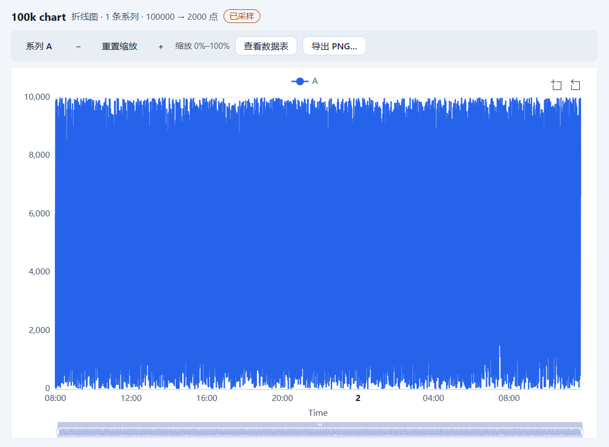

# T4.5 报告 — 图表交互、空态与 PNG 导出

- 任务：T4.5（FR-CHT-04、FR-CHT-06、FR-CHT-07；SPEC §11.4–§11.6）
- 日期：2026-10-26
- 决策：ADR-044（交互 API、三态空态、PNG 传输、导出入口、无障碍摘要、toolbox 本地化）
- 状态：已完成；未进入 T4.6。

## 1. 目标与交付

1. 图例/缩放/tooltip/resize：`ChartRenderer` 增加瞬态交互 API（读取 dataZoom 窗口与隐藏系列、
   派发图例切换/缩放、订阅 ECharts `datazoom`/`legendselectchanged`）；图表视图工具栏提供
   逐系列 `aria-pressed` 图例按钮、放大/缩小/重置缩放，键盘可达；canvas 内置控件与 DOM 工具栏
   共享同一状态。
2. 三种空态：`data-chart-empty="no-table|unmapped|no-data"`。无表显示“删除图表…”（复用
   `DeleteChartDialog`）；未映射/缺列显示“配置映射”并聚焦内嵌 `ChartMappingFields`；无数据
   （`data-chart-state="empty"`）显示“查看数据表”（`openTable`）。映射仍不自动改写。
3. PNG 导出：`ChartCanvas.exportPng` 先 flush 120ms 防抖、等待两个动画帧，再调用同步
   `toPNG`；导出对话框提供透明/白/深背景、固定 2x、建议文件名
   `<标题>-<yyyyMMdd-HHmm>.png`（非法字符/Windows 保留名/80 码点清洗）；保存复用
   `file:exportText` 的新可选 `encoding:'base64'`，main 解码后原子写字节；不新增 IPC 通道，
   preload 白名单不变。
4. 无障碍：canvas 宿主 `role="img"` 的 `aria-label` 为“标题、类型、系列数、点数（采样时含
   原始点数）”；工具栏与无数据态都提供“查看数据表”；E2E 在 100k 图上运行 axe wcag2a/aa。
5. toolbox 本地化：`toEChartsOption` 接受 `labels { zoom, zoomBack }`，`ChartCanvas` 从 i18n
   传“框选缩放/还原缩放”；tooltip 增加稳定类名 `cs-chart-tooltip`。
6. 不改变 `formatVersion`/manifest 字段/JSONL/`ChartSpec`/`RenderModel`/命令总线；不新增第三方
   运行时依赖；交互状态不持久化、不进撤销。

## 2. 关键文件

```text
packages/chart-echarts/src/option.ts (+option.test/snapshot)     # labels、tooltip className
packages/chart-echarts/src/renderer.ts (+renderer.test)          # 交互读取/派发/订阅
apps/desktop/src/shared/contracts/ipc.ts (+ipc.test)             # exportText encoding
apps/desktop/src/main/import/import-files.ts (+test)             # base64 解码/字节写
apps/desktop/src/main/workspace/atomic-write.ts                  # atomicWriteBytes
apps/desktop/src/main/index.ts                                   # 传递 encoding
apps/desktop/src/renderer/features/charts/
├─ ChartView.tsx (+test)            # 工具栏、三态空态、aria 摘要、导出入口
├─ ChartCanvas.tsx (+test)          # exportPng/交互句柄、toolbox labels
├─ ChartExportDialog.tsx (+test)    # 背景选择、文件名、成功/失败
├─ ChartEmptyState.tsx              # 三态空态卡片
├─ chart-export.ts (+test)          # 文件名清洗/base64 data URL
├─ chart-text.ts                    # chartSummaryText
└─ use-chart-editor.ts              # 沿用 T4.4
apps/desktop/src/renderer/{i18n/messages/*,styles.css}
apps/desktop/e2e/chart-interaction.spec.ts                      # 3 条 E2E
docs/adr/044-t45-chart-interaction-export.md
docs/reports/t4.5/REPORT.md
```

## 3. 公开 API

```ts
// @curve/chart-echarts（T4.5）
type ChartInteractionAction =
  | { type: 'toggle-series'; name: string }
  | { type: 'zoom-by'; factor: number }
  | { type: 'reset-view' };
interface ChartZoomWindow { start: number; end: number }
interface ChartInteractionState { zoom: ChartZoomWindow | null; hiddenSeries: string[] }
interface ChartToolboxLabels { zoom?: string; zoomBack?: string }
interface ChartOptionOptions { locale?: string; labels?: ChartToolboxLabels }

interface ChartRenderer {
  // T4.3 …
  getInteractionState(): ChartInteractionState;
  dispatchInteraction(action: ChartInteractionAction): void;
  onInteractionChange(listener: (state: ChartInteractionState) => void): () => void;
}
createChartRenderer(options?: { locale?: string; labels?: ChartToolboxLabels }): ChartRenderer

// IPC（T4.5 扩展，不新增通道）
type ExportTextEncoding = 'utf8' | 'base64';
interface ExportTextRequest {
  suggestedName: string;
  content: string;
  encoding?: ExportTextEncoding;   // 缺省 utf8
  filters: FileFilter[];
}

// renderer features/charts（组件契约）
interface ChartCanvasHandle {
  exportPng(options?: ChartPngOptions): Promise<ChartPngOutcome>;
  getInteractionState(): ChartInteractionState;
  dispatchInteraction(action: ChartInteractionAction): void;
  subscribeInteraction(listener: (state: ChartInteractionState) => void): () => void;
}
ChartView({ view }) / ChartCanvas({ ref, model, label, testId?, renderer? })
ChartExportDialog({ open, title, disabled, canvas, onClose })
ChartEmptyState({ kind: 'no-table' | 'unmapped' | 'no-data', … })
chartPngFileName(title, now): string
pngDataUrlToBase64(dataUrl): string | null
chartSummaryText(model, t): string
```

## 4. 语义实现（对照 SPEC §11.4–§11.6 / ADR-044）

| 项 | 语义 |
|---|---|
| 图例 | DOM 按钮 `aria-pressed`；`dispatchInteraction` 调 `legendToggleSelect`；ECharts 自身图例点击经 `legendselectchanged` 同步回 DOM |
| 缩放 | 放大 factor 2 / 缩小 0.5，围绕窗口中心收放并夹在 0–100、最小 1%；重置同时 `legendAllSelect` + dataZoom 0–100；`data-chart-zoom-start/end` 供 E2E |
| tooltip | `renderMode:'html'` + `className='cs-chart-tooltip'`；用户文本仍全部 `escapeHtmlText`；`trigger:'axis'`（scatter 为 item） |
| resize | `ResizeObserver → renderer.resize()`；E2E 改变窗口宽度后 canvas 变窄且状态仍 ready |
| 无表 | `data-chart-state="missing-table"` + `data-chart-empty="no-table"` + “删除图表…”（二次确认、可撤销） |
| 未映射 | `missing-columns`/`invalid` + `data-chart-empty="unmapped"` + “配置映射”（聚焦第一个映射选择器）；`chart-remap` 始终可见 |
| 无数据 | `data-chart-state="empty"` + `data-chart-empty="no-data"` + “查看数据表”；不渲染空 canvas |
| 导出等待 | flush 防抖 → 两个 `requestAnimationFrame`（无 DOM 时 `setTimeout(0)`）→ 同步 `toPNG`；`animation:false` 使结果确定 |
| PNG 参数 | `scale:2`、背景 `transparent`/`light(#ffffff)`/`dark(#1e1e1e)`；toolbox 排除；PNG 尺寸 = 容器 CSS 尺寸 × 2（±4px） |
| 文件名 | `<清洗标题>-<yyyyMMdd-HHmm>.png`（本地时间）；非法字符→`_`、去尾部点/空格、保留名加 `_`、80 码点 |
| 保存 | `file:exportText` + `encoding:'base64'`；main 严格 base64 校验后 `atomicWriteBytes`（临时文件 + fsync + rename）；取消对话框不报错 |
| 无障碍 | canvas 宿主 `role="img"` 的 `aria-label` = `图表：<标题>，<类型>，N 条系列，M 个点[，已采样（显示 R 点）]`；工具栏 `role="toolbar"` |
| toolbox | `labels.zoom/back` → `toolbox.feature.dataZoom.title`；不传时保持 ECharts 英文默认值 |
| 瞬态性 | 图例/缩放不写 `ChartSpec`/manifest、不进撤销；关闭标签/重启回到全选 0–100 |

## 5. 验收逐项

| # | 验收项 | 结果 |
|---|---|---|
| 1 | 缩放/图例/tooltip 在 100k 采样图上可用 | ✅ E2E `chart-interaction`：100k 行、`sampled=true`、`source-points=100000`、`rendered-points≤2000`；图例按钮切换隐藏/恢复（`data-chart-hidden-series`）；缩放 0–100 → 放大 → 缩小/重置；hover 出现 `.cs-chart-tooltip`；缩窗后 canvas 变窄且仍 ready；axe wcag2a/aa critical = 0 |
| 2 | 导出 PNG 尺寸/背景/文件名符合 SPEC | ✅ E2E `png`：文件名正则 `^PNG chart-\d{8}-\d{4}\.png$`；三次导出透明/白/深，PNG IHDR 宽高 = canvas × 2（±4）；像素 alpha 0 / `#ffffff` / `#1e1e1e`；单元测试覆盖文件名清洗、base64 提取、IPC 失败/取消/非 PNG |
| 3 | 三种空态文案与行动按钮正确 | ✅ 组件测试覆盖三态：`no-table`（删除图表对话框 → `deleteChart` 调用）、`unmapped`（聚焦 `chart-remap-layout`）、`no-data`（`openTable`）；E2E 覆盖可达的 `no-data`/`unmapped`（`no-table` 是防御态：合法 manifest 的缺失表被 `checkChartInto` 判为错误，无法从磁盘打开） |
| 4 | axe 无 critical | ✅ E2E 在 100k 图表视图注入 axe-core，`runOnly wcag2a/wcag2aa`，critical 违规为 0；审计 JSON 作为测试附件 |

补充覆盖：导出前 flush 防抖（单测断言 update 先于 toPNG）、非 PNG data URL 拒绝、IPC 失败与
取消、PNG 文件名/保留名/代理对截断、toolbox labels 只传一项/两项、交互事件订阅/退订/dispose
清理、工具栏键盘（Space）与 200% 缩放对话框不越界。

**截图证据**（E2E 生成后复制到本目录）：




## 6. 验证命令与结果

> 本节数字在本机（Windows、空闲 CPU）实测；`pnpm e2e` 独占 CPU 运行。

```text
pnpm verify
  161 files / 1474 tests passed；ESLint 0；
  depcruise 441 modules / 1830 deps / 0 violations

pnpm test:coverage
  All files：statements 76.12% / branches 69.03% / functions 74.65% / lines 76.26%
  chart-echarts/src：lines 96.75%（renderer.ts 93.75%、option.ts 100%）
  chart-model/src：lines 95.93%（未改动）

pnpm format:check
  通过

pnpm build
  exit 0；renderer 3,238.36 kB（+28.39 kB vs T4.4）、CSS 72.19 kB（+1.53 kB）
  + ImportSession 42.82 kB；table/query/import worker 220.68/236.16/270.16 kB

pnpm e2e（chart-interaction 单独）
  3 passed（9.6s）：100k 交互 4.0s、PNG 2.4s、空态 2.4s

pnpm e2e（全量）
  79 passed（3.7m）；chart.spec.ts 4 条、chart-interaction.spec.ts 3 条全绿；
  perf.spec 冷启动 1,149ms、100k 打开 591ms、内存 578MB/600MB；M2 11.1s、M3 9.9s

pnpm bench
  exit 0；open 361ms、save 237ms、edit 0ms、query 196ms、text-sort 263ms、
  cjk-sort 443ms、import 644ms、condition P95 1ms；
  chart.resolve-sample.100k P95 66ms/300ms、chart.sample.100k P95 2ms/50ms；
  memoryPeakMB=885（Node 管线趋势，非应用内存门禁）；baseline=none
```

**黄金快照变更（有意，ADR-044）**：

- `packages/chart-echarts/src/__snapshots__/option.test.ts.snap`：6 条 option 快照的 tooltip
  新增 `className: "cs-chart-tooltip"`（稳定 DOM 契约）。更新命令：
  `pnpm exec vitest run packages/chart-echarts -u`。RenderModel 快照未变。

## 7. 残留风险与未覆盖

- **`no-table` 无法从合法 manifest 进入**：`checkChartInto` 把缺失表当错误（`E_WS_INVALID_MANIFEST`），
  正常路径也不会留下引用缺失表的图表（`table.delete` 级联删除图表）。该态只由 ChartView 组件
  测试覆盖；若未来允许“换表/孤儿图表”，需要新 ADR 并放宽 invariant。
- **交互状态不持久化**：图例选择与缩放窗口关闭标签/重启后重置；若产品要求保留，需写入
  `ChartSpec`/manifest 并加迁移与 ADR。
- **导出入口在视图工具栏**：SPEC §11.5 原文把“导出”列在检查器；ADR-044 已改为视图工具栏
  （渲染器实例归属），检查器仍是四组文档属性。若检查器内必须导出，需要跨组件渲染器注册表。
- **base64 传输**：PNG 体积 +33%；当前 2x 图通常 0.3–2MB，256MB 载荷上限足够。4x/超长画布需
  分块或二进制通道。
- **等待两帧**：导出多约 33ms；换取“刚改完检查器立刻导出”也包含最新模型。
- **toolbox 标签只在经 `ChartCanvas` 的路径本地化**：直接调用 `chart-echarts` 且不传 labels
  的调用方仍是 ECharts 英文默认值。
- **DOM 图例与 ECharts 内置图例并存**：依靠事件同步；极端情况下 DOM 状态可能滞后一拍，下一次
  交互以 `getOption()` 的真实状态为准。
- **图表与表格选中行联动**（SHOULD）仍未实现；T4.6 只做性能硬化。
- **主 chunk 继续增长**（+28.39 kB）：T6.4 评估拆包。

## 8. 结论与停点

T4.5 的四项验收全部通过：100k 采样图上图例/缩放/tooltip/resize 可用且 axe critical 为 0；
PNG 以 2x 导出三种背景且文件名/尺寸/像素符合 SPEC；三种空态与行动按钮有组件测试，E2E 覆盖
可达的两种；导出等待渲染完成、失败与取消都有明确处理。`pnpm verify` 全绿、`pnpm e2e` 全绿、
`pnpm bench` exit 0；新增 ADR-044、SPEC §11.4/§11.5/§11.6/§15.1 实现边界与 3 条 E2E。下一步
T4.6（图表性能硬化），仍是一次只推进一个任务；M4 验收演示在 T4.6 完成后执行并停下等用户确认。

提交：**`9e904ac`**（`feat(chart): add chart interaction, empty states and PNG export (T4.5)`）；
本报告的交接提交见 `git log -1 -- docs/HANDOFF.md`。
