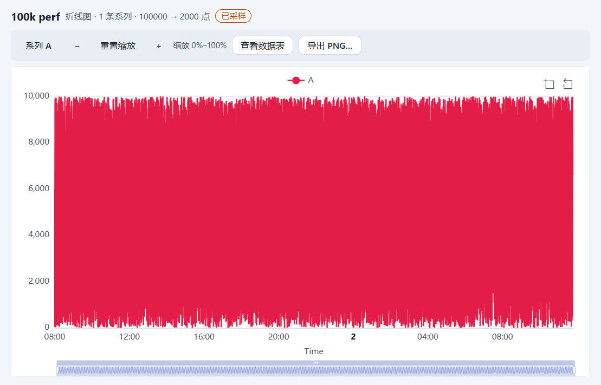
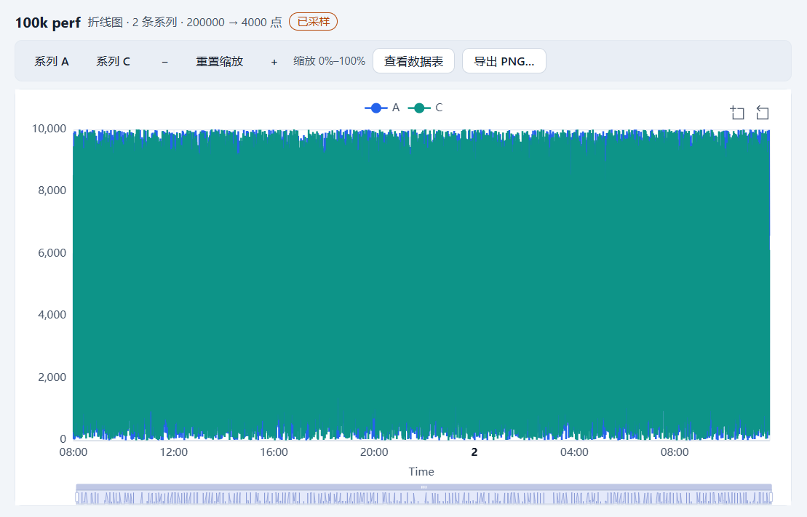

# T4.6 报告 — 图表性能硬化

- 任务：T4.6（FR-CHT-05、NFR-01；SPEC §16.1）
- 日期：2026-10-26
- 决策：ADR-045（解析/样式拆分、数据缓存、延迟解析与 loading、诊断契约、按帧合并交互、
  `chart` 基准 suite）
- 状态：已完成；未进入 M4 验收演示。

## 1. 目标与交付

1. **四段耗时都有自动化记录**：`pnpm bench -- --chart` 覆盖解析+采样、纯采样、option 构造与
   样式复用；真实渲染/更新（含 ECharts `setOption` 与画布）由 E2E `chart-perf.spec.ts` 的
   `data-chart-update-ms` 判定（SPEC §16.1 的“手工/Playwright”口径）。
2. **避免重复 resolve**：`@curve/chart-model` 拆成 `resolveChartData`（行集 → x/系列值/meta）与
   `renderChartModel`（调色板/背景/线宽/图例/精度/Y 轴名/kind），`resolveSeries` 仍是二者组合
   且输出不变；渲染层新增数据缓存（`rows` 引用 + 数据键双重命中），样式提交只重跑样式段。
3. **大表切换不冻结输入**：>20,000 行且缓存未命中时先渲染 loading（`role="status"`、
   `data-chart-pending="true"`），再在 `setTimeout(0)` 中解析；首次挂载与切换映射/标签页同样生效。
4. **连续拖动缩放更稳**：ECharts `datazoom`/`legendselectchanged` 驱动的状态发布按
   `requestAnimationFrame` 合并（每帧最多一次 React 更新），工具栏动作仍立即发布。
5. **无泄漏可验证**：`chart-canvas` 暴露 `data-chart-instances`（`activeChartInstanceCount()`）
   与 `data-chart-update-count`；E2E 在 5 次映射 + 6 次标签切换后断言实例数恒为 1。
6. **解析分配优化**（实现级、语义不变）：默认数值/时间 X 排序改为“坐标数组 + 下标排序”，
   去掉每行 `{row,index,value}` 装饰对象；无筛选时不再先复制整表行。
7. **修复任务中暴露的主进程缺陷**：`FileWorkspaceStore.copyToBackup` 直接写入 `backups/`，
   但该目录可能不存在（从别处复制/恢复、`gen-100k` 生成的工作区都没有它），导致每次
   `manifest:write`/`table:write` 备份失败并返回 `E_FS_WRITE`(ENOENT)——100k 复制的图表工作区
   无法保存任何修改（E2E 截图里的“文件写入失败”提示即由此而来）。备份前 `mkdir(recursive)`，
   并补一条“备份目录缺失时保存仍成功”的回归测试。修复后 `chart-perf` 的 11 次切换内存也从
   605–612MB 回落到 **584–592MB**（失败保存的重试/错误状态不再累积）。
8. 不改变 `RenderModel` 形状、采样/断点/映射规则、空态/PNG/交互瞬态语义、命令总线、
   `formatVersion`/manifest/JSONL/IPC/preload/CSP、依赖方向；不新增运行时依赖；不引入图表 Worker。

## 2. 关键文件

```text
packages/chart-model/src/render-model.ts (+render-model.test.ts)   # resolveChartData/renderChartModel、
                                                                  # resolveSeries 组合、下标排序
apps/desktop/src/renderer/features/charts/
├─ chart-data-cache.ts (+test)          # LRU(2)、数据键、resolveChartDataCached
├─ use-chart-render-status.ts (+test)   # 延迟解析 + loading 快照 + resolveMs
├─ chart-view-model.ts (+test)          # chartRenderStatus 接缓存、ChartRenderOptions
├─ ChartView.tsx (+test)                # loading 态、data-chart-pending/resolve-ms
├─ ChartCanvas.tsx (+test)              # update-ms/update-count/instances、rAF 合并
├─ NewChartDialog.tsx                   # 预览复用同一缓存
apps/desktop/src/renderer/i18n/messages/{zh-CN,en-US}.ts   # chart.view.loading
apps/desktop/src/renderer/styles.css                        # .cs-chart-view__loading
apps/desktop/src/main/workspace/file-workspace-store.ts (+test)  # 备份目录缺失时保存仍成功
scripts/bench.ts / bench/README.md / scripts/tsconfig.json / package.json / pnpm-lock.yaml
apps/desktop/e2e/chart-perf.spec.ts                          # 2 条 E2E
docs/adr/045-t46-chart-performance.md
docs/reports/t4.6/REPORT.md
```

## 3. 公开 API / 契约

```ts
// @curve/chart-model（T4.6）
interface ResolvedSeries { id: string; name: string; values: (number | null)[] }
interface ResolvedXAxis { values: (number | string)[]; type: RenderXAxis['type']; columnLabel: string; unit?: string }
interface ResolvedChartData { x: ResolvedXAxis; series: ResolvedSeries[]; meta: RenderMeta }
type ChartDataResult = { ok: true; data: ResolvedChartData } | { ok: false; issues: ChartIssue[] };
resolveChartData(table, rows, spec, options?): ChartDataResult
renderChartModel(data, spec, options?): RenderModel
resolveSeries(...): ChartResolveResult          // 行为不变 = renderChartModel(resolveChartData(...))

// renderer features/charts（T4.6）
CHART_DATA_CACHE_CAPACITY = 2
createChartDataCache(capacity?): ChartDataCache   // { size, get, set, clear }
chartDataKey(table, rows, spec, locale?): string
hasCachedChartData(cache, table, rows, spec, options?): boolean
resolveChartDataCached(cache, table, rows, spec, options?): ChartDataResult
CHART_DEFER_RESOLVE_ROW_THRESHOLD = 20_000
useChartRenderStatus(input): { status: ChartRenderStatus | null; pending; resolveMs }
chartRenderStatus(input, options?: { cache }): ChartRenderStatus   // 省略 cache 时保持旧行为

// DOM 诊断契约（只读，不是持久化字段）
chart-view:   data-chart-pending, data-chart-resolve-ms
chart-canvas: data-chart-update-ms, data-chart-update-count, data-chart-instances
```

## 4. 语义实现（对照 ADR-045）

| 项 | 语义 |
|---|---|
| 数据/样式拆分 | 数据段只依赖 filter/sort/mapping/sampling/locale/列元数据；样式段才读 palette/background/线宽/平滑/点/图例/网格/精度/从零/Y 轴名/kind/`xLabel` |
| 缓存键 | 表 id + 列签名（id/label/type/role/unit/precision/enumOptions）+ 行数 + mapping + filter + sort + sampling + locale；不含样式字段与 `xLabel` |
| 缓存命中 | 要求数据键**与 `rows` 引用**同时相同（Immer 每次变更产生新数组）；失败结果不缓存 |
| 延迟解析 | `rows.length > 20_000` 且缓存未命中 → 先 commit pending，`setTimeout(0)` 解析；小表/缓存命中/缺 chart/table 同步；输入再次变化时取消旧任务 |
| loading | 首次挂载显示 `data-chart-state="loading"` + “正在解析图表…”；已有模型时保留旧图并在顶部显示 loading，`data-chart-state` 保持旧值 + `data-chart-pending="true"` |
| 交互合并 | 事件驱动发布 → 队列 + rAF，每帧最多一次，发布最新状态；立即发布取消已排队帧；无 rAF 同步 |
| 解析耗时 | `data-chart-resolve-ms` 为最近一次 `chartRenderStatus`（含缓存查找）的整毫秒；缓存命中≈0 |
| 更新耗时 | `data-chart-update-ms` = `renderer.render`（首帧）或 `renderer.update` 的同步耗时（含 option + `setOption`）；`data-chart-update-count` 单调递增 |
| 实例数 | `data-chart-instances` 在每次 render/update 后读 `activeChartInstanceCount()`；dispose 后引擎计数归零 |
| 基准 suite | `sample` → `chart`，`--sample` 保留别名；新增 `chart.option.2k`（50ms）与 `chart.restyle.100k`（20ms） |

## 5. 验收逐项

| # | 验收项 | 结果 |
|---|---|---|
| 1 | 预算达标；连续拖动缩放不卡顿 | ✅ bench：`chart.resolve-sample.100k` P95 **63ms**/300、`chart.sample.100k` P95 **2ms**/50、`chart.option.2k` P95 **1ms**/50、`chart.restyle.100k` **0ms**/20；E2E：`data-chart-resolve-ms=47`（≤300）、`data-chart-update-ms=89`（≤200，多次运行 47–54/88–97）、样式提交 `resolve=0`/`update=14`；10 次连点缩放期间 `longtask` 计数 0（无 >50ms 主线程任务），实例数保持 1 |
| 2 | 切换表/映射无内存泄漏（10 次后实例数稳定） | ✅ E2E：5 次映射切换 + 6 次标签切换，逐次断言 `data-chart-instances=1`；切换期间捕获到 `data-chart-pending="true"`（loading 出现）；切换后 4 次采样平稳（589–591MB，无持续增长）且 **≤600MB**；100k 图表工作区初始 private **470MB** |
| 3 | 回归 >20% 报警 | ✅ `bench/baseline.json` 的 P95 回归比较沿用 ADR-033，新用例自动纳入；`scripts/bench-report.test.ts` 覆盖“20% 容忍 / 20.1% 报警”与 `::warning` 输出；`chart-perf` 的绝对预算同时是硬门禁 |

**截图证据**（E2E 生成后复制到本目录）：





## 6. 验证命令与结果

> 本节数字在本机（Windows、空闲 CPU）实测；`pnpm e2e` 独占 CPU 运行。

```text
pnpm verify
  163 files / 1505 tests passed；ESLint 0；
  depcruise 446 modules / 1867 deps / 0 violations

pnpm test:coverage
  All files：statements 76.34% / branches 69.21% / functions 74.99% / lines 76.47%
  chart-model：render-model.ts lines 96.88%、sampling.ts 93.24%
  chart-echarts/src：lines 96.75%（未改动）

pnpm format:check
  通过

pnpm build
  exit 0；renderer 3,251.27 kB（+12.91 kB vs T4.5）、CSS 72.31 kB（+0.12 kB）
  + ImportSession 42.82 kB；table/query/import worker 220.68/236.16/270.16 kB

pnpm bench -- --chart
  exit 0；chart.resolve-sample.100k P50 57ms / P95 59ms（300ms）
  chart.sample.100k P95 3ms（50ms）；chart.option.2k P95 1ms（50ms）
  chart.restyle.100k P95 0ms（20ms）；chart.resolve-unsampled.100k P95 45ms（诊断）

pnpm bench（全量）
  exit 0；table.open 591ms/3s、table.save 379ms/500ms、edit 0ms/50ms、
  query 190ms/400ms、text-sort 357ms/400ms、cjk-sort 619ms/800ms、import 956ms/8s、
  condition 0ms/16ms；chart.resolve-sample.100k P50 59ms / P95 63ms/300ms、
  chart.sample.100k 2ms/50ms、chart.option.2k 1ms/50ms、chart.restyle.100k 0ms/20ms；
  chart.resolve-unsampled 51ms（诊断）、query.sync-clone 319ms（诊断）；
  memoryPeakMB=914（Node 管线趋势；chart suite 加载 ECharts 后较 T4.5 的 885 上升，非应用门禁）

pnpm e2e（全量）
  81 passed（4.1m）；chart-perf.spec.ts 2 条（4.3s / 6.5s）

pnpm e2e -- --grep "chart-perf"（单独）
  2 passed（11.6s）

pnpm e2e -- --grep "perf"（T2.7 门禁复跑）
  3 passed；冷启动 1,355ms/2.5s、100k 打开 620ms/3s、整应用 private 577MB/600MB
```

## 7. 残留风险与未覆盖

- **100k 图表切换后的 private 内存余量不大**：修复备份目录缺陷后，11 次映射/标签切换的
  private 峰值为 **584–592MB**（本机 3 次复跑：585/588/589；门禁 600MB，余量 1.5–2.5%），
  初始 100k 图表工作区 466–474MB。每次切换都会 `dispose()` 旧 ECharts 实例并新建 canvas
  （`activeChartInstanceCount()=1`、`zrender.dispose()` 已清空容器），Chromium 的 canvas/
  分配器池不会立刻把内存还给 OS；采样平稳、无 JS 保留。CI runner 更慢/更碎片化时可能顶到
  600MB；若后续出现失败，先按 ADR-033 排查噪声，再考虑降 ECharts DPR、跨标签复用 canvas
  或限制单页图表数（需新 ADR）。
- **备份目录缺陷已修复但曾是静默失败**：修复前 `manifest:write` 每次返回 `E_FS_WRITE`(ENOENT)
  而 UI 只显示 Toast；现在保存前会 `mkdir` 备份目录，并有单测覆盖。其它“工作区目录被外部
  改动”的场景（如文件只读、磁盘满）仍会走 `committed: true` + 状态栏重试路径。
- **长表在 100k 行上的成本**：20 个系列 × 100k 的 `null` 数组（共享 X 轴 + 逐系列数组）仍未
  优化；本次 E2E 用宽表切换验证，未对长表做预算断言。要根治需要 per-series x / 结构化 gap
  （ADR-041 复核条件，新 ADR）。
- **延迟解析不可中断**：单次 100k 解析仍占用主线程约 40–60ms；loading 只保证“先绘制、先处理
  输入”。若未来要求可取消/真正后台，需要图表 Worker（协议 + ADR）。
- **数据缓存占用**：容量 2，关闭采样时为 100k×系列；随组件卸载释放。若内存吃紧可降到 1。
- **`data-chart-*` 诊断属性扩容**：新增 5 个属性，是 E2E/排障契约；改名会影响测试，需同步
  SPEC §11.5。
- **长任务门禁是软信号**：`longtask` 在不支持的浏览器上跳过断言（本机支持且计数为 0）。
- **bench suite 更名**：`sample` 从 `bench/report.json` 消失（`--sample` 仍是别名）；基线尚未
  生成，无兼容成本；CI 生成基线后新用例自动进入回归比较。

## 8. 结论与停点

T4.6 的三项验收全部通过：四段耗时都有自动化记录（解析+采样 P95 63ms、option 1ms、样式复用
0ms、真实更新 89ms/200ms），连续缩放无长任务；11 次映射/标签切换后 ECharts 实例数恒为 1、
出现 loading、内存 589–591MB/600MB；20% 回归报警沿用 bench 基线机制并有单测覆盖。任务中还
发现并修复了“备份目录缺失导致所有保存失败”的主进程缺陷（含回归测试），它同时解释了此前
切换场景 605–612MB 的内存读数。`pnpm verify` 全绿（163 files / 1505 tests）、`pnpm e2e`
81 passed、`pnpm bench` exit 0；新增 ADR-045、SPEC §11.3/§11.5/§16.1 实现边界、`chart` 基准
suite 与 2 条 `chart-perf` E2E。M4 的 T4.1–T4.6 已全部完成，下一步执行 **M4 验收演示**
（TESTPLAN E6，宽表折线 + 长表多系列 → 缩放/图例/tooltip → 100k 采样徽标 → PNG → 重启还原），
完成后停下等用户确认。

提交：**`9e10fa7`**（`feat(chart): harden chart performance with cached data and deferred
resolve (T4.6)`）；本报告的交接提交见 `git log -1 -- docs/HANDOFF.md`。
