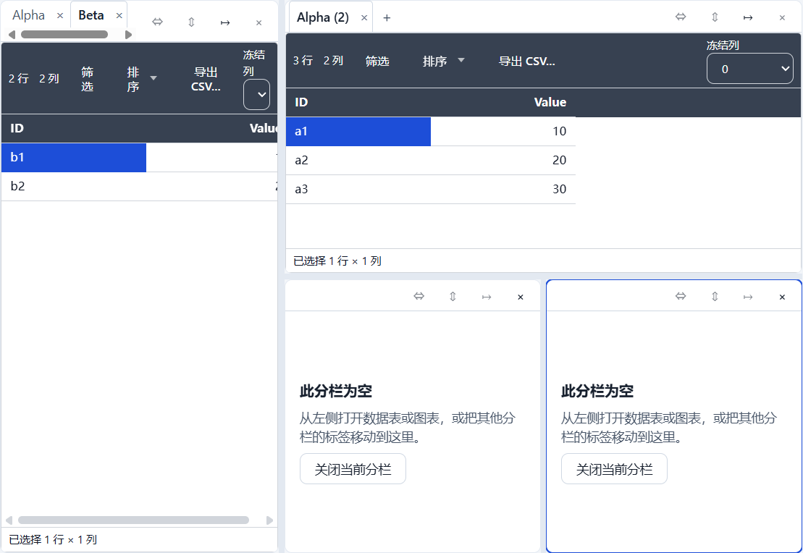

# T5.1 报告 — 分栏布局与标签页

- 任务：T5.1（FR-WS-02；SPEC §12；TESTPLAN E7 布局部分）
- 日期：2026-10-27
- 决策：ADR-046（递归分栏、活动 pane、标签移动、500ms 布局保存去抖、非法布局回退）
- 状态：已完成；M5 继续 T5.2（本任务不是里程碑停点）

## 1. 目标与交付

1. **递归分栏**：`LayoutNode` 直接驱动渲染，pane 拥有独立标签栏与活动视图；split 支持
   水平/垂直、0.2–0.8 比例、最多 4 pane。
2. **标签页**：每个 pane 独立标签；新建/复制视图、关闭标签、关闭空 pane、按视觉顺序
   “移动到下一分栏”；关闭最后一个标签会折叠 pane，全部关闭时保留一个空根 pane。
3. **持久化与恢复**：每个 pane 的 `activeViewId` 与 split 比例写入 `manifest.layout`；
   纯布局变更（激活、分栏、移动、比例）500ms 去抖合并写盘，`Ctrl+S`/关闭工作区/flush
   会冲掉定时器；视图新建/删除/更新仍立即写。
4. **非法布局回退**：引用缺失/重复、比例越界、结构非法或 pane 数 >4 时，打开阶段用
   `views[]` 重建单 pane（保留全部视图），显示 warning；其它 manifest 错误仍拒绝打开。
5. **键鼠与 200%**：分隔条可拖拽或方向键调 2%；标签 Arrow 循环；Ctrl+W 关闭；200% 缩放下
   2 pane 与分隔条仍在视口内。

不改变 `LayoutNode` 形状、`formatVersion`、JSONL、IPC、preload、CSP 或运行时依赖；没有新增
pane id/字段。唯一命令载荷扩展是 `view.layout` 的可选 `activePanePath`（UI-only，不持久化）。

## 2. 关键文件

```text
packages/app-core/src/commands/layout.ts                 # PaneEntry/路径、split/move/prune/
                                                         # removePane/setRatio + 视图增删
packages/app-core/src/commands/{views,tables,charts}.ts  # activePanePath、layout 剪枝
packages/app-core/src/usecases/workspace-actions.ts      # split/closePane/move/ratio、
                                                         # 500ms scheduleLayoutSave + flush
packages/app-core/src/usecases/open-workspace.ts         # 活动 pane/视图恢复
packages/app-core/src/state/{types,store}.ts             # ui.activePanePath、focusPane
packages/persistence/src/manifest.ts                     # parseManifestDocument 单 pane 回退
apps/desktop/src/renderer/features/workspace/
├─ LayoutView.tsx                                       # 递归 split/pane、分隔条、pane 工具栏
└─ WorkspaceView.tsx                                    # 警告/快捷键/粘贴层 + LayoutView
apps/desktop/src/renderer/{i18n/messages/*,styles.css}  # pane 文案与分栏样式
apps/desktop/e2e/layout.spec.ts                         # 3 条 E2E
packages/app-core/src/commands/layout.test.ts            # 9 条纯函数测试
```

## 3. 公开 API / 契约

```ts
// @curve/app-core
interface PaneEntry { path: string; pane: PaneNode }
LAYOUT_ROOT_PATH = 'root'
listPaneEntries(layout): PaneEntry[]        // root、root.0、root.1、root.0.1…
findPaneEntry/findPaneByPath
addViewToLayout(layout, viewId, panePath?): string
activateViewInLayout(layout, viewId, panePath?): string
splitPaneInLayout(layout, panePath, direction): { layout, panePath }
moveViewToPane(layout, viewId, targetPanePath): LayoutNode
removeViewFromLayout(layout, viewId): LayoutNode   // 折叠空 pane
removePaneFromLayout(layout, panePath): LayoutNode
setSplitRatio(layout, splitPath, ratio): LayoutNode
pruneEmptyPanes(layout): LayoutNode

// UiState / actions（UI-only，不写 manifest）
activePanePath: string | null
focusPane(path): void

// WorkspaceActions
splitPane(direction: 'horizontal' | 'vertical'): Promise<ActionOutcome>
closePane(): Promise<ActionOutcome>                 // 只允许空 pane
moveViewToNextPane(viewId: string): Promise<ActionOutcome>
setLayoutRatio(splitPath: string, ratio: number): Promise<ActionOutcome>
LAYOUT_SAVE_DELAY_MS = 500

// @curve/persistence
parseManifestDocument(raw): ValidatedManifest       // layout 非法时单 pane 回退 + warning

// DOM 契约（只读，E2E）
layout:        data-layout-panes
pane:          data-pane-path, data-pane-active     // 不用网格的 data-active
split-handle:  data-split-path, aria-valuenow/orientation
空 pane:       data-testid="workspace-empty" + data-pane-empty="true"
```

## 4. 语义实现（对照 ADR-046）

| 项 | 语义 |
|---|---|
| 活动 pane | `ui.activePanePath`（`root`/`root.0`…）；打开时取第一个有活动标签的 pane；pane 的 `activeViewId` 持久化，最后聚焦 pane 不持久化 |
| 分栏 | 当前 pane → `split(原 pane, 空 pane)`，比例 0.5，新 pane 聚焦；不创建/移动视图；>4 pane 拒绝 |
| 移动标签 | 按视觉顺序移到下一 pane；源 pane 空则折叠；不做跨 pane 拖拽 |
| 关闭 | 关闭标签走 `view.delete`；空 pane 折叠；全部关闭保留空根 pane；“关闭分栏”只对空 pane |
| 比例 | 拖拽只更新本地比例，`pointerup` 提交一条 `view.layout`；键盘 ±2%；schema 限制 0.2–0.8 |
| 保存 | 纯布局变更 500ms 去抖（`scheduleLayoutSave` → `SaveQueue.enqueueManifest`）；`flushSaves`/close/`Ctrl+S` 冲掉；视图增删改立即写 |
| 回退 | `parseManifestDocument` 正常校验失败 → 用 `views[]` 重建单 pane 重试；成功则 warning，原文件不改写；其它错误仍拒绝 |
| 空态 | 复用 `workspace-empty`；空 pane 提供“关闭当前分栏”，不自动打开已有视图；pane 没有活动标签时显示第一个标签 |
| 键盘 | 标签 ArrowLeft/Right 循环、Ctrl+W 关闭；分隔条 Tab + 方向键；200% 冒烟 |

## 5. E2E 与测试

`apps/desktop/e2e/layout.spec.ts`（3 条，全量套件内 5.2s / 2.2s / 2.5s）：

1. **layout-split**：2 表 3 视图 → 水平分栏 → 把 `Alpha (2)` 移到第二 pane → 拖比例到
   0.35 → 垂直分栏到 3 pane → 空 pane 水平分栏到 4 pane（按钮禁用）→ 关闭空 pane 回到 2
   pane → 等待保存 → 重启同一 `userData`，断言 2 pane、比例、每个 pane 的活动标签。
2. **layout-fallback**：写入缺失视图引用的 layout → 打开显示 warning、单 pane、3 个标签都在；
   再写入 ratio 0.1 的 layout → 同样回退，`manifest.views` 未丢。
3. **layout-keyboard**：标签 ArrowRight 切换、Ctrl+W 关闭、垂直分栏、分隔条 ArrowDown 到
   52%、200% 缩放下分隔条与 pane 操作按钮在视口内。

单元测试：`layout.test.ts` 9 条（路径、split、折叠、移动、比例、removePane）、
`workspace-actions.test.ts` +2 条（分栏/移动/比例合并写盘、5 pane/比例/最后 pane 限制）、
`manifest.test.ts` +3 条（缺失引用/非法比例回退、非布局错误仍拒绝）。

## 6. 验证命令与结果（2026-10-27 本机）

```text
pnpm verify
  164 files / 1519 tests passed；ESLint 0；
  depcruise 450 modules / 1892 deps / 0 violations

pnpm test:coverage
  statements 75.84% / branches 68.82% / functions 74.49% / lines 75.99%
  全局阈值 70/60 未下调；新增 LayoutView 主要由 E2E 覆盖，
  app-core layout.ts lines 78.52%（纯布局函数，非 domain/table-engine/chart-model 的 85% 门禁）

pnpm build
  exit 0；renderer 3,273.65 kB、CSS 74.30 kB；ImportSession 42.82 kB；
  table/query/import worker 220.68/236.16/270.16 kB

pnpm e2e
  85 passed（4.3m）；layout.spec 3 条 5.2s / 2.2s / 2.5s；
  chart-perf resolve 44ms / update 85ms、切换后 private 588MB/600MB

pnpm bench
  exit 0；table.open 334ms/3s、table.save 348ms/500ms、edit 0ms/50ms、
  query 196ms/400ms、text-sort 281ms/400ms、cjk-sort 461ms/800ms、
  import 628ms/8s、condition 0ms/16ms；
  chart.resolve-sample P95 126ms/300ms、chart.sample 3ms/50ms、
  chart.option.2k 1ms/50ms、chart.restyle.100k 0ms/20ms

pnpm exec playwright test --config apps/desktop/playwright.config.ts \
  apps/desktop/e2e/layout.spec.ts
  3 passed（11.1s）
```

## 7. 截图证据





## 8. 残留风险与未覆盖

- **最后聚焦的 pane 不持久化**：`ui.activePanePath` 是 UI-only；重启后焦点落在第一个有活动
  标签的 pane，但每个 pane 的标签选择与比例都恢复。要精确保留焦点需新增 manifest 字段与迁移
  （ADR-046 复核条件）。
- **分栏后是空 pane**：分栏不自动复制/搬移视图；用户需移动标签或新建视图。换来分栏不产生
  隐式文档变更。v1 也没有跨 pane 拖拽（只有“移动到下一分栏”）。
- **有标签的 pane 不能一键关闭**：必须逐个关闭标签；“关闭分栏”只对空 pane。避免 manifest 中
  出现不在 layout 的“隐藏视图”。
- **500ms 去抖窗口**：直接强退可能丢最后 500ms 的焦点/比例/分栏变化；`Ctrl+S`、关闭工作区与
  保存队列 flush 会冲掉。T5.3 统一退出 flush。
- **空 pane 复用 `workspace-empty`**：多 pane 时可能有多个同名 testid；新增测试必须限定在
  pane 内。
- **回退只修复 layout**：其它 manifest 不合法仍拒绝打开；warning 为英文、原文件在下一次保存前
  保持原样；修复后的 layout 不会立即回写。
- **覆盖率下降**：全局 lines 75.99%（T5.1 前 76.47%），新增 `LayoutView.tsx` 主要由 E2E 覆盖；
  仍高于全局 70/60 阈值，纯逻辑包门禁未变。
- **200% 冒烟只在 2 pane**：4 pane 的比例/空态在 100% 下覆盖；4 pane × 200% 未单独断言。
- **布局写失败只进保存状态**：`scheduleLayoutSave` 不把错误返回给调用方，失败由状态栏/重试
  暴露（与 `enqueueManifest` 一致）。
- **布局命令与撤销栈的交互留给 T5.2**：`view.layout` 不在 `EditHistory` 的可记录命令集中，
  不会进入 undo，但有 patches 时仍会清空 redo（与 T5.1 前的 `activateView` 行为相同）。
  E7 第 4 步“标签切换/选择不进入历史”由 T5.2 统一裁决；本任务未改 `EditHistory`。
- **chart-perf 内存余量仍小**：本次 588MB/600MB；T4.6 的既有风险不变。

## 9. 结论与停点

T5.1 的四项验收全部通过：4 pane（水平/垂直/上限）、比例拖拽/键盘、重启后布局与每个 pane
的活动标签、非法 layout 回退单 pane 且视图不丢、键盘切换/关闭与 200% 缩放。布局变更走命令
总线，纯布局写盘 500ms 去抖并在 flush/关闭时补齐；没有改 `formatVersion`/JSONL/IPC/preload/
CSP 或新增运行时依赖。新增 ADR-046、SPEC §6.6/§12/§13.1 实现边界、TASKS T5.1 与
`docs/reports/t5.1/REPORT.md`。

**停点**：T5.1 完成；M5 继续 **T5.2（撤销/重做）**，不是里程碑停点。

> 后续（2026-10-28）：T5.2 已完成（ADR-047）。`view.layout` 的纯标签/焦点切换是瞬态、不入
> 历史也不清 redo；分栏/移动/比例/关闭 pane 作为结构变更可撤销。本报告 §8 中“留给 T5.2”的
> 条目已由 `docs/reports/t5.2/REPORT.md` 与 ADR-047 关闭。
