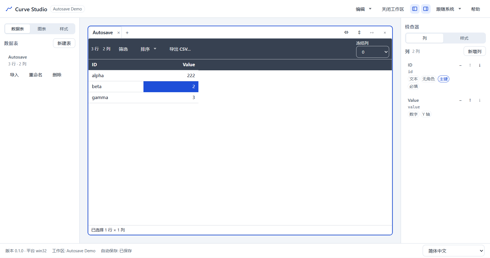
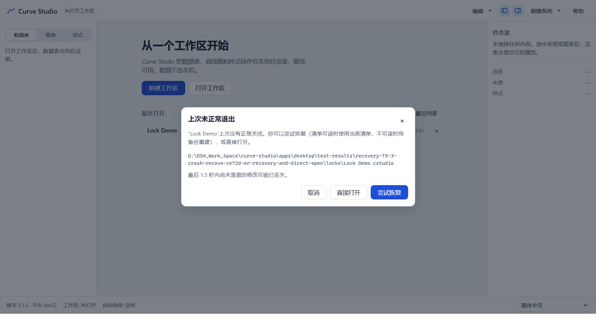
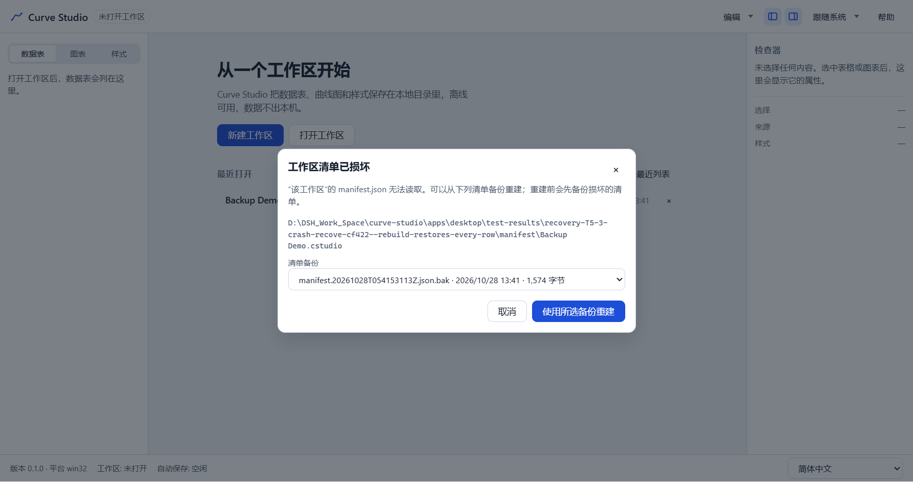

# T5.3 报告 — 自动保存、恢复与最近打开

- 任务：T5.3（FR-WS-01、FR-WS-03；SPEC §7.5、§13.3；TESTPLAN E8）
- 日期：2026-10-28
- 决策：ADR-048（1.5s/10s 自动保存窗口、3s 退出握手、锁/清单恢复、最近列表）
- 状态：已完成；M5 继续 T5.4（本任务不是里程碑停点）

## 1. 目标与交付

1. **自动保存**：`SaveQueue` 实现 SPEC §13.3 的 1.5s trailing 去抖与 10s 强制上限；表 → manifest
   仍按单循环串行写。`flush()`（Ctrl/Cmd+S、关闭工作区、退出握手）与 `retry()` 取消定时器立即写；
   失败保留 `ui.dirtyTables`/`ui.save.error`，状态栏“保存失败（重试）”可用。
2. **退出握手**：main 拦截 `BrowserWindow.close`/`app.before-quit`，发送 `app:quit-requested`；
   renderer flush ≤3s，成功时调用 `workspace.close` 删除 `.lock` 并回复
   `app:quit-response { action: 'quit', flushed: true }`。失败或 3s 无响应时原生“退出/取消”确认；
   取消保持应用打开，`flushed: false` 时故意保留 `.lock` 供下次恢复。新增单实例锁。
3. **崩溃恢复**：只读 `workspace:inspect` 返回锁/manifest 状态与 `backups/manifest.*.json.bak`
   列表；`workspace:open` 增加可选 `recovery`。欢迎页恢复对话框提供“尝试恢复/直接打开”，
   manifest 不可读时列出备份并二次确认重建；取消不写任何文件。
4. **最近列表**：`recent.json` 的 remove/clear、`workspace:recent:remove|clear`、preload
   `recentRemove/recentClear` 与欢迎页移除/清空按钮。
5. **失败清理**：逐表读取/解码失败时关闭已打开的工作区，避免半打开状态与 stale lock。
6. **不改变**：`formatVersion`、manifest 字段、JSONL/CSV/图表格式、CSP、运行时依赖；
   `SaveQueue` 仍是唯一写表路径；T5.1/T5.2 的布局、历史与图表契约不变。

## 2. 关键文件

```text
packages/app-core/src/usecases/save-queue.ts            # 1.5s/10s 窗口、flush/retry 立即写
packages/app-core/src/usecases/open-workspace.ts        # 逐表失败时 close 工作区
packages/persistence/src/types.ts                       # recovery/inspection 类型
apps/desktop/src/main/quit-guard.ts                     # 3s 退出握手状态机
apps/desktop/src/main/index.ts                          # close/before-quit、原生确认、单实例
apps/desktop/src/main/workspace/file-workspace-store.ts # inspect / manifest 备份重建 / recent
apps/desktop/src/main/workspace/recent-list.ts          # remove/clear
apps/desktop/src/main/ipc/handlers.ts                   # inspect/recent/quit 通道
apps/desktop/src/shared/contracts/{channels,ipc}.ts     # 通道、Zod schema、CurveApi
apps/desktop/src/preload/{api,index}.ts                 # 白名单方法与事件订阅
apps/desktop/src/renderer/api-client.ts                 # 双向校验
apps/desktop/src/renderer/app-core/workspace-store.ts   # inspect/recentRemove/recentClear
apps/desktop/src/renderer/app-core/use-workspace-controller.ts
apps/desktop/src/renderer/app-core/use-quit-guard.ts    # flush → close → respond
apps/desktop/src/renderer/features/workspace/
├─ workspace-open-flow.tsx                              # 预检 + 恢复流程
├─ WorkspaceRecoveryDialog.tsx                          # 两个恢复对话框
├─ WelcomePage.tsx                                      # 最近列表移除/清空
└─ OpenWorkspaceDialog.tsx                              # 统一走 open flow
apps/desktop/src/renderer/{App.tsx,shell/AppShell.tsx}
apps/desktop/src/renderer/i18n/messages/{zh-CN,en-US}.ts
apps/desktop/src/renderer/styles.css
apps/desktop/e2e/{autosave,recovery}.spec.ts + workspace-seed.ts
```

## 3. 公开 API / 契约

```ts
// @curve/app-core
AUTOSAVE_DELAY_MS = 1_500
AUTOSAVE_MAX_DELAY_MS = 10_000
createSaveQueue({ autosaveDelayMs?, autosaveMaxDelayMs?, … })

// @curve/persistence
interface WorkspaceRecoveryChoice { acceptStaleLock?: boolean; manifestBackup?: string }
type WorkspaceLockStatus = 'none' | 'active' | 'stale' | 'corrupt'
type WorkspaceManifestStatus = 'ok' | 'missing' | 'invalid' | 'unsupported'
interface WorkspaceInspection { dir; name; lock; manifest; errorCode?; backups: BackupEntry[] }
interface OpenWorkspaceRequest { dir; recovery?: WorkspaceRecoveryChoice }

// IPC（SPEC §15.1 / §15.4）
app:quit-requested        M→R  { reason: 'window-close' | 'app-quit' }（事件）
app:quit-response         R→M  { action: 'quit' | 'cancel'; flushed: boolean } → { ok: true }
workspace:inspect         R→M  { dir } → WorkspaceInspection
workspace:open            R→M  { dir, recovery? } → { manifest, warnings }
workspace:recent:remove   R→M  { path } → { ok: true }
workspace:recent:clear    R→M  {} → { ok: true }

// window.api
app.onQuitRequested(handler): () => void
app.respondToQuit({ action, flushed }): Promise<IpcResult<{ ok: true }>>
workspace.inspect({ dir })
workspace.recentRemove({ path }), workspace.recentClear()
```

DOM 契约（E2E）：恢复对话框 `role="dialog"` 名称为“上次未正常退出/工作区清单已损坏”，
备份选择 `data-testid="recovery-backup-select"`；最近列表 `recent-remove`/`recent-clear`；
保存状态沿用 `data-testid="autosave-status"`。

## 4. 语义实现（对照 ADR-048）

| 项 | 语义 |
|---|---|
| 保存窗口 | 最后一次变更后 1.5s；第一次待写变更起最多 10s；连续编辑重置 1.5s 但被 10s 裁剪 |
| 立即写 | `flush()`、`retry()` 取消定时器并运行；Ctrl/Cmd+S、关闭工作区、退出握手都走 `flushSaves()` |
| 串行 | 单循环按表写 JSONL → manifest；写期间再次入队合并为一次后续写 |
| 失败 | 保留 dirty 与 `ui.save.error`，停止循环；下一次编辑/重试恢复；内存文档不变 |
| 退出成功 | renderer flush 成功后 `workspace.close` 释放锁并回复 `flushed: true` |
| 退出失败 | 回复 `flushed: false` → 原生确认；取消保持应用打开；确认退出保留 `.lock` |
| 退超时 | main 3s 计时到点直接确认；renderer 迟到回复被忽略；不永久阻塞 `before-quit` |
| stale/corrupt 锁 | `inspect` 只读报告；UI 提供尝试恢复/直接打开；任何恢复前 active lock 仍拒绝 |
| manifest 损坏 | 列出 `backups/manifest.*.json.bak`；取消不写文件；重建先备份损坏清单再原子写 |
| 自动恢复 | `acceptStaleLock` 只在 stale/corrupt 锁 + manifest 不可读时尝试最新备份 |
| 打开失败 | 逐表读取/解码失败 → `workspace.close` → 返回错误 |
| 最近列表 | 移除按路径（Windows 大小写不敏感）、清空写 `[]`；缺失/损坏文件重建 |
| 不改变 | manifest/JSONL/CSP/`formatVersion`/运行时依赖；T5.1/T5.2/M4 契约不变 |

## 5. 测试

### 5.1 单元测试（`pnpm test`：167 files / 1569 tests）

- `save-queue.test.ts` 13 条（+6）：默认 1.5s/10s 常量、1500ms 后写、每次变更重置窗口、
  连续编辑 10s 强制、flush/retry 绕过窗口；原有串行/合并/失败/超时用例保持。
- `open-workspace.test.ts`：逐表读取失败时 state 不变、`workspace` 为 null 且 `close` 调用一次。
- `file-workspace-store.test.ts` 24 条（+4）：inspect 不写文件、显式备份重建（行相等、损坏清单
  被备份）、stale 锁 + 损坏 manifest 用最新备份、非法/不存在备份不改字节。
- `m1-acceptance.test.ts`（+1）：clean inspect、stale 锁恢复、manifest 损坏取消不改字节 /
  备份重建后 1,000 行逐行相等。
- `recent-list.test.ts`（+2）：remove 大小写不敏感、clear 写 `[]`、文件缺失时 remove/clear 可用。
- `quit-guard.test.ts` 8 条：请求一次、成功立即退出、失败确认、取消保持、3s 超时确认、
  迟到回复忽略、renderer 不可达时兜底。
- `use-quit-guard.test.tsx` 4 条：flush → close → respond、flush 失败不 close、close 失败仍回复、
  无工作区时直接回复。
- `handlers.test.ts`（+2）：inspect/recent 通道转发与非法载荷、quit 握手转发。
- `api-client.test.ts`（+3）、`preload/api.test.ts`（+2）、`channels.test.ts`、`ipc.test.ts`（+3）：
  通道集合、Zod 契约、事件订阅与取消、quit 响应校验。
- `e2e-hooks.test.ts`（+2）：`CURVE_E2E_QUIT_CONFIRM` 仅未打包 + E2E 生效。

### 5.2 E2E（8 条，`pnpm e2e` 96 passed / 5.7m）

1. **autosave-debounce-and-ctrl-s**（5.0s）：编辑后状态“保存中”，1.5s 窗口后 JSONL 落盘并回到
   “已保存”；再编辑并 Ctrl+S，1.4s 内落盘。
2. **autosave-quit-flush**（3.8s）：编辑后立即 `app.quit()`（去抖窗口内）→ 进程退出 → 同
   userData 重启 → 无恢复提示、值已恢复。
3. **autosave-failure-retry**（4.1s）：只读表文件 → 状态“保存失败”、内存值保留；此时 `app.quit()`
   被确认替身取消，窗口仍在；恢复写权限后点“重试” → “已保存”且 JSONL 更新。
4. **autosave-recent-list**（2.8s）：两个最近工作区 → 移除一条 → 清空 → 重载后仍为空。
5. **recovery-force-kill**（6.0s）：提交 555 并落盘 → 编辑 999 → `taskkill /F /T` 杀 main →
   重启出现“上次未正常退出”与“最后 1.5 秒”提示 → 尝试恢复 → 555 仍在、stale lock warning。
6. **recovery-lock-choices**（2.8s）：伪造 stale 锁 → “直接打开”成功；伪造 corrupt 锁 →
   “尝试恢复”成功并显示 unreadable warning。
7. **recovery-keyboard**（2.7s）：200% 缩放下恢复对话框在视口内；Esc 关闭且不打开工作区；
   Tab×3 聚焦“尝试恢复”后 Enter 打开工作区（纯键盘）。
8. **recovery-manifest-backup**（2.8s）：损坏 manifest → 备份列表 → 取消后字节不变 →
   重建后 3 行数据可见、manifest 只引用 `tbl_simple`。

## 6. 验证命令与结果（2026-10-28 本机）

```text
pnpm verify
  167 files / 1569 tests passed；ESLint 0；
  depcruise 464 modules / 1967 deps / 0 violations

pnpm test:coverage
  statements 75.90% / branches 68.81% / functions 74.53% / lines 76.05%
  main/quit-guard.ts lines 88.52%
  renderer/app-core/use-quit-guard.ts lines 93.75%
  app-core/usecases/save-queue.ts lines 89.15%
  全局阈值 70/60 未下调

pnpm build
  exit 0；renderer 3,306.03 kB、CSS 75.14 kB；ImportSession 42.82 kB；
  table/query/import worker 220.68/236.16/270.16 kB

pnpm e2e
  96 passed（5.7m）；autosave 5.0s/3.8s/4.1s/2.8s、recovery 6.0s/2.8s/2.7s/2.8s

pnpm exec playwright test --config apps/desktop/playwright.config.ts \
  apps/desktop/e2e/autosave.spec.ts apps/desktop/e2e/recovery.spec.ts
  8 passed（31.4s）

pnpm bench
  exit 0；table.open 347ms/3s、table.save 274ms/500ms、edit 0ms/50ms、
  query 232ms/400ms、text-sort 284ms/400ms、cjk-sort 561ms/800ms、
  import 711ms/8s、condition 1ms/16ms；
  chart.resolve-sample P95 85ms/300ms、chart.sample 3ms/50ms、
  chart.option.2k 1ms/50ms、chart.restyle.100k 0ms/20ms；
  memoryPeakMB 942（Node 管线趋势，非应用门禁）
```

## 7. 截图证据








## 8. 残留风险与未覆盖

- **强杀仍可能丢最后 1.5s 编辑**：SPEC §13.3 的既定取舍；恢复对话框明确提示。若不可接受，需要
  写前日志/检查点，另写 ADR。
- **flush 失败后确认退出会留下 stale lock**：下次启动多一次恢复提示；这是有意把“未正常退出”
  如实呈现，而不是静默清锁。
- **原生退出确认/恢复提示为英文**：main 没有 i18n；与既有 About/文件对话框一致。恢复对话框本身
  （renderer）已中英文；仅 main 的原生确认文案未本地化。
- **`inspect` 每次打开多读一次 manifest**：几十 KB 量级；换取“取消恢复不写文件”的可测试语义。
- **自动重建只尝试最新一份备份**：遵循 SPEC §7.5；最新备份自身损坏时不回溯更旧备份。
- **两个 stale-lock 按钮在 manifest 可读时行为相同**：SPEC 要求提供两个选项；真正差异在 manifest
  不可读时（直接打开失败、尝试恢复可重建）。
- **自动保存关闭后的“保存/放弃/取消”三选一未实现**：当前自动保存始终开启；T5.5 设置任务需要
  补该交互（ADR-048 复核条件）。
- **`workspace-open-flow.tsx`/恢复对话框没有组件级测试**：由 8 条 E2E 覆盖完整决策路径；纯逻辑
  （inspect/open 校验、quit guard、save queue）有单测。
- **E2E 的 `CURVE_E2E_QUIT_CONFIRM` 是测试钩子**：仅未打包 + `CURVE_E2E=1` 生效。

## 9. 结论与停点

T5.3 的六项验收全部通过：强杀恢复已提交数据并提示 1.5s 窗口、保存失败可见可重试、
退出 flush 成功且超时确认不卡死、Ctrl+S 立即落盘、最近列表可移除/清空、stale/corrupt 锁与
损坏 manifest 的恢复/直接打开选择且取消不改字节。保存队列仍是唯一写表路径，未改
`formatVersion`/JSONL/CSP 或新增运行时依赖。新增 ADR-048、SPEC §7.5/§12/§13.3/§15.1/§15.4
实现边界、TASKS T5.3、TESTPLAN E8 覆盖说明与 `docs/reports/t5.3/REPORT.md`。

**停点**：T5.3 完成；M5 继续 **T5.4（快捷键与命令面板）**，不是里程碑停点。
