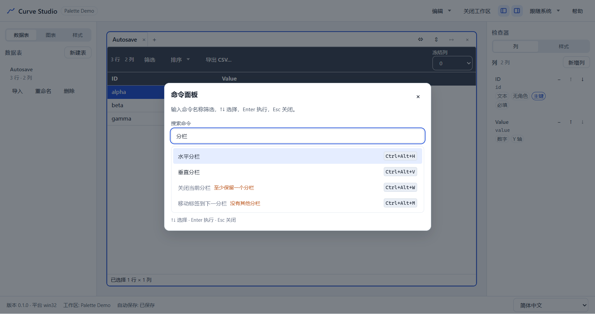
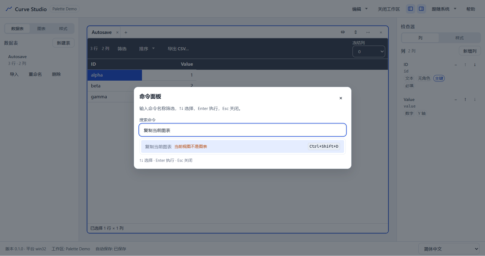
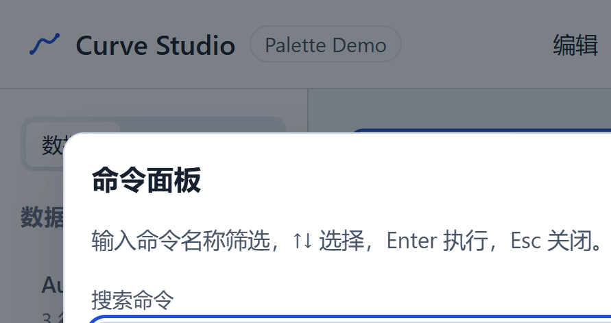

# T5.4 报告 — 快捷键与命令面板

- 任务：T5.4（FR-WS-02、NFR-03；SPEC §9.1、§13.2、§13.4、§16.3；TESTPLAN E11）
- 日期：2026-10-28
- 决策：ADR-049（renderer 键位注册表、作用域、冲突检测、命令面板、最近使用）
- 状态：已完成；M5 继续 T5.5（本任务不是里程碑停点）

## 1. 目标与交付

1. **键位注册表**：`apps/desktop/src/renderer/features/keymap/` 的 `APP_COMMANDS` 声明
   `{ id, labelKey, shortcuts, scopes, visibleInPalette, isEnabled, run }`；只调用既有
   `core.actions`/Shell 回调，不在 app-core 增加命令包装层。
2. **作用域**：`global`（任何界面）、`workspace`（有工作区）、`grid`（活动视图是数据表）、
   `chart`（活动视图是图表）。作用域是“可用上下文”，不是局部按键所有权。
3. **冲突检测**：快捷键归一化后按作用域交集检测；构造 keymap 时发现冲突直接抛
   `KeymapConflictError`。`grid`/`chart` 两个互斥作用域可复用 Ctrl/Cmd+Shift+D。
4. **命令面板**：Ctrl/Cmd+K 打开；`Dialog` + `Input` + `role=listbox/option` +
   `aria-activedescendant`；标签/命令 id 子序列模糊搜索；空查询最近使用优先；禁用项显示
   结构化原因；↑↓/Home/End/Enter/Esc/鼠标可用。
5. **最近使用**：最多 8 条，存 `localStorage['curve-studio.recent-commands']`（UI 偏好，
   不写 manifest）；只在打开面板时读取。
6. **帮助与发现性**：`HelpDialog` 的快捷键表由同一注册表生成；F1 打开帮助。
7. **不改**：`formatVersion`、manifest 字段、JSONL/CSV/图表格式、IPC/preload、CSP、
   Electron 安全选项、运行时依赖；网格/编辑器/标签/分隔条/对话框的局部键盘契约不变。

## 2. 关键文件

```text
apps/desktop/src/renderer/features/keymap/
├─ shortcut.ts                 # 解析/归一/格式化/匹配（Ctrl/Cmd、Shift、Alt、F1）
├─ keymap.ts                   # 作用域、冲突检测、keydown 分发、editable 目标保护
├─ command-context.ts          # CommandContext / scopes / 不可用原因联合
├─ commands.ts                 # APP_COMMANDS、handlers 绑定、禁用原因 → i18n key
├─ command-search.ts           # 子序列模糊评分与排序
├─ recent-commands.ts          # localStorage 最近使用（容错/去重/上限）
├─ palette-model.ts            # 打开面板时的可用性快照
├─ use-command-keymap.ts       # 全局监听、命令执行、面板状态/最近使用
├─ CommandPalette.tsx          # Dialog + combobox/listbox 渲染与键盘
└─ *.test.ts(x)                # 7 个单测文件 + CommandPalette.test.tsx

apps/desktop/src/renderer/shell/AppShell.tsx     # 条件挂载 palette/help，不订阅文档 store
apps/desktop/src/renderer/shell/HelpDialog.tsx   # 命令快捷键表
apps/desktop/src/renderer/features/workspace/WorkspaceView.tsx  # 移除旧 keydown
packages/ui/src/Input.tsx                        # 支持 ref（initialFocus）
apps/desktop/src/renderer/i18n/messages/{zh-CN,en-US}.ts
apps/desktop/src/renderer/styles.css
apps/desktop/e2e/palette.spec.ts                 # 3 条 E2E
```

## 3. 公开行为 / 契约

```ts
// renderer 内部（非 app-core 公共 API）
type CommandScope = 'global' | 'workspace' | 'grid' | 'chart';
type CommandDisabledReason =
  'no-workspace' | 'no-view' | 'no-table-view' | 'no-chart-view' | 'no-history' | 'no-redo' |
  'no-pane' | 'max-panes' | 'single-pane' | 'pane-not-empty' | 'no-second-pane' | 'theme-active';

interface KeymapCommand {
  id: string;
  shortcuts: readonly string[];
  scopes: readonly CommandScope[];
  isEnabled(context: CommandContext): CommandAvailability;
  run(context: CommandContext): void;
}

createKeymap(commands): Keymap; // 冲突时抛 KeymapConflictError
// Keymap.handleKeyDown(event, context): ignored | handled | disabled(reason)

RECENT_COMMANDS_STORAGE_KEY = 'curve-studio.recent-commands';
MAX_RECENT_COMMANDS = 8;
```

E2E/DOM 契约：

- 对话框名称：`命令面板`、`键盘快捷键`。
- `data-testid="command-palette"`、`command-palette-input`、`command-palette-list`。
- 选项：`role="option"`、`data-command-id`、`data-command-recent`、`aria-selected`、
  `aria-disabled`；输入框 `role="combobox"` + `aria-activedescendant`。
- 无结果：面板内 `role="status"` 文本“没有匹配的命令。”。

## 4. 语义实现（对照 ADR-049）

| 项 | 语义 |
|---|---|
| 分发顺序 | 局部组件（网格/编辑器/标签/分隔条/Menu/Dialog）先处理；全局监听在 window 冒泡阶段 |
| 跳过条件 | `defaultPrevented`、`repeat`、`isComposing`、input/textarea/select/contenteditable/`[role=dialog]` |
| 作用域 | `global` 恒真；`workspace` 需工作区；`grid`/`chart` 看活动视图 kind |
| 冲突 | 作用域上下文有交集且规范化快捷键相同 → 抛错；`grid` 与 `chart` 不相交 |
| 快捷键表 | 面板 Ctrl/Cmd+K、帮助 F1、保存 Ctrl/Cmd+S、撤销 Ctrl/Cmd+Z、重做 Ctrl/Cmd+Shift+Z 与 Ctrl/Cmd+Y、关闭视图 Ctrl/Cmd+W、侧栏 Ctrl/Cmd+B、检查器 Ctrl/Cmd+Alt+I、分栏 Ctrl/Cmd+Alt+H/V、关闭分栏 Ctrl/Cmd+Alt+W、移动标签 Ctrl/Cmd+Alt+M、复制视图/图表 Ctrl/Cmd+Shift+D |
| 面板打开 | 读取最近使用、按当前 state 快照 `isEnabled`、条件挂载 Dialog |
| 面板执行 | `runCommand` 重新读取 state 并复查可用性；成功后记录最近使用并关闭 |
| 禁用 | 仍列出，显示 `command.reason.*`；Enter 不执行 |
| 最近使用 | 去重、移动到队首、最多 8 条；存储缺失/损坏/不可用时回退空列表 |
| 性能 | AppShell 不订阅 store；面板/帮助关闭时不挂载；最近使用延迟读取 |

## 5. 测试

### 5.1 单元/组件（`pnpm test`：174 files / 1634 tests）

- `shortcut.test.ts` 10 条：Ctrl/Cmd 归一、修饰键顺序/别名、F1/Esc、非法输入、平台格式化、
  精确修饰键匹配、签名等价。
- `keymap.test.ts` 14 条：global 与各作用域冲突、grid/chart 互斥复用、同命令重复声明、
  构造抛错、handled/disabled/ignored、F1、input/textarea/select/contenteditable/dialog 保护、
  repeat/composition/defaultPrevented、metaKey。
- `command-search.test.ts` 10 条：子序列/大小写/中文、前缀优先、空查询、id 匹配、去重、
  最近使用排序与同分 tie-break。
- `recent-commands.test.ts` 6 条：损坏 JSON、非数组、非字符串、去重/上限、移到队首、
  存储异常与缺失。
- `commands.test.ts` 11 条：唯一 id、合法快捷键、0 冲突、锁定快捷键表、核心命令都有快捷键、
  各 `isEnabled` 原因、handlers 分发（含 chart/table 互斥）。
- `palette-model.test.ts` 2 条：可见性过滤、原因/最近 rank。
- `CommandPalette.test.tsx` 9 条：关闭不渲染、初始焦点、过滤+Enter、↑↓/Home/End、Esc、
  禁用原因、空态、最近优先、点击执行。
- `App.test.tsx` +3：F1、Ctrl+K 打开→执行帮助→Esc、输入/下拉框内 Ctrl+K 不劫持。

### 5.2 E2E（`apps/desktop/e2e/palette.spec.ts` 3 条，单跑约 9–11s）

1. **palette-runs-commands**（3.1s）：Ctrl+K → 输入“分栏” → 显示水平/垂直/关闭/移动及快捷键
   → Enter 水平分栏（pane=2）→ 再次打开时该命令排第一且 `data-command-recent=true` →
   通过面板“撤销”回到 pane=1、`data-undo-depth=0`。
2. **palette-editor-safety**（3.4s）：单元格编辑器内 Ctrl+K 不打开面板；F1 帮助含“命令与快捷键”
   与“水平分栏/Ctrl+Alt+H”；表视图下“复制当前图表”显示“当前视图不是图表”且
   `aria-disabled=true`、Enter 不执行；面板输入框内 Ctrl+V 不触发命令；关闭面板后
   Ctrl+Alt+H 分栏、Ctrl+Z 撤销；Ctrl+Shift+D 复制表视图并可撤销。
3. **palette-keyboard-200**（3.1s）：200% 缩放下面板在视口内；↑↓/Home/End 改变
   `aria-activedescendant`；无结果态；执行“切换侧栏”后面板关闭且 `data-sidebar=closed`。

## 6. 验证命令与结果（2026-10-28 本机）

```text
pnpm verify
  174 files / 1634 tests passed；ESLint 0；
  depcruise 481 modules / 2028 deps / 0 violations

pnpm test:coverage
  statements 76.59% / branches 69.41% / functions 75.18% / lines 76.74%
  features/keymap lines 90.27% / branches 82.37%
  全局阈值 70/60 未下调

pnpm build
  exit 0；renderer 3,342.56 kB、CSS 77.49 kB；ImportSession 42.82 kB；
  table/query/import worker 220.68/236.16/270.16 kB

pnpm e2e
  99 passed（7.4m）；palette 3.1s/3.4s/3.1s；
  chart-perf 100k 切换 private 506MB（≤600MB）

pnpm bench
  exit 0；table.open 452ms/3s、table.save 394ms/500ms、edit 0ms/50ms、
  query 258ms/400ms、text-sort 365ms/400ms、cjk-sort 603ms/800ms、
  import 862ms/8s、condition 1ms/16ms；
  chart.resolve-sample P95 81ms/300ms、chart.sample 3ms/50ms、
  chart.option.2k 1ms/50ms、chart.restyle.100k 0ms/20ms；
  memoryPeakMB 911（Node 管线趋势，非应用门禁）
```

## 7. 截图证据







## 8. 性能/内存修复记录

第一版把 `CommandPalette`/`HelpDialog` 常驻挂载，并在 `AppShell` 中通过 `useAppState` 订阅
活动视图、历史、分栏等状态。单跑 `chart-perf` 时 100k 图表 11 次切换的 private 峰值到
**605–615MB**（门禁 600MB）。逐步隔离（无 hook / 仅 hooks / 仅 catalog / 无监听 / 空面板）
确认：问题不是单个纯函数，而是“常驻面板 + 整壳随文档状态重渲染”的组合；同时每次启动读取
最近使用也增加了不必要的初始化。

最终实现：

- `AppShell` 不订阅文档 store；keymap 在 keydown 时读 `core.store.getState()`。
- 面板只在 `paletteOpen` 时挂载；打开时读取最近使用、快照 `isEnabled`；执行前复查。
- HelpDialog 只在打开时挂载。
- 结果：全量 E2E 该场景 **506MB**，isolated 509–519MB；T4.6 的 resolve/update/实例数断言仍通过。

不要改回常驻面板或在 `AppShell` 里加文档订阅；若未来需要面板打开时实时刷新，应把订阅放进
只在打开时挂载的子树（ADR-049 复核条件）。

## 9. 残留风险与未覆盖

- **快捷键不可自定义**：v1 固定表；如需要用户覆盖，需新 ADR 与设置持久化。
- **Ctrl/Cmd+Alt 组合**：在部分 AltGr/输入法布局下可能被占用；输入框/对话框内不受影响。
  若目标键盘冲突，替换键位并更新 ADR/SPEC/单测。
- **面板可用性是打开时快照**：面板是模态的，打开期间文档不会变化；`runCommand` 执行前
  重新校验。若未来允许非模态面板，需要订阅或重新快照。
- **功能局部对话框未进入面板**：新建表/导入/筛选/导出 CSV/图表向导的 open 状态在功能组件
  本地；提升为全局命令需要 renderer 命令注册上下文（ADR-049 复核条件），T5.4 不做。
- **帮助对话框只列有快捷键的命令**：主题切换仅面板、无快捷键，因此不在帮助表中；面板中
  仍可见。若需要完整命令目录，扩展 `listShortcutCommands` 的过滤条件。
- **内存门禁依赖条件挂载**：见 §8；任何让 AppShell 随文档状态重渲染的改动都可能把 chart-perf
  推回 600MB 附近。

## 10. 结论与停点

T5.4 的三项验收全部通过：核心命令都有快捷键且冲突检测为 0；编辑器/输入框内 Ctrl/Cmd+K、
Ctrl/Cmd+C/V 不被劫持；命令面板可用 ↑↓/Home/End/Enter 键盘操作、Esc 关闭，并在 200% 缩放下
不越界。新增 ADR-049、SPEC §9.1/§13.2/§13.4/§16.3 实现边界、TASKS T5.4、TESTPLAN E11 与
本报告；全量 E2E **99 passed**，chart-perf 内存 **506MB**，未新增运行时依赖，未改
`formatVersion`/manifest/JSONL/IPC/CSP。

**停点**：T5.4 完成；M5 继续 **T5.5（设置与国际化）**，不是里程碑停点。
