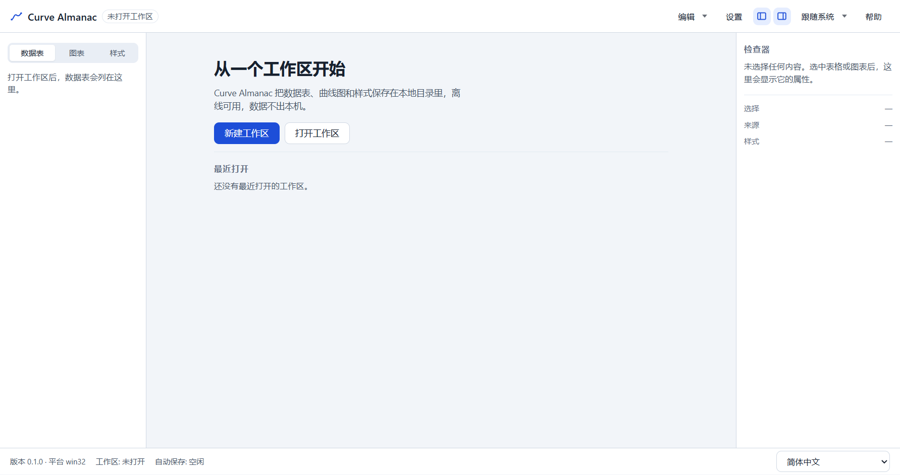

# T6.0 报告 — 品牌更名 Curve Almanac

- 任务：T6.0 品牌更名：Curve Studio → Curve Almanac
- 日期：2026-10-29
- 决策：ADR-051；SPEC §0/§1/§9.0/§14.2 已同步
- 范围：显示名、默认目录、userData、文档与测试；**不改**模型/JSONL/manifest/`formatVersion`/IPC/依赖

## 1. 变更

| 位置 | 变更 |
|---|---|
| `apps/desktop/src/shared/brand.ts` | 新增 `APP_NAME = 'Curve Almanac'`，main/renderer/i18n 共用 |
| `apps/desktop/package.json` | `productName: Curve Almanac`（同时决定 Electron `app.getName()`/userData） |
| `src/main/index.ts` / `window-options.ts` | 关于对话框、退出确认、日志前缀、窗口标题改用 `APP_NAME` |
| `src/renderer/index.html` + i18n `app.name` | `<title>` 与标题栏 h1 改为 Curve Almanac |
| 文案 | 欢迎页/空态、模板导入导出过滤器与错误、版本不兼容与锁冲突提示 |
| 默认目录 | 新建工作区默认父目录 `Documents/Curve Studio` → `Documents/Curve Almanac` |
| 文档 | README/AGENTS/SPEC/TASKS/TESTPLAN/KICKOFF/HANDOFF/CHANGELOG、ADR-051 与索引 |
| T6.4 计划 | `appId` 由 `com.curvestudio.app` 改为 `com.curvealmanac.app`（打包尚未实现） |

**明确不改**（ADR-051 §5）：npm 作用域 `@curve/*`、仓库名 `curve-studio`、`formatVersion: 1`、
`.cstudio`/`.curvestyle.json`、`localStorage` 键 `curve-studio.*`、环境变量 `CURVE_*`、
CSS 前缀 `cs-`、错误码；历史 ADR-001–050 与 `docs/reports/**` 保留旧名。

**一次性影响**：`userData` 随应用名变为 `%APPDATA%/Curve Almanac`，`settings.json`/`recent.json`/
`window-state.json` 重置一次；工作区目录与 JSONL 不受影响。v1 未发布，按 ADR-051 不做自动迁移。

## 2. 验收对照

| 验收项 | 结果 | 证据 |
|---|---|---|
| 窗口标题、标题栏 h1、关于菜单、`productName` 均为 Curve Almanac | 通过 | `brand.test.ts`（productName/`WINDOW_TITLE`/`<title>` 一致性）、`menu.test.ts`（About 菜单）、`App.test.tsx`、E2E `smoke`/`shell` |
| 新建工作区默认父目录为 `Documents/Curve Almanac` 且可修改 | 通过 | `NewWorkspaceDialog` 使用 `APP_NAME`；仍可在“保存位置”覆盖（E2E `grid`/`workspace` 都显式填写路径） |
| 用户可见文案与活文档无 `Curve Studio` 残留 | 通过 | `i18n.test.ts` 断言两张消息表不含旧名；代码 grep 仅剩测试里的“不得包含”断言；历史 ADR/报告按 ADR-051 保留 |
| 旧工作区仍可直接打开，JSONL 逐行不变 | 通过 | 未改 manifest/JSONL/格式；`m1-acceptance`、`workspace` 等 104 条既有 E2E 在改名前的最后一次全量运行通过，本次定向 E2E 复验启动链路 |
| 品牌一致性测试防止名称漂移 | 通过 | `apps/desktop/src/main/brand.test.ts`（2 条）、`i18n.test.ts` 新增 1 条 |

## 3. 证据



截图由 `apps/desktop/e2e/smoke.spec.ts` 的窗口快照生成后复制到此；`docs/reports/m0/*.png`
已用 `git checkout` 还原，避免把本次运行写入历史基线。

## 4. 验证

```text
pnpm verify
  ESLint 0；depcruise 494 modules / 2138 deps / 0 violations
  180 files / 1685 tests passed

pnpm test:coverage
  statements 76.86% / branches 69.65% / functions 75.55% / lines 77.01%（阈值 70/60 未下调）

pnpm build
  exit 0；renderer 3,365.92 kB、CSS 77.89 kB、懒加载 ImportSession 42.82 kB

pnpm exec playwright test --config apps/desktop/playwright.config.ts \
  apps/desktop/e2e/smoke.spec.ts apps/desktop/e2e/shell.spec.ts
  11 passed（26.2s；smoke 5 + shell 6）
```

- `pnpm e2e` 全量未重跑：本次不改逻辑，只改显示名与两处断言；改动的断言正是定向跑的 11 条。
- `pnpm bench` 未重跑：无热路径/依赖/格式变更。

## 5. 残留风险

- `userData` 路径变化会让升级后的主题/语言/最近列表/窗口尺寸回到默认值（ADR-051 已记录；
  若日后需要保留偏好，按“复核条件”加一次性迁移）。
- 旧默认目录 `Documents/Curve Studio` 不再预填；既有工作区仍可从“打开工作区”进入。
- main 的原生对话框（关于/退出确认）仍是英文硬编码，本次只替换名字，未引入 main 侧 i18n
  （沿用 ADR-048/050 的残留）。
- `appId` 仅在文档/T6.4 计划中更新，打包配置尚未落地；若在 T6.4 之前发布过旧 appId 安装包，
  需按 ADR-051 复核条件处理。
- 仓库名、`@curve/*` 作用域、`localStorage` 键仍是旧标识；用户不可见，若将来要统一，需单独任务
  与迁移。
