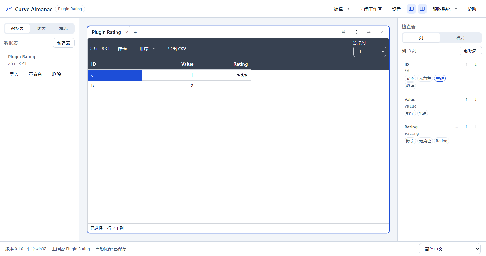

# T6.2 报告 — 示例插件

- 任务：T6.2 示例插件（依赖 T6.1）
- 日期：2026-10-30
- 决策：ADR-053；SPEC §14.1/§14.2/§14.3 已同步
- 范围：`plugins/plugin-sample`（`rating` 字段类型 + points 导入器）、渲染进程组装点、列对话框的
  语义类型、导入向导的插件导入器、主进程的 `fieldTypeId` 解析；**不接** T6.3 的其余贡献点

## 1. 交付

| 文件 | 内容 |
|---|---|
| `plugins/plugin-sample/src/rating.ts` | `ratingFieldType`（id `com.curvealmanac.rating`，storageType `number`，`★` 格式化，1–5 校验，nulls-last 比较） |
| `plugins/plugin-sample/src/points-importer.ts` | `pointsImporter`（id `com.curvealmanac.points`）与 `parsePointsJson`：`{"points":[…]}` 或点对象数组 |
| `plugins/plugin-sample/src/plugin.ts` | `samplePlugin`（`com.curvealmanac.sample`）、`sampleFieldTypes`、`registerSampleContributions` |
| `plugins/plugin-sample/src/index.ts` | 包公开出口（插件定义 + 两个贡献 + 纯函数） |
| `plugins/plugin-sample/src/*.test.ts` | 3 个测试文件、**29 条**单测，不依赖桌面/Electron |
| `plugins/plugin-sample/README.md` | 插件用途、id 约定、接入方式、测试命令、新增贡献点规则 |
| `apps/desktop/src/renderer/plugins/index.ts` | 组装点：宿主单例、`activateRendererPlugins()`、字段类型/导入器读取、`fieldTypeLookup`、`formatFieldCell` |
| `apps/desktop/src/main/plugins.ts` | 主进程只读的「字段类型 → storageType」映射（供 manifest 校验） |
| `apps/desktop/src/renderer/features/import/plugin-import.ts` | 插件导入会话：解码 → `ImporterDef.parse` → `ParsedImportData` + 预览 |
| `apps/desktop/src/renderer/features/import/use-import.tsx` | 导入器切换、插件数据集的内联规划、字节副本（Worker transfer 前） |
| `apps/desktop/src/renderer/features/columns/{ColumnFormDialog,ColumnsPanel,column-form}.tsx/ts` | 语义类型下拉、保存/清除语义类型、列表徽标 |
| `apps/desktop/src/renderer/features/grid/DataGrid.tsx`、`features/style/StylePreview.tsx` | 网格/自动列宽/样式预览使用字段类型 `format` |
| `packages/ui/src/table-style-format.ts` | `StyledCellOptions.formatField` 回调（`ui` 不依赖 plugin-sdk） |
| `packages/app-core/src/validation/{field-types,cell-validation,column-draft}.ts`、`commands/table-cell-set.ts`、`usecases/workspace-actions.ts`、`app-core.ts` | 结构化 `FieldTypeLookup`；存储规则 + 语义规则；`ColumnDraft.fieldTypeId` 三态 |
| `packages/persistence/src/manifest.ts`、`apps/desktop/src/main/workspace/file-workspace-store.ts` | `resolveFieldTypeStorage` 选项与三处校验 |
| `apps/desktop/e2e/plugin.spec.ts` | 3 条真实 Electron 用例（rating 列、200% 键盘、示例导入器） |
| 配置 | `tsconfig.base.json` 路径、根/desktop 的 references、desktop 的两个 workspace 依赖、`lint:boundaries` 扫描 `plugins`、`pnpm-lock.yaml` |

## 2. 关键语义

| 项 | 行为 |
|---|---|
| 字段类型 id | 反向域名 `com.curvealmanac.rating`，不与五种内置存储类型重名 |
| 解析 | `parseText` 接受整数文本（`0`/`6` 也解析为数字）；空文本清空为 `null`；非数字文本报「类型不匹配」 |
| 校验 | 1–5 的整数；越界/小数在 `validate` 报「超出允许范围」；`required` 仍来自列定义 |
| 格式化 | `3` → `★★★`，`null` → 空，其他值原样可读；网格、自动列宽、样式预览一致 |
| 列对话框 | 只列出 `storageType === form.type` 的字段类型；换存储类型清空；可显式改回「（按存储类型）」 |
| 列表徽标 | 存储类型旁显示字段类型 label；`data-field-type` 供 E2E 断言 |
| 命令层 | `checkTableCellSet`/`validateCellBatch` 先用 `coerceCell`（存储），再用 `parseText`/`validate`（语义）；未注入 lookup 时与 T2.2 一致 |
| 载入/保存 | 主进程用编译进包的映射严格校验 `fieldTypeId`；未知或 storageType 不符 → `E_WS_INVALID_MANIFEST`；无 resolver 时只 warning |
| 导入器 | 接受 `{"points":[…]}` 与点对象数组；`x`/`y` 必须有限；`label` 可选；结构错误 `E_IMPORT_FORMAT`；空列表 warning |
| 导入向导 | 第 1 步「导入器」下拉（自动 + 插件），选中后预览改由插件结果驱动、编码下拉禁用；规划仍在同一 `planImport` 语义下执行 |
| 激活 | `main.tsx` 首帧前 `activateAll()` 一次；失败由宿主隔离（回滚/禁用/日志），不阻塞窗口 |

## 3. 测试

```text
plugins/plugin-sample/src/rating.test.ts          15 条：值域/解析/格式化/校验/比较/字段类型声明
plugins/plugin-sample/src/points-importer.test.ts  9 条：两种 JSON 形状、label 列、空列表警告、
                                                       非法 JSON/根节点/坐标/label、AbortSignal
plugins/plugin-sample/src/plugin.test.ts           5 条：定义、激活注册、deactivate 移除、字段类型导出、命名空间
apps/desktop/src/main/plugins.test.ts              2 条：主进程 resolver（已知/内置/未知）
apps/desktop/src/renderer/plugins/index.test.ts    3 条：激活幂等、贡献列表/来源、格式化回退、导入器
apps/desktop/src/renderer/features/import/plugin-import.test.ts 4 条：预览/列推断/非法数据集/导入器抛错
apps/desktop/src/renderer/features/columns/ColumnFormDialog.test.tsx +2 条：语义类型可选、换类型清空
apps/desktop/src/renderer/features/columns/column-form.test.ts +1 条：字段类型随列复制
packages/app-core/src/validation/cell-validation.test.ts +4 条：语义解析/越界/无 lookup/批量
packages/app-core/src/validation/column-draft.test.ts +2 条：透传/清除/未指定
packages/app-core/src/usecases/column-actions.test.ts +1 条：`null` 清除字段类型
packages/persistence/src/manifest.test.ts +2 条：无 resolver 警告、有 resolver 拒绝未知/不匹配
packages/ui/src/table-style-format.test.ts +1 条：`formatField` 优先与回退
```

E2E（`apps/desktop/e2e/plugin.spec.ts`，1 worker）：

```text
ok 1 rating 列：新建 → 存 number → ★★★ → 0/6 显示「超出允许范围」→ 重载无警告且仍格式化 (6.2s)
ok 2 200% 缩放：键盘打开对话框、键盘切换存储类型、键盘选择语义类型、Dialog 不越界 (2.5s)
ok 3 示例导入器：下拉列出 Points JSON → 预览 2 行 → 映射 → 校验 → 提交（JSONL 两行）(3.3s)
3 passed (13.0s)
```

## 4. 验证

```text
pnpm verify
  ESLint 0；depcruise 514 modules / 2209 deps / 0 violations（新增 plugins 扫描路径）
  188 files / 1761 tests passed

pnpm test:coverage
  statements 77.11% / branches 69.95% / functions 76.23% / lines 77.25%（阈值 70/60 未下调）
  plugins/plugin-sample/src：lines 97.64% / branches 97.05% / functions 100%

pnpm build
  exit 0；renderer 3,394.50 kB（T6.1 3,365.92 kB，+28.58 kB 来自插件 SDK/示例插件）；
  CSS 77.89 kB；main 338.76 kB

pnpm exec vitest run plugins/plugin-sample
  3 files / 29 tests passed

pnpm exec playwright test --config apps/desktop/playwright.config.ts apps/desktop/e2e/plugin.spec.ts
  3 passed（13.0s）

pnpm e2e
  107 passed（6.5m，1 worker；含 plugin.spec 3 条 13.0s、m5-acceptance 20.2s）
  chart-perf 100k 图表/映射切换单独复跑 privatePeak 505 / 516 MB（门禁 600MB）

pnpm bench
  exit 0；table.open 486ms/3s、table.save 365ms/500ms、edit 0ms/50ms、query 183ms/400ms、
  text-sort 315ms/400ms、cjk-sort 575ms/800ms、import 890ms/8s、condition 1ms/16ms；
  chart.resolve-sample P95 58ms/300ms、chart.sample 2ms/50ms、chart.option.2k 0ms/50ms、
  chart.restyle.100k 0ms/20ms；memoryPeakMB 923（Node 趋势，非应用门禁）

pnpm format:check
  All matched files use Prettier code style!
```

## 5. 证据




截图由 `apps/desktop/e2e/plugin.spec.ts` 生成后复制到此；`docs/reports/m0/*.png` 已用
`git checkout` 还原（E2E 会重写它们）。

## 6. 残留风险与下一步

- **插件导入在主线程解析与规划**：内置 CSV/JSON 仍走 Worker；插件导入大文件可能阻塞 UI
  （ADR-053 复核条件）。
- **字节副本**：为支持导入器切换，`use-import` 在 Worker transfer 前多保留一份字节副本，受现有限额约束。
- **label 不本地化**：字段类型/导入器的 label 由插件提供，不进 i18n 消息表。
- **CSV 导出未接语义格式化**：导出仍用存储格式化（T3.6 行为不变）。
- **UI 只在启动时读快照**：运行时启用/禁用插件、贡献点变化后的刷新、来源徽标、错误 toast、
  手动禁用与持久化属 T6.3。
- **T6.3 仍要**把内置字段类型/导入器/图表类型/命令统一为「注册表 + 内置注册」，并移除
  `ColumnFormDialog`/`use-import` 里剩余的硬编码列表。
- **chart-perf 实测波动**：全量 E2E 中该门槛通过；紧跟全量套件后的第一次单独复跑出现 602MB 的
  离群值（门禁 600MB），随后两次复跑为 505 / 516MB。判定为测试环境瞬时压力而非 T6.2 回归
  （新增渲染代码仅 +28.58 kB，且不触及图表路径）；若后续再出现，先确认是否有外部进程占用
  内存/CPU，不要先放宽门槛。
