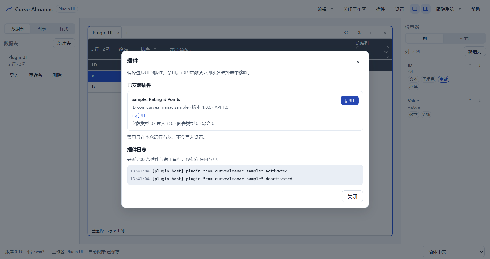

# T6.3 报告 — 插件接入 UI 与隔离

- 任务：T6.3 插件接入 UI 与隔离（依赖 T6.2、T2.5、T3.2）
- 日期：2026-10-30
- 决策：ADR-054；SPEC §13.4/§14.1/§14.3/§14.4 已同步
- 范围：四类贡献点全部改为读插件宿主注册表（含内置注册）、来源标识、错误边界与 toast/日志跳转、
  插件管理器（会话级禁用/启用）与贡献点变更后的 UI 刷新；**不改** IPC/数据格式/CSP，不新增运行时
  依赖，不改 `@curve/plugin-sdk` 公开 API

## 1. 交付

| 文件 | 内容 |
|---|---|
| `apps/desktop/src/renderer/plugins/builtins.ts` | 内置贡献注册：5 种字段类型（id = 存储类型）、`builtin.csv`/`builtin.json` 导入器（`parse` 复用 table-engine）、line/scatter/bar 图表类型；`registerBuiltinContributions` |
| `apps/desktop/src/renderer/plugins/index.ts` | 激活前注册内置贡献；`listChartKinds`/`listPluginCommands`/`findFieldTypeEntry`/`readPluginSnapshot`/`subscribePluginChanges`/`setPluginEnabled`/`reportContributionError`/`runPluginCommand`；`formatFieldCell` 捕获插件抛错 |
| `apps/desktop/src/renderer/plugins/log.ts` | 200 条内存环形日志、`createRingPluginLogger`（宿主 logger）、`createPrefixedPluginLogger`（`[plugin:<id>]`） |
| `apps/desktop/src/renderer/plugins/errors.ts` | 插件错误总线：`AppError` 归一化、2s 去重、写日志、发布事件 |
| `apps/desktop/src/renderer/plugins/labels.ts` | 内置/插件标签与来源后缀（`（插件：<name>）`）、`data-command-source` 文案来源 |
| `apps/desktop/src/renderer/plugins/use-plugin-snapshot.ts` | `usePluginSnapshot(enabled)`/`usePluginLog(enabled)`：只在表面打开时订阅 |
| `apps/desktop/src/renderer/features/plugins/PluginManagerDialog.tsx` | 插件列表（状态/版本/API/贡献数/错误）、禁用/启用、插件日志（错误 toast 的跳转目标） |
| `apps/desktop/src/renderer/features/columns/ColumnFormDialog.tsx`、`column-form.ts` | 存储类型与语义类型都读注册表；删除 `COLUMN_TYPES`；插件项带来源后缀；打开时订阅刷新 |
| `apps/desktop/src/renderer/features/charts/NewChartDialog.tsx` | 图表类型读 `chartKinds`；插件类型 = `seriesType` + `defaults` 预设 |
| `apps/desktop/src/renderer/features/charts/ChartInspector.tsx` | 类型下拉读注册表（只列内置）；删除 `KINDS` |
| `apps/desktop/src/renderer/features/import/{use-import,ImportWizardDialog}.tsx/ts` | 导入器读注册表（内置 + 插件）；内置项经 `format` 强制 Worker 解析器；插件失败后保留导入器下拉 |
| `apps/desktop/src/renderer/import/{worker-protocol,worker-handler,client}.ts` | `ImportOpenPayload.format: 'auto'|'csv'|'json'`（渲染进程 ↔ Worker 内部协议） |
| `apps/desktop/src/renderer/features/keymap/{commands,palette-model,CommandPalette,use-command-keymap}.ts/tsx` | `app.plugins` 命令；插件命令并入面板（来源徽标、`PluginCommandContext`、`execute` 派发） |
| `apps/desktop/src/renderer/shell/{AppShell,TitleBar}.tsx` | “插件”按钮、插件管理器挂载、插件错误 toast（带“查看插件日志”动作） |
| `packages/ui/src/{Toast.tsx,ui.css,Toast.test.tsx}` | `ToastMessage.action`（可选跟进动作）与样式 |
| `apps/desktop/src/renderer/i18n/messages/{zh-CN,en-US}.ts` | `plugins.*` 文案（状态、贡献数、来源后缀、错误 toast、日志） |
| `apps/desktop/src/renderer/styles.css` | 插件管理器/日志样式（只消费已声明令牌） |
| `apps/desktop/e2e/plugin-ui.spec.ts` | 3 条真实 Electron 用例（见 §3） |
| `apps/desktop/e2e/import-fixtures.ts` | `points-invalid.json` 与 `writeImportFixtureFile`（同一路径换内容） |
| `apps/desktop/test/plugin-contributions.test.ts` | 源码扫描：无硬编码贡献列表、四个消费点都读注册表、贡献 id 唯一来源 |
| 配置/文档 | SPEC、TASKS、TESTPLAN、ADR-054、ADR 索引、CHANGELOG、HANDOFF、AGENTS §0 |

## 2. 关键语义

| 项 | 行为 |
|---|---|
| 内置注册 | `activateRendererPlugins()` 先 `registerBuiltinContributions(host)` 再 `activateAll()`；`list()` 内置在前 |
| 字段类型 id | 内置 = 存储类型名（`text`/`number`/`date`/`boolean`/`enum`），插件 id 仍为反向域名；二者不会冲突 |
| `fieldTypeId` | 只写插件字段类型；列对话框的语义类型只列 `source.kind === 'plugin'` 且 storageType 匹配的条目 |
| 存储类型列表 | 由内置字段类型注册提供（5 项），不再是 `COLUMN_TYPES` |
| 图表类型 | 内置 3 种；插件类型映射到 `seriesType` 并把 `defaults` 合并进 `ChartOptions`；检查器只列内置（`ChartSpec` 无预设字段） |
| 导入器 | 下拉 = `自动` + 注册表条目（内置 CSV/TSV、JSON 与插件导入器）；内置项强制 Worker 解析器，插件项在渲染进程解析 |
| 插件失败 | 内联错误 + 带插件名的 toast（`查看插件日志`）；导入器下拉保留，可切回内置解析器 |
| 禁用/启用 | 宿主 `deactivate`/`activate`；会话级，不写 `settings.json`/manifest；重启后重新尝试 |
| UI 刷新 | `Registry.subscribe`（四类）+ 插件状态总线合并；只在对话框/面板打开时订阅 |
| 插件命令 | 面板合并 `APP_COMMANDS` + `commands`；内置 id 优先；`log` 写环形日志，`execute` 派发应用命令 |

## 3. 测试

单测（新增/扩展，`pnpm exec vitest run` 覆盖）：

```text
plugins/builtins.test.ts            13 条：5 种字段类型（解析/格式化/校验/比较）、
                                          CSV/JSON 导入器（含 abort）、内置注册与唯一性、非法 storageType
plugins/log.test.ts                  5 条：环形上限、订阅/取消/异常隔离、logger 与前缀、detail 归一化
plugins/errors.test.ts               5 条：归属与日志、builtin 空 id、2s 去重、不同失败、订阅者异常
plugins/labels.test.ts               6 条：内置 id 判定、来源后缀（中/英）、内置字段/图表标签、导入器标签
plugins/use-plugin-snapshot.test.*   4 条：启用时刷新、禁用时不订阅、日志订阅与冻结
plugins/index.test.ts                8 条：内置在前、导入器契约、快照订阅、禁用/启用、抛错回退与归属、
                                          插件命令 execute 成功/失败
features/plugins/PluginManagerDialog.test.tsx  4 条：列表/贡献数、禁用→0→启用、日志与聚焦、空态
features/columns/ColumnFormDialog.test.tsx     +1 条：插件选项带来源后缀、存储类型仅 5 项
features/charts/ChartInspector.test.tsx        内置类型列表（注册表驱动）
features/import/ImportWizardDialog.test.tsx    +1 条：注册表导入器与插件项锁定编码
features/keymap/{commands,palette-model}.test  +2 条：`app.plugins` 快捷键表、插件命令不遮蔽内置
apps/desktop/test/plugin-contributions.test.ts 4 条：无硬编码列表、四个消费点接线、id 唯一来源
packages/ui/src/Toast.test.tsx                +1 条：toast 跟进动作
```

E2E（`apps/desktop/e2e/plugin-ui.spec.ts`，1 worker）：

```text
ok 1 禁用示例插件：列对话框语义类型为空、导入向导只剩内置项；重新启用后选项恢复 (≈3.9s)
ok 2 插件抛错隔离：示例导入器拒绝 points-invalid.json → 内联错误 + 带插件名 toast →
     “查看插件日志”打开插件管理器日志 → 切回内置解析器恢复 → 网格仍可编辑 →
     写入合法文件后同一插件导入成功 (≈3.6s)
ok 3 200% 缩放：键盘打开插件管理器、键盘禁用/启用、无横向溢出、Esc 关闭 (≈2.6s)
3 passed (≈11.1s)
```

既有 T6.2 `plugin.spec.ts` 的断言随来源后缀更新（`toContainText('Rating')` + 插件名），3 条仍通过。

## 4. 验证

```text
pnpm verify
  ESLint 0；depcruise 529 modules / 2297 deps / 0 violations
  195 files / 1811 tests passed

pnpm test:coverage
  statements 77.13% / branches 69.82% / functions 76.51% / lines 77.28%（阈值 70/60 未下调）
  renderer/plugins：statements 93.77% / branches 86.36% / functions 94.31% / lines 94.44%
  features/plugins：statements 86.84% / branches 75% / functions 92.3% / lines 86.84%

pnpm build
  exit 0；renderer 3,469.35 kB、CSS 81.34 kB、main 338.76 kB
  （T6.2 renderer 3,394.50 kB / CSS 77.89 kB，+74.95 kB 来自插件管理器/日志/内置注册等 UI）

pnpm exec playwright test --config apps/desktop/playwright.config.ts apps/desktop/e2e/plugin-ui.spec.ts
  3 passed (11.1s)

pnpm e2e
  110 passed（6.7m；含 plugin-ui 3 条 11.1s、plugin.spec 3 条 12.9s、m5-acceptance 20.2s）
  chart-perf 100k 图表/映射切换：本次全量 privatePeak **591MB**（门禁 600MB）

pnpm bench
  exit 0（全部预算内）：table.encode 360ms/1500、table.decode 650ms/3000、table.open 582ms/3000、
  table.save 401ms/500、edit 0ms/50、query 217ms/400、text-sort 364ms/400、cjk-sort 587ms/800、
  condition 1ms/16、import 925ms/8s；chart.resolve-sample P95 60ms/300、chart.sample 2ms/50、
  chart.option.2k 1ms/50、chart.restyle.100k 0ms/20；memoryPeakMB 944（Node 趋势，非应用门禁）
```

**内存门禁复核（重要）**：T6.3 首次全量 E2E 时 `chart-perf` 的 privatePeak 出现 **608MB**（超过
600MB 门禁）而失败；随后单跑连续得到 601/592/546MB，与 T6.2 记录的“偶发 602MB、复跑
505/516MB”一致。为排除 T6.3 回归，做了 A/B 对比（同一机器、同一夹具、同一测试）：

- 把 T6.3 改动 stash 回 T6.2 提交（`1321879`）后 `pnpm build`：privatePeak **509 / 526MB**；
- 恢复 T6.3 改动后 `pnpm build`：privatePeak **533 / 523MB**（`performance.memory` 探针：
  usedJSHeap 93–117MB、DOM 275 节点、canvas 1 个）；
- 最终全量 E2E：privatePeak **591MB**（通过）。

结论：T6.3 没有引入可复现的内存回归；该场景在本机的波动区间约 **509–608MB**，离群值与 HANDOFF
§3.6 记录的既有 flake 相符（外部负载/GC 时机），**未放宽 600MB 门槛**。后续若再出现离群值，
先确认 CPU/内存环境后复跑；真需要处理时按 ADR-045 的复核条件单独评估，不要改预算。

## 5. 证据




截图由 `apps/desktop/e2e/plugin-ui.spec.ts` 生成后复制到此；`docs/reports/m0/*.png` 已用
`git checkout` 还原（E2E 会重写它们）。

## 6. 残留风险与下一步

- **禁用不持久化**（ADR-054 §7）：网络/崩溃类坏插件每次启动都会重试并再记一条日志；跨启动记忆
  需要在 `settings.json` 增字段 + 迁移 + E2E（ADR-052/054 复核条件）。
- **插件图表预设不能在检查器回显**：`ChartSpec.kind` 只存 v1 series type，预设被展开成
  `ChartOptions`；要回显需升级 schema 与 `formatVersion`。
- **插件文案/命令标签不本地化**：`FieldTypeDef`/`ImporterDef`/`CommandDef` 只有 `label: string`。
- **插件导入仍可能在主线程规划大文件**（ADR-053 遗留）：示例导入器只处理小文件；需要时把数据集
  送入 Worker。
- **错误去重窗口 2s**：同一失败在窗口内只报一次，用户可能只看到一条 toast（日志同样只记一条）。
- **内置导入器的 `parse` 与 Worker 路径并存**：内置文件仍走 Worker，`parse` 是注册表契约的完整
  实现（测试与将来的程序化解析使用）；若把向导改为渲染进程解析，会失去编码嗅探与大文件边界。
- **性能**：新增订阅只在对话框/面板打开时存在；`formatFieldCell` 仍是“每单元格一次 try/catch +
  查表”，未触达 T4.6 的图表/网格预算（全量 E2E 与 bench 均通过）。
