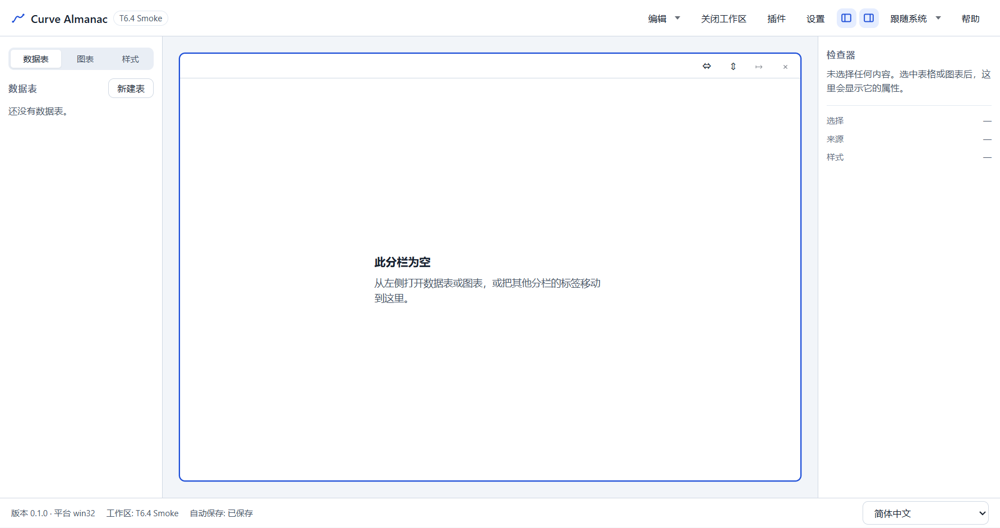

# T6.4 报告 — 安装包与发布配置

- 任务：T6.4 安装包与发布配置（依赖 T0.2、T5.5；覆盖 NFR-08）
- 日期：2026-10-30
- 决策：ADR-055；SPEC §5.2/§16.6、TESTPLAN §7 已同步
- 范围：electron-builder 配置（NSIS 当前用户安装 + portable）、`appId`/`productName`/版本、
  图标与许可证、`release/` 产物、真实安装/启动/卸载/数据保留冒烟；**不改** IPC/数据格式/CSP/
  Electron 安全选项/运行时依赖

## 1. 交付

| 文件 | 内容 |
|---|---|
| `apps/desktop/electron-builder.yml` | `appId=com.curvealmanac.app`、`productName=Curve Almanac`、`files` 白名单（`out/**` + `package.json`，排除 source map）、`asar`、`npmRebuild:false`、`publish:null`、`release/` 输出、NSIS（`oneClick:false`/`perMachine:false`/`allowElevation:false`/`deleteAppDataOnUninstall:false`/快捷方式/许可证）与 portable |
| `apps/desktop/build/icon.svg` | 图标设计源（深色圆角方块 + 网格 + 上升曲线与数据点，品牌色取自 `@curve/ui` 令牌） |
| `apps/desktop/build/icon.png` | 1024×1024 主稿 |
| `apps/desktop/build/icon.ico` | 16/24/32/48/64/128/256 七档 ICO（PNG 压缩条目） |
| `apps/desktop/build/license.txt` | 专有软件许可证（与根 `UNLICENSED` 一致，NSIS 许可证页默认读取） |
| `apps/desktop/package.json` | `package`/`package:dir` 脚本、`license`/`author`/用户可读 `description`（exe `FileDescription` 不再显示 “Electron main…”） |
| `package.json`（根） | 新增 `package:smoke`；`package` 保持“先 build 再打包” |
| `scripts/package-smoke.ts` | 真实 Windows 冒烟：asar 检查 → 静默安装 → 校验快捷方式/注册表 → 启动已安装应用 → 默认路径新建工作区 → 卸载 → 数据保留；自动清理；已有安装时拒绝运行 |
| `apps/desktop/test/packaging.test.ts` | 5 条静态契约：身份/输出、NSIS 每用户参数、文件白名单、ICO/PNG/许可证、脚本接线 |
| 配置/文档 | ADR-055、SPEC §5.2/§16.6、TASKS T6.4、TESTPLAN §7、README、CHANGELOG、HANDOFF、AGENTS §0、ADR 索引 |

**产物**（`release/`，gitignore）：

| 文件 | 大小 |
|---|---|
| `Curve Almanac Setup 0.1.0.exe`（NSIS） | 112,400,939 B（107.2 MiB） |
| `Curve Almanac 0.1.0.exe`（portable） | 112,163,368 B（107.0 MiB） |
| `release/win-unpacked/` | 391,112,000 B（约 373 MiB；Electron 44 单 exe 247MB） |

## 2. 验收对照

| 验收项 | 结果 | 证据 |
|---|---|---|
| 干净 Windows 用户安装/启动/卸载成功 | 通过（本机干净用户态、非管理员） | `pnpm package:smoke`：静默安装 17.3s → `%LOCALAPPDATA%\Programs\Curve Almanac`；启动 4.4s → 欢迎页；静默卸载 8.9s；安装目录/快捷方式/卸载注册表均清理 |
| 安装后工作区默认路径可写 | 通过 | 已安装应用内通过 UI 新建 `T6.4 Smoke`，保存位置默认 `C:\Users\...\Documents\Curve Almanac`，磁盘生成 `manifest.json`（`formatVersion:1`）；截图 `t6.4-installed-workspace.png` |
| 卸载后用户工作区仍在 | 通过 | 卸载后 `Documents/Curve Almanac/T6.4 Smoke.cstudio/manifest.json` 仍存在且 SHA-256 不变（`ab945b29…`）；`%APPDATA%\Curve Almanac\window-state.json` 也保留（`deleteAppDataOnUninstall:false`） |
| 版本号与 `package.json` 一致 | 通过 | exe `ProductVersion 0.1.0` = desktop/root `0.1.0`；应用内 `app.getVersion()` = `0.1.0`；`packaging.test.ts` 断言根/子版本相等 |
| 发布身份 | 通过 | `appId=com.curvealmanac.app`、`productName/app.name/ProductName/窗口标题 = Curve Almanac`；`CompanyName=Curve Almanac` |
| 每用户安装、不要求管理员 | 通过 | `perMachine:false`/`allowElevation:false`/`asInvoker`；非管理员会话静默安装成功，无 UAC；安装路径在 `%LOCALAPPDATA%` |
| 打包内容只含运行所需文件 | 通过 | asar 23 个文件：`out/{main,preload,renderer}` + `package.json` + `node_modules/{write-file-atomic,signal-exit}`；无 `src/e2e/test/docs/fixtures/*.map`/`build/` |
| 生产包无测试钩子、无 Node 暴露、CSP 生效 | 通过 | `window.require`/`window.process` 为 `undefined`；`window.api` 可用；CSP = 生产策略（`default-src 'self'`，无 `unsafe-eval`）；`CURVE_E2E_USER_DATA` 被忽略，DevTools 未打开 |
| 图标/许可证 | 通过 | ICO 7 档（含 16/32/256）；PNG 1024²；NSIS 许可证页使用 `build/license.txt`；`packaging.test.ts` 校验二进制头 |

## 3. 测试

```text
apps/desktop/test/packaging.test.ts                 5 条（身份/输出、NSIS 每用户、文件白名单、
                                                          ICO/PNG/许可证、脚本接线）
pnpm package:smoke（真实 Electron/NSIS）             1 条端到端：
  asar 检查 → 安装 → 快捷方式/注册表 → 启动 → 元数据/CSP/无 Node → 默认路径建工作区 →
  关闭写 window-state → 卸载 → 工作区/用户数据保留 → 清理
```

冒烟脚本的三个环境要点（ADR-055 §6）：安装器先复制到 `%TEMP%`（DSH 沙箱拒绝工作区内的
可执行文件写用户目录）；`CURVE_E2E_NO_SANDBOX=1` 时给启动加 `--no-sandbox`（不改
`webPreferences.sandbox`）；开始前若检测到已有安装则拒绝运行，避免误卸载。

## 4. 验证

```text
pnpm verify
  ESLint 0；depcruise 530 modules / 2300 deps / 0 violations
  196 files / 1816 tests passed（T6.3 为 195/1811）

pnpm test:coverage
  statements 77.13% / branches 69.82% / functions 76.51% / lines 77.28%
  （阈值 70/60 未下调；新增 scripts/ 不进覆盖率统计，故数值与 T6.3 相同）
  注：首次并行运行时 file-workspace-store.test.ts 出现已知 5s 超时（HANDOFF §3.6），
  单文件复跑 2.6s 通过、重新全量 coverage 通过；未放宽超时。

pnpm build
  exit 0；renderer 3,469.35 kB、CSS 81.34 kB、main 338.76 kB（与 T6.3 相同）

pnpm package
  exit 0；NSIS `Curve Almanac Setup 0.1.0.exe` + portable `Curve Almanac 0.1.0.exe`
  （electron-builder 26.15.3；Electron 44.9.0；本机 GitHub 不可达，使用 npmmirror 镜像
   下载 Electron/winCodeSign/NSIS，见报告 §6）

pnpm package:smoke
  PASS；install 17,293ms / launch 4,365ms / uninstall 8,918ms
  metrics: docs/reports/t6.4/t6.4-package-metrics.json
```

## 5. 证据




截图由 `apps/desktop/e2e` 之外的 `scripts/package-smoke.ts` 生成后直接写入本目录；
`docs/reports/m0/*.png` 未被本次运行改写（没有跑全量 E2E）。

## 6. 残留风险与下一步

- **未签名**：无代码签名证书，SmartScreen/未知发布者提示；企业环境可能拦截。接入签名按
  ADR-055 复核条件。
- **体积**：未压缩 391MB、安装包 112MB；Electron 44 的固有成本，T6.5 可评估裁剪 locales。
- **打包依赖网络**：electron-builder 首次下载 Electron/NSIS/winCodeSign；本机 GitHub 超时，
  用 `ELECTRON_MIRROR`/`ELECTRON_BUILDER_BINARIES_MIRROR` 指向 npmmirror 才成功。CI/新机器
  需要能访问 GitHub 或配置镜像；失败应记为阻塞，不要删依赖。
- **冒烟写真实用户目录**：安装/启动会短暂使用 `%LOCALAPPDATA%`、`%APPDATA%` 与
  `Documents/Curve Almanac`；脚本在 `finally` 清理，但中断时可能留下测试工作区。已安装版本
  存在时脚本拒绝运行，不会误删真实数据。
- **portable 只验证产出**：冒烟校验其文件/元数据，未做完整启动交互；portable 的 NSIS 自解压
  行为由 electron-builder 提供，仍建议 T6.5 在干净机器上手工启动一次。
- **本机冒烟非“全新 Windows”**：机器已有大量用户软件；验证的是“无既存安装、无既存
  userData/默认工作区、非管理员”的干净应用态，不是全新系统镜像。
- **macOS/Linux 未配置**（SPEC §16.6 次要平台）；v1 只承诺 Windows x64。
- **`deleteAppDataOnUninstall:false`** 意味着卸载后 `%APPDATA%\Curve Almanac` 保留；如果要
  “彻底卸载”，需另行提供清理选项并写 ADR，不能在默认卸载里删用户数据。
- **下一步**：T6.5 全量验收与文档收尾（全量 E2E/性能/可访问性、九步演示、发布清单、
  安装包在干净机器复验）。
